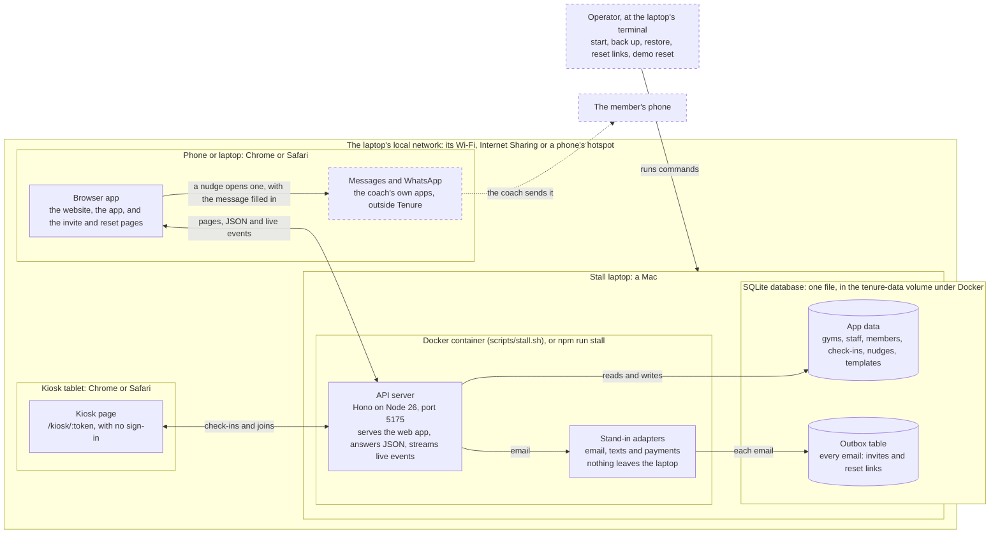

# Tenure: software requirements specification

The first version: what Tenure must do, and how well. The structure follows ISO/IEC/IEEE 29148, kept lean.

| Document | Software requirements specification |
| --- | --- |
| Version | 0.1, a working draft |
| Date | 7 November 2026 |
| Status | Approved scope (`docs/milestone-2/FIRST-VERSION.md`); being built |
| Sources | `docs/milestone-2/answers.md` (Uzair's answers, which win), `docs/ARCHITECTURE.md` (the contract), `packages/copy/COPY.md` (every word) |

**Revision history**

| Version | Date | What changed |
| --- | --- | --- |
| 0.1 | 7 Nov 2026 | First draft: the scope, requirements, use cases, data, architecture, build plan, risks, acceptance tests, traceability and open issues for the first version |

Every requirement has a stable ID. Code, tests and commits point back to it: each test's name starts with the ID it
covers, for example `FR-KIOSK-03 a second check-in within the hour is not stored`.

Priorities use MoSCoW:
- **Must:** in the first version.
- **Should:** in the first version if time allows.
- **Could:** the polish that follows.
- **Won't:** not in this version.

## Contents

- [1. Introduction](#1-introduction)
  - [1.1 Purpose](#11-purpose)
  - [1.2 Scope](#12-scope)
  - [1.3 Definitions](#13-definitions)
  - [1.4 References](#14-references)
- [2. Overall description](#2-overall-description)
  - [2.1 Product perspective](#21-product-perspective)
  - [2.2 Product functions](#22-product-functions)
  - [2.3 User classes](#23-user-classes)
  - [2.4 Operating environment](#24-operating-environment)
  - [2.5 Constraints](#25-constraints)
  - [2.6 Assumptions and dependencies](#26-assumptions-and-dependencies)
- [3. Functional requirements](#3-functional-requirements)
  - [3.1 Accounts and sign-in (AUTH)](#31-accounts-and-sign-in-auth)
  - [3.2 Gym settings (GYM)](#32-gym-settings-gym)
  - [3.3 Staff and roles (STAFF)](#33-staff-and-roles-staff)
  - [3.4 Members (MEM)](#34-members-mem)
  - [3.5 The member page (MEMBER)](#35-the-member-page-member)
  - [3.6 Today (TODAY)](#36-today-today)
  - [3.7 The board (BOARD)](#37-the-board-board)
  - [3.8 Nudges (NUDGE)](#38-nudges-nudge)
  - [3.9 Templates (TPL)](#39-templates-tpl)
  - [3.10 The kiosk (KIOSK)](#310-the-kiosk-kiosk)
  - [3.11 The CSV import (IMPORT)](#311-the-csv-import-import)
  - [3.12 Reports (REPORT)](#312-reports-report)
  - [3.13 Billing (BILL)](#313-billing-bill)
  - [3.14 Me (ME)](#314-me-me)
  - [3.15 The app shell (SHELL)](#315-the-app-shell-shell)
  - [3.16 The website (WEB)](#316-the-website-web)
  - [3.17 Global-ready (GLOBAL)](#317-global-ready-global)
  - [3.18 Live updates (LIVE)](#318-live-updates-live)
  - [3.19 Privacy and data (PRIV)](#319-privacy-and-data-priv)
  - [3.20 Operations (OPS)](#320-operations-ops)
  - [3.21 Development (DEV)](#321-development-dev)
- [4. Non-functional requirements](#4-non-functional-requirements)
- [5. Use cases](#5-use-cases)
  - [5.1 Sign up and import members (UC-01)](#51-sign-up-and-import-members-uc-01)
  - [5.2 Check in or join at the kiosk (UC-02)](#52-check-in-or-join-at-the-kiosk-uc-02)
  - [5.3 See who's slipping and contact them (UC-03)](#53-see-whos-slipping-and-contact-them-uc-03)
  - [5.4 Work the board and Members (UC-04)](#54-work-the-board-and-members-uc-04)
  - [5.5 Manage staff (UC-05)](#55-manage-staff-uc-05)
  - [5.6 Read Reports (UC-06)](#56-read-reports-uc-06)
  - [5.7 Archive, restore and delete a member (UC-07)](#57-archive-restore-and-delete-a-member-uc-07)
  - [5.8 Edit Settings (UC-08)](#58-edit-settings-uc-08)
  - [5.9 Reset a password (UC-09)](#59-reset-a-password-uc-09)
  - [5.10 Run the stall demo (UC-10)](#510-run-the-stall-demo-uc-10)
- [6. Data requirements](#6-data-requirements)
  - [6.1 Entities](#61-entities)
  - [6.2 Rules across the tables](#62-rules-across-the-tables)
  - [6.3 Retention and deletion](#63-retention-and-deletion)
- [7. Architecture and key algorithms](#7-architecture-and-key-algorithms)
  - [7.1 The monorepo](#71-the-monorepo)
  - [7.2 Key algorithms](#72-key-algorithms)
    - [7.2.1 Weeks, pace and status](#721-weeks-pace-and-status)
    - [7.2.2 Came back](#722-came-back)
    - [7.2.3 Board order and "Slipping Now" order](#723-board-order-and-slipping-now-order)
    - [7.2.4 The phone rule: the gym's country wins](#724-the-phone-rule-the-gyms-country-wins)
    - [7.2.5 The import's date order](#725-the-imports-date-order)
    - [7.2.6 Import matching and planning](#726-import-matching-and-planning)
    - [7.2.7 Report cohorts and the visits-by-week chart](#727-report-cohorts-and-the-visits-by-week-chart)
- [8. Build plan](#8-build-plan)
  - [8.1 Phase 0: foundations (about 2 h, while the design picks are made)](#81-phase-0-foundations-about-2-h-while-the-design-picks-are-made)
  - [8.2 Phase 1: backend slices (about 3 h, still during the picks)](#82-phase-1-backend-slices-about-3-h-still-during-the-picks)
  - [8.3 Phase 2: core screens (about 3 h, after Uzair's design polish picks)](#83-phase-2-core-screens-about-3-h-after-uzairs-design-polish-picks)
  - [8.4 Phase 3: management (about 2.5 h), then pause 1](#84-phase-3-management-about-25-h-then-pause-1)
  - [8.5 Phase 4: account basics and the website (about 2 h)](#85-phase-4-account-basics-and-the-website-about-2-h)
  - [8.6 Phase 5: close (about 2 h), then pause 2](#86-phase-5-close-about-2-h-then-pause-2)
  - [8.7 Side tracks](#87-side-tracks)
  - [8.8 Pauses](#88-pauses)
- [9. Risks](#9-risks)
- [10. Acceptance tests](#10-acceptance-tests)
  - [10.1 Smoke (`smoke.e2e.ts`)](#101-smoke-smokee2ets)
  - [10.2 Kiosk (`kiosk.e2e.ts`)](#102-kiosk-kioske2ets)
  - [10.3 Live updates (`live.e2e.ts`)](#103-live-updates-livee2ets)
  - [10.4 Today and the board (`today-board.e2e.ts`)](#104-today-and-the-board-today-boarde2ets)
  - [10.5 Members and the member page (`members.e2e.ts`)](#105-members-and-the-member-page-memberse2ets)
  - [10.6 Contact and the nudges log (`contact.e2e.ts`)](#106-contact-and-the-nudges-log-contacte2ets)
  - [10.7 Reports and Billing (`reports.e2e.ts`)](#107-reports-and-billing-reportse2ets)
  - [10.8 Templates (`templates.e2e.ts`)](#108-templates-templatese2ets)
  - [10.9 The app shell and Me (`shell.e2e.ts`)](#109-the-app-shell-and-me-shelle2ets)
  - [10.10 Settings and staff (`settings-staff.e2e.ts`)](#1010-settings-and-staff-settings-staffe2ets)
  - [10.11 Import (`import.e2e.ts`)](#1011-import-importe2ets)
  - [10.12 Archive and delete (`archive-delete.e2e.ts`)](#1012-archive-and-delete-archive-deletee2ets)
  - [10.13 Account and website (`account-website.e2e.ts`)](#1013-account-and-website-account-websitee2ets)
  - [10.14 Outside the browser](#1014-outside-the-browser)
  - [10.15 Checked by a person](#1015-checked-by-a-person)
- [Appendix A. Traceability matrix](#appendix-a-traceability-matrix)
  - [A.1 Use cases to requirements and tests](#a1-use-cases-to-requirements-and-tests)
  - [A.2 Functional requirements to use cases and tests](#a2-functional-requirements-to-use-cases-and-tests)
  - [A.3 Non-functional requirements to use cases and tests](#a3-non-functional-requirements-to-use-cases-and-tests)
- [Appendix B. Open issues](#appendix-b-open-issues)
  - [B.1 Waiting on Uzair](#b1-waiting-on-uzair)
  - [B.2 Legal steps per market](#b2-legal-steps-per-market)
  - [B.3 Requirement fixes waiting on the orchestrator](#b3-requirement-fixes-waiting-on-the-orchestrator)
  - [B.4 Outside this spec](#b4-outside-this-spec)

## 1. Introduction

### 1.1 Purpose

This document says what the first version of Tenure must do (§3) and how well (§4). It is the working document for
the people and agents who build, test and review that version, and for Uzair, who approves its scope.

Tenure helps independent gyms keep new members past their first 90 days. It counts each new member's visits week by
week, shows who is slipping, and lets a coach nudge them with a message sent from the coach's own phone.

### 1.2 Scope

The first version is the whole MVP, built simply: every core screen, the account basics, and a simple public website
with sign-up. Its core flows are tested end to end, through the server and in the browser, and small rough edges are
allowed. It runs on one machine, locally or in Docker. In stall mode it serves phones and the kiosk on that machine's
local network (FR-OPS-01).

**In the first version**

| Area | What's in | Where |
| --- | --- | --- |
| Accounts | Sign-up with the gym's country, log-in, 30-day sessions, password reset, and staff invites by email | §3.1, FR-STAFF-03 |
| The gym and its staff | Settings, owners and coaches, deactivating and reactivating staff | §3.2, §3.3 |
| Members | The Members list and the member page: add, edit, archive, restore and delete | §3.4, §3.5 |
| The first 90 days | Today and the board | §3.6, §3.7 |
| Nudges | The composer and its channel buttons, the nudges log, and templates | §3.8, §3.9 |
| The kiosk | Check-in by phone or name, joining, and the welcome | §3.10 |
| The import | Members or check-ins from a CSV file | §3.11 |
| Reports and Billing | Cohorts, visits by week, nudge results, and the pilot day | §3.12, §3.13 |
| The shell | Me, the navigation and the one light theme | §3.14, §3.15 |
| The website | Home, Pricing, sign-up, and "Try the Demo" at the stall | §3.16 |
| Across the product | Five markets, live updates, privacy and deletion | §3.17 to §3.19 |
| Running it | Stall mode, Docker, backup and restore, the demo reset, migrations, and the development outbox | §3.20, §3.21 |
| Quality | Speed, accessibility, security, privacy, reliability, browsers, maintenance, markets and copy | §4 |

**Not in the first version**

| What | Where it stands |
| --- | --- |
| Real email, texts and payments | Stand-ins only, and email lands in the outbox (FR-DEV-02). Real providers come with the hardening, once Uzair has made the accounts (ARCHITECTURE §13) |
| Online hosting | Local and Docker only (FR-OPS-01). Hosting also comes with the hardening |
| Email verification | Later (FR-AUTH-10). Password reset is in (FR-AUTH-07) |
| Translations | English only (FR-GLOBAL-06). Translations are decided per market (ARCHITECTURE §2) |
| Native apps | Tenure runs in Chrome and Safari (NFR-COMP-01) |
| Links to other gym software | Members and check-ins come in through the CSV import (FR-IMPORT-01) and the kiosk |
| The add-to-home-screen kiosk | Later (FR-KIOSK-09). The kiosk runs in the browser |
| A price | The pilot is free, and no price is shown until Uzair sets one (FR-BILL-01, FR-WEB-02) |
| Analytics and tracking | None (FR-PRIV-01) |

The rare edge cases and the rest of the old app's tests wait for the polish that follows (ARCHITECTURE §13).

### 1.3 Definitions

| Term | Meaning |
| --- | --- |
| Gym | One customer of Tenure, with its own staff, members, country and time zone. Every read and write is held to the signed-in user's gym (FR-PRIV-02). |
| Staff | The people who sign in to a gym: its owners and coaches (FR-STAFF-01). |
| Owner | A staff member with the owner role. Whoever signs the gym up is its first owner (FR-AUTH-03). Owners see every member and have the owner-only pages (FR-STAFF-06). |
| Co-owner | Another owner, invited with the Owner choice in "Invite Staff" (FR-STAFF-03, FR-STAFF-04). A co-owner has the same rights as the first owner. The last active owner can't be deactivated (FR-STAFF-05). |
| Coach | A staff member with the coach role. A coach sees and acts on only their own members (FR-STAFF-07). |
| Own members | The members whose coach is that staff member. An owner can coach members too. |
| Member | Someone who trains at the gym. Members don't sign in: they check in at the kiosk, and staff add or import them (FR-MEM-05, FR-IMPORT-01). A member has a first name, an optional last name (FR-GLOBAL-04) and a joined date, and may have a phone and a coach. |
| Kiosk | The check-in screen at `/kiosk/:token`, open on the front-desk tablet or screen. It needs no sign-in (FR-KIOSK-01). Members check in there by phone or name, and visitors join (FR-KIOSK-02, FR-KIOSK-04). |
| Kiosk token | The gym's secret in the kiosk link: anyone with the link can use the kiosk. A bad token shows a not-found screen (FR-KIOSK-01). Settings shows the link and its QR code (FR-GYM-03). |
| Check-in | One recorded arrival, made at the kiosk or brought in by the import. A second one by the same member within an hour isn't stored (FR-KIOSK-03, FR-IMPORT-07). |
| Visit | A day on which a member checked in, in the gym's time zone. Weeks, pace and statuses count visits, so several check-ins on one day count once. |
| The 90-day window | A member's first 90 days: day 0 is the joined date and day 89 the last, in the gym's time zone. The board and Members' "First 90 Days" view list only members inside it (FR-BOARD-01, FR-MEM-01). Visits outside it don't count toward weeks, pace or status. |
| Week | Seven days counted from the joined date. Week 1 is days 0 to 6, and so on to week 13, days 84 to 89, which has only 6. A week is finished once all its days are before today; the current week is still in progress. |
| Status | One of four, worked out from a member's finished weeks. The rules are checked in the order below, and the first that matches wins (ARCHITECTURE §7). |
| Slipping | Checked first: 2 or more finished weeks, and the last two each under 2 visits. |
| New | Checked second: fewer than 2 finished weeks. |
| On the line | Checked third: the last finished week had 3 or more visits. |
| Below the line | Checked last: everything else. |
| The line | 3 visits a week. Reports draws it on its chart (FR-REPORT-02). |
| Pace | A member's mean visits a week over their last 3 finished weeks, or over all of them if fewer have finished, to one decimal. There is none before the first finished week. |
| Nudge | A staff member's message to a member, to bring them back. It is written in the composer, from a template or from scratch (FR-NUDGE-01), and recorded when the sender picks how to send it (FR-NUDGE-02). Tenure never sends it (FR-NUDGE-05). |
| Channel | How a nudge went out, stored with it: `text`, `whatsapp`, `copy` or `in-person`, shown as "Text", "WhatsApp", "Copied" or "In person" (FR-NUDGE-06). A nudge from before the first version shows none. |
| Came back | A nudge came back when the member checks in strictly after it and within 7 days (FR-NUDGE-07). |
| Template | A named nudge message that fills `{first}`, `{coach}`, `{gym}` and `{days}` (FR-TPL-02). Owners edit templates and coaches read them (FR-TPL-01). A new gym gets the three default ones (FR-TPL-03). |
| Pilot | A gym's free first 90 days on Tenure, counted from the day it signed up. Billing shows "Pilot Day {n} of 90" (FR-BILL-01). There is no price. |
| Archive | Hiding a member and keeping their history. An archived member is left out of every list except Members' "Archived" view, and out of the kiosk's name search (FR-MEM-01, FR-KIOSK-02). Their history still counts in Reports (FR-REPORT-01). At the kiosk, a typed phone or a join that matches them shows "Please see the front desk to check in." (FR-KIOSK-06). "Restore Member" or a matching import row brings them back (FR-MEMBER-06, FR-IMPORT-09). Only an archived member can be deleted for good (FR-MEMBER-07). |
| Stall mode | Tenure as it runs at the expo stall: `npm run stall`, or Docker through `scripts/stall.sh`, serves the built app from the API on the laptop's network (FR-OPS-01). The kiosk, phone and invite links use the laptop's LAN address (FR-GYM-03, FR-STAFF-03), "Try the Demo" works (FR-WEB-04), and a button re-seeds the demo gym (FR-OPS-03). |
| The demo gym | Northside Strength, the seeded sample gym: 3 staff and 85 members, 60 of them in their first 90 days. Its dates are relative to the day it was seeded, and its country follows the laptop's time zone (FR-GLOBAL-05). Its kiosk shows the "Sample data" tag (FR-KIOSK-07). `npm run demo:reset` re-seeds it (FR-OPS-03). |
| Stand-in | An adapter that keeps an email, a text or a payment on the machine instead of calling a provider. Every environment uses the stand-ins in the first version (FR-DEV-02). |
| Outbox | The table where the email stand-in puts every email, such as invites and reset links. `/dev/outbox` shows it, in development only (FR-DEV-01). |
| E.164 | The international phone format: "+", the country code, then the number, with no spaces, such as +13125550142. Every phone is stored this way (FR-GLOBAL-02). |
| MoSCoW | The priority scale in §3: Must, Should, Could and Won't, as defined at the top of this document. |

### 1.4 References

| Reference | What it holds |
| --- | --- |
| `docs/ARCHITECTURE.md` | The contract: the decisions, layout, dependency rules, design tokens, commands and milestones |
| `docs/milestone-2/FIRST-VERSION.md` | The approved plan for the first version and for this spec (7 Nov 2026) |
| `docs/milestone-2/answers.md` | Uzair's product answers, which win over every other source |
| `docs/milestone-2/kiosk-blend.md` | The kiosk's N1 "Soft corners" blend, with its CSS and contrast checks. Retired in the redesign (7 Nov): the kiosk's ground is plain (FR-KIOSK-07) |
| `packages/copy/COPY.md` | Every word the product shows |
| `docs/DEMO.md` | The stall runbook, written in phase 4 (FR-OPS-05) |
| `legacy/app/SPEC.md` | The old app's product spec and API, the reference for the port |
| `legacy/app/DEMO.md` | The old app's stall runbook and demo script |
| `marketing/brand/DESIGN.md` | The brand's voice, for the home page copy round |
| WCAG 2.1 | W3C, Web Content Accessibility Guidelines 2.1, held to level AA (NFR-USE-01) |
| ISO/IEC/IEEE 29148:2018 | Systems and software engineering: life cycle processes, requirements engineering. The shape of this spec |
| ITU-T E.164 | The international public telecommunication numbering plan: the phone format |

## 2. Overall description

### 2.1 Product perspective

Tenure is a self-contained web app on one machine. In stall mode and in Docker, one server, the API on Node 26, serves
the website, the app and the kiosk, answers their JSON requests, and streams live events to open screens (FR-LIVE-01).
All data lives in one SQLite file on the same machine (FR-PRIV-01). At the stall that machine is a Mac, running
Tenure in Docker or with `npm run stall`, and phones and the kiosk tablet reach it over the laptop's local network
(FR-OPS-01).

The browser app is one React app: the website, the app under `/app`, the kiosk, and the invite and reset pages. The
website loads without the app's code (FR-WEB-05).

Tenure contacts no outside service (NFR-PRIV-01):
- A nudge opens the coach's own Messages or WhatsApp with the message filled in, and the coach sends it (FR-NUDGE-02,
  FR-NUDGE-05).
- Email, texts and payments go through stand-in adapters (FR-DEV-02). Email goes to the outbox table. Nothing in the
  first version sends a text or takes a payment (FR-NUDGE-05, FR-BILL-01).

The first version replaces the old expo app, kept in `legacy/app` as the reference for the port. Its flows and rules
carry over into the new layout (ARCHITECTURE §3), changed where answers.md and the first-version plan say so.

<!-- PDF: the same diagram is docs/spec/context.svg -->

*Figure 1.* Tenure at the stall. Dashed boxes are outside Tenure. In development (`npm run dev`) the parts run on one
Mac without Docker: the web app has its own server on port 5174, and the outbox page is on (FR-DEV-01).

**Interfaces**

| Interface | Between | What passes |
| --- | --- | --- |
| HTTP | Browsers on the network, and the API | Pages and JSON. A write must be JSON from a matching Origin (NFR-SEC-02), and bodies are capped (NFR-SEC-05) |
| Live events | The API and each signed-in tab | One server-sent event stream per tab, scoped to the user (FR-LIVE-02) |
| Message links | The browser app and the coach's own apps | The member's number and the filled-in message, through text and WhatsApp links (FR-NUDGE-02, FR-NUDGE-03) |
| The clipboard | The browser app and the device | A copied message or link (FR-NUDGE-02, FR-GYM-03, FR-STAFF-03) |
| QR codes | Settings and a phone's camera | The kiosk and phone links (FR-GYM-03) |
| CSV files | The owner's files and the import | Members or check-ins, up to 2 MB (FR-IMPORT-01) |
| Adapter ports | The API and its providers | Emails to the outbox now; Resend, Twilio and Stripe later (FR-DEV-02) |
| The terminal | The operator and the machine | The stall, backup, restore, reset-link and demo reset commands (FR-OPS-01 to FR-OPS-03, FR-AUTH-08) |

### 2.2 Product functions

| Function | What it does | Requirements |
| --- | --- | --- |
| Start a gym | An owner signs up with the gym's country and starts the free pilot, on an empty Today that links to the import and the kiosk | FR-AUTH-01 to FR-AUTH-03, FR-TODAY-03 |
| Check in | Members check in at the kiosk by phone or name; a visitor joins and is checked in at once | FR-KIOSK-02 to FR-KIOSK-06 |
| See who is slipping | Today and the board show each member's weeks, pace and status, and the member page their 90 days, all updated live | FR-TODAY-01, FR-BOARD-01, FR-MEMBER-01, FR-LIVE-01 |
| Nudge | A coach picks a template or writes a message, then contacts the member by text, WhatsApp or a copied message. Tenure records the nudge, and whether the member came back | FR-NUDGE-01 to FR-NUDGE-07, FR-TPL-01 |
| Look after members | Add, edit, archive, restore and delete members, and import members or check-ins from a CSV file | FR-MEM-05, FR-MEMBER-02, FR-MEMBER-05 to FR-MEMBER-07, FR-IMPORT-01 |
| Run the team | Invite coaches and co-owners, deactivate and reactivate them, and keep each coach to their own members | FR-STAFF-02 to FR-STAFF-07 |
| Read the results | Cohorts by join month, visits by week and nudge results; the pilot day on Billing | FR-REPORT-01, FR-BILL-01 |
| Set up | The gym's name, country and time zone, and the kiosk and phone links with their QR codes | FR-GYM-01 to FR-GYM-03 |
| Keep accounts safe | Sessions, password reset and rate limits | FR-AUTH-04 to FR-AUTH-07, NFR-SEC-01, NFR-SEC-03 |
| Work in five markets | Phones, dates and times, and single names, by the gym's country | FR-GLOBAL-01 to FR-GLOBAL-04 |
| Introduce Tenure | The website's Home, Pricing and sign-up, and "Try the Demo" at the stall | FR-WEB-01 to FR-WEB-04 |
| Run the stall | Stall mode and Docker, backup and restore, the demo reset, and reset links | FR-OPS-01 to FR-OPS-03, FR-AUTH-08 |

### 2.3 User classes

| User class | Who | What they use | What they may do |
| --- | --- | --- | --- |
| Owner | Runs the gym, and signed it up | The whole app, on a laptop or a phone | Everything in their gym, including the owner-only pages (FR-STAFF-06). Sees every member and every live event (FR-LIVE-02) |
| Co-owner | A second owner, invited by an owner | The same as the owner | The same as the owner (FR-STAFF-01, FR-STAFF-04) |
| Coach | Coaches members, and joined through a coach invite | Today, the board, Members, Nudges and Templates, often on their own phone | Works with only their own members (FR-STAFF-07): adds, archives, restores and nudges them (FR-MEM-05, FR-MEMBER-05, FR-MEMBER-06). Reads templates (FR-TPL-01). Gets 403 from owner routes (FR-STAFF-06) |
| Member at the kiosk | A member, or a newcomer joining | The kiosk only, with no account | Checks in by phone or name, or joins with a first name (FR-KIOSK-02, FR-KIOSK-04). Sees their welcome (FR-KIOSK-05), and the "First L." names the name search shows |
| Stall visitor | Someone at the expo stall | The kiosk, and "Try the Demo" in stall mode | Joins at the kiosk, and uses the demo gym as its owner, with everything usable (FR-WEB-04). The demo is re-seeded between visitors (FR-OPS-03) |
| Operator | Whoever runs the machine, such as the stall team | The laptop's terminal and the runbook (FR-OPS-05) | Starts Tenure (FR-OPS-01), backs up and restores (FR-OPS-02), re-seeds the demo (FR-OPS-03) and prints reset links (FR-AUTH-08). Only someone at the laptop can get a reset link |

### 2.4 Operating environment

| Part | Environment |
| --- | --- |
| Browsers | Chrome on laptops and Android; Safari on Mac, iPhone and iPad (NFR-COMP-01). The blended background needs a 2024 or later browser, and older ones show the flat page ground (ARCHITECTURE §2) |
| Screens | From phone width up: below 1024 px a header and a bottom tab bar, and from 1024 px a sidebar (FR-SHELL-01, FR-SHELL-02) |
| The server | A Mac with Docker Desktop, running `scripts/stall.sh`, or Node 26 directly, with `npm run stall` (FR-OPS-01). One process serves everything on port 5175, which must be free. The data is one SQLite file, kept in the `tenure-data` volume under Docker |
| The network | The laptop's local network: its Wi-Fi, Internet Sharing, or a phone's hotspot. Phones and the kiosk join it and open the laptop's LAN address over plain HTTP, so the session cookie isn't marked Secure (NFR-SEC-01). Tenure needs no internet while it runs: it calls no outside service (NFR-PRIV-01), and its fonts are self-hosted. The first Docker build does, to fetch packages (ARCHITECTURE §12) |
| The kiosk | A tablet at the front desk, such as an iPad in Safari, or a second browser window. It works by touch or with a hardware keyboard (FR-KIOSK-08) |
| Rate limits under Docker | Every device counts as one for the rate limits (NFR-SEC-03), because Docker Desktop's port publishing hides each client's address (ARCHITECTURE §12) |
| Development | `npm run dev` on a Mac with Node 26: the API on port 5175 and the web app on 5174, with hot reload and the outbox page (FR-DEV-01) |

### 2.5 Constraints

| Constraint | What it means | Source |
| --- | --- | --- |
| The contract | The layout, dependency rules, design tokens and commands in ARCHITECTURE.md hold. To break a rule, that file changes first, in its own commit. The lint checks the dependency rules (NFR-MAINT-01) | ARCHITECTURE §3, §4, §9 |
| The stack | A TypeScript monorepo: React 19 and Vite, Hono on Node 26, SQLite through Drizzle, npm workspaces and Turborepo. Node 26 runs the TypeScript directly, and nothing is installed globally | ARCHITECTURE §2, CLAUDE.md |
| One test-only package | `@playwright/test` is the only package added for the first version (NFR-MAINT-04) | FIRST-VERSION.md |
| The gates | Typecheck, lint, test, build and e2e pass before each phase is done (NFR-MAINT-02). Every Must has a test that names its ID, or a stated check (NFR-MAINT-03) | ARCHITECTURE §11 |
| The copy rules | Every word comes from COPY.md, in Apple's split (ARCHITECTURE §2, "Capitals"). A line describes the action rather than quoting a button, and button labels take no closing punctuation, except a progress label's ellipsis ("Saving…") (NFR-COPY-01). COPY.md's own rules hold too: numerals always, and no exclamation marks | ARCHITECTURE §10, COPY.md |
| Five markets | Only the US, Canada, the UK, Pakistan and the UAE can be chosen (FR-GLOBAL-01), and the interface is in English only (FR-GLOBAL-06) | ARCHITECTURE §2, answers.md |
| Nothing leaves the machine | No outside service is contacted (NFR-PRIV-01), and Tenure sends no message itself (FR-NUDGE-05) | ARCHITECTURE §2 |
| Printed links | `/kiosk/:token` and `/invite/:token` keep their shape, so printed links still work | ARCHITECTURE §8 |
| Hands off | `legacy/app` and `marketing/` don't change during the port; the redesign redoes `marketing/` at Uzair's request (ARCHITECTURE.md §2) | CLAUDE.md |

### 2.6 Assumptions and dependencies

**Assumptions**

- The laptop's clock and time zone are right on the day. The demo gym's dates are relative to the day it was seeded,
  in the laptop's zone, so it is re-seeded on the morning of the stall (FR-GLOBAL-05, ARCHITECTURE §12).
- The operator re-seeds the demo between visitors (FR-OPS-03). Until then, a visitor who taps "Try the Demo" sees what
  earlier visitors entered at the kiosk, names and phones included, as any owner would (FR-WEB-04).
- The laptop's firewall lets phones and the kiosk connect on port 5175.
- Coaches send nudges from their own phone or computer, with Messages or WhatsApp set up on it. A text needs mobile
  service, and WhatsApp needs the internet (FR-NUDGE-05).
- Each gym is in one of the five markets (FR-GLOBAL-01). Its members' phones are local numbers, or typed with "+"
  (FR-GLOBAL-02). The demo keeps its +1 sample numbers in every country (FR-GLOBAL-05).
- A gym's existing members come in as a CSV file of up to 2 MB, or as pasted text (FR-IMPORT-01).
- No email leaves the machine. Staff take invite links by copying them (FR-STAFF-03), and reset links from the
  operator (FR-AUTH-08).
- Backups are the operator's to keep. A deleted member stays in older backups (NFR-PRIV-02).

**Dependencies**

| Dependency | What relies on it |
| --- | --- |
| Node 26 and npm, with internet for the first install | Every command (ARCHITECTURE §12) |
| Docker Desktop on the Mac | `scripts/stall.sh`, and the `tenure-data` volume that backups copy (FR-OPS-01, FR-OPS-02) |
| `libphonenumber-js` and its metadata | Which numbers are real in each country, and their E.164 form (FR-GLOBAL-02) |
| The Intl data in Node and the browsers | Dates and times in the gym's locale, with en-001 where a country has no English formats (FR-GLOBAL-03) |
| The device's own apps | Text and WhatsApp links open Messages and WhatsApp with the message filled in. iOS opens WhatsApp only on the tap itself, so each channel button is a link (FR-NUDGE-02, FR-NUDGE-03) |
| Playwright's browsers | The e2e gate: Chrome through the installed browser, and WebKit downloaded once. If WebKit has no build for this macOS, iPhone Safari on the Simulator is checked by hand at each pause (NFR-COMP-01) |
| Uzair's picks | The design polish picks before the screens are built, and the home page words before the website (FR-WEB-01) |
| The core-flow edge-case answers | They fold into the backend jobs before those merge |

## 3. Functional requirements

Words in quotes are the interface's own words, taken from COPY.md or picked by Uzair.

### 3.1 Accounts and sign-in (AUTH)

| ID | Requirement | Priority |
| --- | --- | --- |
| FR-AUTH-01 | An owner shall create a gym at `/signup` with the gym's name, their own name, email, a password of 8 to 200 characters and the gym's country. The browser's time zone is sent with the form. | Must |
| FR-AUTH-02 | The Country choice shall list the five open markets (FR-GLOBAL-01). It is preset when the detected country is one of them and otherwise left empty. A missing or unlisted country is refused: "Choose a country from the list." | Must |
| FR-AUTH-03 | Sign-up shall create the gym, its owner and the three default templates, then sign the owner in to an empty Today. The line under the title reads "Start a free 90-day pilot for your gym." | Must |
| FR-AUTH-04 | Staff shall log in with email and password. A wrong email or password gets one message, and an unknown email takes as long to answer as a wrong password. | Must |
| FR-AUTH-05 | A session shall last 30 days, in an httpOnly cookie. Log-out ends it, and an expired session is refused. | Must |
| FR-AUTH-06 | A deactivated user shall be refused at log-in, and their sessions and live stream end at once. | Must |
| FR-AUTH-07 | Password reset, from "Forgot your password?" on Login: • `/reset` asks for the email ("Reset Your Password", button "Send Reset Link") and gives the same answer whether or not the email exists; • the emailed link opens a second page ("Choose a New Password", button "Save Password"); • the link works once and expires after an hour; • saving ends the user's other sessions. | Must |
| FR-AUTH-08 | On the stall laptop and in Docker, `npm run reset-link -- <email>` shall print a reset link, since the outbox page is development only (FR-DEV-01). | Must |
| FR-AUTH-09 | A signed-in visitor to `/login` or `/signup` shall go straight to `/app`. | Should |
| FR-AUTH-10 | Email verification. | Won't |

### 3.2 Gym settings (GYM)

| ID | Requirement | Priority |
| --- | --- | --- |
| FR-GYM-01 | Owners shall edit the gym's name, country (one of the five) and time zone at `/app/settings`. Saving updates the signed-in gym everywhere. | Must |
| FR-GYM-02 | The time-zone list shall give US gyms the old app's 7 zones (plus the current one if it is missing), and every other country all of its zones by city, east to west. | Must |
| FR-GYM-03 | Settings shall show the kiosk link and the phone link first, each a QR code with a one-line footer and a Copy button, and the link itself behind "Show Link". "Open on a Phone" shows on laptops only (1024 px and up). In stall mode they use the laptop's LAN address. | Must |
| FR-GYM-04 | Settings shall link to the import page with "Import Members or Check-Ins". | Must |
| FR-GYM-05 | A settings change shall publish an event, so open screens show it. | Should |

### 3.3 Staff and roles (STAFF)

| ID | Requirement | Priority |
| --- | --- | --- |
| FR-STAFF-01 | The roles shall be owner and coach. A gym may have several owners. | Must |
| FR-STAFF-02 | Owners shall see the staff list: each person's role, their members in the 90-day window, how many are slipping (in the attention colour), and an "Inactive" tag where it applies. | Must |
| FR-STAFF-03 | Owners shall invite staff through "Invite Staff", choosing Coach or Owner. The invite is emailed (to the outbox) and its link is also shown to copy. It works once, for 7 days, and uses the LAN link in stall mode. | Must |
| FR-STAFF-04 | `/invite/:token` shall let the invitee set their name and password and join the gym, with the owner wording on an owner invite. A bad or used link shows "This Link Doesn't Work". Accepting ends any old session in that browser. | Must |
| FR-STAFF-05 | Owners shall deactivate staff after a confirm, and bring them back with "Reactivate". Their history stays. The last active owner can't be deactivated. | Must |
| FR-STAFF-06 | These shall be owner only: Reports, Settings, the import, Billing, member edits (name, coach, phone), the template editor, the coach filter and column, and the pilot day. A coach gets 403 from their routes. | Must |
| FR-STAFF-07 | A coach shall see and act on only their own members. Another coach's member answers 404. | Must |

### 3.4 Members (MEM)

| ID | Requirement | Priority |
| --- | --- | --- |
| FR-MEM-01 | `/app/members` shall offer one three-way choice: "First 90 Days" (the default), "Everyone" (every member who isn't archived) and "Archived". | Must |
| FR-MEM-02 | Members and the board shall share a filter bar, kept in the URL, on one line on the board and, on Members, from 48 rem with the search on its own line above the chips and the coach filter: • search, its label visually hidden but still its accessible name, folding case and accents, with digit queries ignoring leading zeros; • status chips on one line that scrolls sideways, each with its status shape; • for owners, a coach filter whose options come from the members on screen. | Must |
| FR-MEM-03 | The list shall be a table from 48 rem and cards below. Each row opens the member: on the table the name is the link, below 48 rem the whole card, and its accessible name includes the member ("Sam O."). Slipping shows by its triangle and word, never by a red name. | Must |
| FR-MEM-04 | Names shall show as "First L.", or as a single name alone ("Leo"), sorted with the gym's locale; members with no last name come first. | Must |
| FR-MEM-05 | Owners and coaches shall add a member by hand: "Add Member" opens "Add a Member", with a first name, an optional last name, phone, joined date (today or earlier) and coach. A coach's new member is theirs, and a taken phone is refused. | Must |
| FR-MEM-06 | The list shall have an empty state for filters that match nothing, with a way to clear them, and one with no members: "No Members Yet" and "Members appear here once they join at the front desk or you import them." | Must |

### 3.5 The member page (MEMBER)

| ID | Requirement | Priority |
| --- | --- | --- |
| FR-MEMBER-01 | `/app/members/:id` shall show a contact-card header (the name as the page title; the status shape and word and the last visit under it; and "Nudge"), the member's facts (coach, phone, joined date), the 90 days as a grid with week numbers 1 to 13 above it (hidden from screen readers) and the current week ringed, their visits, and their nudges with channel words. An unknown member shows a not-found view. | Must |
| FR-MEMBER-02 | Owners shall change a member's name (first name required, last name optional), coach ("No Coach" is an option) and phone (read in the gym's country). Each change sends only its own field, and shows the server's error under it. | Must |
| FR-MEMBER-03 | The phone shall show in national format when its calling code matches the gym's country, and international otherwise. | Must |
| FR-MEMBER-04 | "Nudge" in the page's header shall open the composer (FR-NUDGE-01). | Must |
| FR-MEMBER-05 | "Archive", confirmed by "Archive {name}?" and its "Archive" button. Owners archive any member and coaches their own. | Must |
| FR-MEMBER-06 | An archived member's page shall offer "Restore Member", with the same permissions. | Must |
| FR-MEMBER-07 | An owner shall permanently delete an archived member: "Delete Permanently", confirmed by "Delete {name}?" (which says their visits and nudges go too, for good) and its "Delete" button. Their check-ins and nudges are deleted with them. | Must |
| FR-MEMBER-08 | The member page shall start with a back link, a chevron and the title of the page it was opened from (Today, Board or Members), falling back to Members after a reload. | Should |

### 3.6 Today (TODAY)

| ID | Requirement | Priority |
| --- | --- | --- |
| FR-TODAY-01 | Today (`/app`) shall show, in order: • a live sentence over the four figures, on one surface, saying how many new members are slipping (with its zero, one and many forms), updated by each check-in; • four figures: new members, the share on the line, slipping (a link to the board filtered to Slipping) and nudged this week (a link to Reports); • "Slipping Now"; • "Checked In Today", with times in the gym's locale; • a short board. Coaches see only their own members. | Must |
| FR-TODAY-02 | "Slipping Now" shall list the viewer's own members first, then by most days since the last visit, as an inset list. Each row is one link to the member, named with their name and last visit, with a tinted "Nudge" beside it (never inside it) and no chevron. Phones show the first 5 and a "Show All {n}" button that opens the rest in place. Once a nudge is recorded, that row's Nudge shows "Nudged" with a check. A member with no coach shows the last-visit words alone, and so does every row of a coach's own list, where each member is theirs. "Checked In Today" takes the same rows, without Nudge. | Must |
| FR-TODAY-03 | An owner's empty gym shall show "Import Members" (to the import page) and "Open the Kiosk". | Must |
| FR-TODAY-04 | Today shall update live: a check-in appears, with a toast. | Must |
| FR-TODAY-05 | Today shall link to the board. | Should |

### 3.7 The board (BOARD)

| ID | Requirement | Priority |
| --- | --- | --- |
| FR-BOARD-01 | `/app/board` shall list every member in their first 90 days, slipping first and then the newest, with the filter bar (FR-MEM-02), 13 week marks, pace, status and the legend. | Must |
| FR-BOARD-02 | Each board row shall open the member: on the table the name is the link, on phone cards the whole card, its accessible name including the member's. There is no "Open" button and no Nudge on the board; Nudge stays on Today's "Slipping Now" and the member page. | Must |
| FR-BOARD-03 | A new check-in shall fill its week cell with a pop, scaling from 1.25 to 1 over 320 ms, and tint its row, the tint fading over 1.6 s. Nothing moves or fades under reduced motion. | Must |
| FR-BOARD-04 | From 1024 px with a fine pointer, the board shall be a compact table: a sticky header row and name column, one toolbar line with the counts, rows still 44 px to hit, and column headers that sort it (name, joined, pace and status), FR-BOARD-01's order being the default, marked on Status as its ascending order (slipping first), so Status's first press reverses it. | Should |

### 3.8 Nudges (NUDGE)

| ID | Requirement | Priority |
| --- | --- | --- |
| FR-NUDGE-01 | The composer ("Nudge {first}") shall open as a sheet on phones and a dialog on laptops, with "Cancel" at its leading edge, and offer a template, or "Write My Own", and an editable message. | Must |
| FR-NUDGE-02 | Under the message the composer shall stack its channels as equal tinted buttons, with no menu: • "Text Message" (on phones only) and "WhatsApp" each open that app with the message filled in; • "Copy Message" copies the message. Pressing any of them records the nudge with that channel. | Must |
| FR-NUDGE-03 | Each channel button shall be a link that records on the same click, because iOS refuses to open WhatsApp after a delay. | Must |
| FR-NUDGE-04 | A member with no phone shall get "No Phone on File" and "Record Nudge", recorded as in person. | Must |
| FR-NUDGE-05 | Tenure shall never send a message itself: every message leaves from the coach's own phone or computer. | Must |
| FR-NUDGE-06 | `/app/nudges` shall list the last 30 days of nudges. Each row shows: • the member's plain name and "Open"; • the start of the message; • the date in the gym's locale; • who sent it; • its channel ("Text", "WhatsApp", "Copied" or "In person"; nothing for nudges from before the first version); • the outcome: came back, waiting, or no visit. | Must |
| FR-NUDGE-07 | A nudge "came back" when a check-in comes strictly after it and within 7 days. | Must |
| FR-NUDGE-08 | Recording a nudge shall check that the member and the template belong to the gym (otherwise not found), and publish an event. | Must |

### 3.9 Templates (TPL)

| ID | Requirement | Priority |
| --- | --- | --- |
| FR-TPL-01 | `/app/templates` shall list the templates. Owners create, edit (a name of up to 60 characters, a body of up to 1,000) and delete them through a confirm, with a live preview. Coaches can read them. | Must |
| FR-TPL-02 | Templates shall fill `{first}`, `{coach}` (the sender's first name), `{gym}` and `{days}`. | Must |
| FR-TPL-03 | A new gym shall get the three default templates. | Must |

### 3.10 The kiosk (KIOSK)

| ID | Requirement | Priority |
| --- | --- | --- |
| FR-KIOSK-01 | `/kiosk/:token` shall work without signing in; the token is the gym's secret. A bad token shows a not-found screen. | Must |
| FR-KIOSK-02 | A member shall check in with their phone or by name, chosen with a segmented choice, "Phone Number" or "Name", at the top of the one frame: • the phone is read in the gym's country, with "+" for others, formatted as it's typed, and shown in full in slots, every digit visible; • the name search matches from the start, folds case and accents, shows up to 6 people as "First L.", and leaves archived members out. | Must |
| FR-KIOSK-03 | A second check-in by the same member within an hour shall be welcomed but not stored. | Must |
| FR-KIOSK-04 | A visitor shall join with a first name (last name and phone optional). A taken phone is refused. They join today, are checked in, and get the next active staff member as coach, in turn. | Must |
| FR-KIOSK-05 | The welcome shall say: • "Welcome, {first}. Day 1 of 90." on a first visit; • "Welcome back, {first}. Week {n}." after that; • "Welcome back, {first}." from day 90. It adds the visits line ("{n} of 3 visits this week.", or "On the line this week." from 3), which enters with a pop. Above the words a check mark draws itself inside one ring of this week's visits, a third per visit and closed at 3, in the tint, filling on the bouncy spring. Under reduced motion the check and the ring show finished and the countdown is text. The "Sample data" tag stays. | Must |
| FR-KIOSK-06 | A typed phone, or a join, that matches an archived member shall show "Please see the front desk to check in." and record nothing. | Must |
| FR-KIOSK-07 | The kiosk's look (kiosk-1, 7 Nov): • one centred column on a plain ground, the page's `bg`, with no blend, grain or glass; • text on the type scale, 64 px at most, except the typed number at up to 128 px; • round flat keys of 76 px, clamped by the screen's height to no less than 64 px, and every other control at least 64 px tall; • the prompt and its errors in one fixed-height slot, and the join button in its own fixed slot, so the keypad never moves; • the "Sample data" tag on the demo gym, on every state. | Must |
| FR-KIOSK-08 | The kiosk shall ask "Still there?" after 60 s with no touch mid-entry, return to its start 20 s after that with no answer, and work with a hardware keyboard. Nothing runs on the start or the welcome. | Must |
| FR-KIOSK-09 | An add-to-home-screen app. | Won't |

### 3.11 The CSV import (IMPORT)

| ID | Requirement | Priority |
| --- | --- | --- |
| FR-IMPORT-01 | `/app/settings/import` (owner only) shall import members or check-ins, chosen with a segmented choice, from a file of up to 2 MB or pasted text. | Must |
| FR-IMPORT-02 | It shall suggest a column mapping from the file's headers, which the owner can change, and name any required field that's missing: a first name or a full name and a join date for members; a time and an ID or phone for check-ins. | Must |
| FR-IMPORT-03 | A "Full name" column shall be split: the first word becomes the first name and the rest the last name; "Lopez, Maria" reads as Maria Lopez; a single word is a first name only. | Must |
| FR-IMPORT-04 | Dates shall be read in the gym country's order, unless the file's own dates settle it. One line says how they are read, and the first rows show as read. A quiet button flips the order: "Read Them Day First" or "Read Them Month First". | Must |
| FR-IMPORT-05 | Problems shall be listed by row ("Row {n}: …"). A bad phone, email or coach keeps the member and notes the problem. A phone that belongs to another member is left as it was. | Must |
| FR-IMPORT-06 | Members shall match by external ID, then by phone. Unchanged rows are skipped, a blank never overwrites, and duplicates within the file are skipped. | Must |
| FR-IMPORT-07 | Check-ins shall match their member by ID, then by phone. A check-in in the future, before joining, or within an hour of another is skipped. | Must |
| FR-IMPORT-08 | Nothing shall be saved until the owner commits, and the commit writes everything in one transaction. A row's coach must belong to the gym. | Must |
| FR-IMPORT-09 | A row that matches an archived member shall restore them, and the check step says so. | Must |
| FR-IMPORT-10 | The result shall show what was created, updated and skipped, with a toast. Open screens update once, however many rows came in. | Must |

### 3.12 Reports (REPORT)

| ID | Requirement | Priority |
| --- | --- | --- |
| FR-REPORT-01 | `/app/reports` (owner only) shall lead with the nudges' result as a sentence ("8 of 12 nudges led to a visit", with its one and none forms) over a part-to-whole bar, then the visits-by-week chart, then the cohorts by join month (the share still coming at day 30, 60 and 90). Each section's title states its takeaway. Archived members' history still counts. | Must |
| FR-REPORT-02 | The chart: • still coming is solid, in the text colour; • slipped is dashed, in the slipping colour, with point markers; • the 3-a-week line is dotted, in soft text; • each line is labelled at its end, with no legend; • a description is given for screen readers. | Must |
| FR-REPORT-03 | Months and dates shall follow the gym's locale, and nudges shall be counted in the gym's time zone. | Must |
| FR-REPORT-04 | The cohorts shall fit a 390 px phone: Month and Days 30, 60 and 90 side by side, with no sideways scrolling. | Should |

### 3.13 Billing (BILL)

| ID | Requirement | Priority |
| --- | --- | --- |
| FR-BILL-01 | `/app/billing` (owner only) shall show "Pilot Day {n} of 90" (1 to 90), the 90 days as one bar, and that the pilot is free. No price and no plan button. | Must |

### 3.14 Me (ME)

| ID | Requirement | Priority |
| --- | --- | --- |
| FR-ME-01 | `/app/me` shall show the user's name, email, gym and role, and "Log Out". It has no theme choice (FR-SHELL-07). | Must |

### 3.15 The app shell (SHELL)

| ID | Requirement | Priority |
| --- | --- | --- |
| FR-SHELL-01 | Below 1024 px: • a static header shows the gym name, with no logo, and for coaches a quiet "Log Out"; below 48rem the page's title sits large at the top of the content and, scrolled under the header, fades into it as the header's small centred title, the gym name giving way and the Sample data tag staying; • a bottom tab bar, a floating glass capsule (opaque when the device asks for less transparency or more contrast, ARCHITECTURE §9), holds the role's pages, each a filled icon over its label with the selected tab in the tint (ARCHITECTURE §9), and no More or account button: Today, Board, Members, Reports and Settings for owners, and Today, Board and Members for coaches; • the open page's tab is marked (`aria-current="page"`), and stays marked on a page under it, such as the import under Settings; • owners log out from the Account group in Settings, which is left out from 1024 px, where the sidebar's "Log Out" is the one (FR-SHELL-02). | Must |
| FR-SHELL-02 | From 1024 px, a sidebar shall hold the logo, the gym name and every page, each with its icon (Regular, and Fill when selected) and the selected page in a soft tinted capsule, with "Log Out" at its foot. | Must |
| FR-SHELL-03 | Owners shall see "Pilot day {n} of 90" under the gym name in the sidebar, and after it in the 768 to 1023 px header. Coaches and phones don't. | Must |
| FR-SHELL-04 | Owner pages shall appear only in owners' navigation. A signed-out visitor is sent to `/login`. | Must |
| FR-SHELL-05 | A screen whose data fails to load shall offer "Try Again". | Must |
| FR-SHELL-06 | After a navigation, focus shall move to the page's title, shown by a short focus bar. | Must |
| FR-SHELL-07 | There shall be one theme, light (Iris), on every page: the website, sign-in, the app and the kiosk. Nothing switches it: there is no theme toggle or choice anywhere, and a device in dark mode doesn't darken the page, which declares `color-scheme: only light` in a meta tag and on `:root`, and sets `theme-color` to the page ground (ARCHITECTURE §9). | Must |

### 3.16 The website (WEB)

| ID | Requirement | Priority |
| --- | --- | --- |
| FR-WEB-01 | Home (`/`) shall be a product page that offers a free pilot: a sticky bar with the mark, "Regulars" and "Try the Demo" (outside stall mode, "Set Up Your Gym" and "Log In"); a centred hero whose headline is "Turn new members into regulars." over the board, which floats and fills its weeks once (finished at once under reduced motion); the sourced figures with footnotes; "Try the Demo" again; and a footer with the footnotes and, in stall mode, "Reset the Demo". In stall mode there is no sign-up or log-in. | Must |
| FR-WEB-02 | Pricing (`/pricing`) shall describe the free 90-day pilot and what it includes, with no price. | Must |
| FR-WEB-03 | The website shall lead to sign-up (FR-AUTH-01). | Must |
| FR-WEB-04 | In stall mode, "Try the Demo" shall sign a visitor in as the demo gym's owner, with everything usable. | Must |
| FR-WEB-05 | The website shall load without the app's code. | Must |

### 3.17 Global-ready (GLOBAL)

| ID | Requirement | Priority |
| --- | --- | --- |
| FR-GLOBAL-01 | Five markets shall be open: the US, Canada, the UK, Pakistan and the UAE. | Must |
| FR-GLOBAL-02 | Phones: • a number without "+" is read in the gym's country; • a "+" number is international, unless its digits also make a real local number, which then wins; • one rule on the server reads every phone, and every number is stored as E.164. | Must |
| FR-GLOBAL-03 | Dates and times shall follow the gym's locale and time zone: English for the gym's country where the browser has it, otherwise international English (en-001), each with the country's 12- or 24-hour clock. | Must |
| FR-GLOBAL-04 | A member may have a single name, everywhere. | Must |
| FR-GLOBAL-05 | The demo gym's country shall come from the laptop's time zone when it's one of the five, otherwise the US. `TENURE_COUNTRY` overrides it, and the demo's +1 sample numbers stay. | Must |
| FR-GLOBAL-06 | The interface shall be in English only. | Must |

### 3.18 Live updates (LIVE)

| ID | Requirement | Priority |
| --- | --- | --- |
| FR-LIVE-01 | Every write shall publish an event, and open screens refresh: a check-in, a join, a member edited, archived, restored or deleted, a nudge, an import, a staff change, a settings change. | Must |
| FR-LIVE-02 | Owners shall receive every event and coaches only their own members'. A member moved to another coach reaches both coaches. | Must |
| FR-LIVE-03 | Refreshes shall be batched: an import of 135 check-ins refreshes Today once, and so does a reconnect. | Must |
| FR-LIVE-04 | The live stream shall end when the session ends or the server stops. | Must |

### 3.19 Privacy and data (PRIV)

| ID | Requirement | Priority |
| --- | --- | --- |
| FR-PRIV-01 | All data shall stay on the machine running Tenure. There is no analytics or tracking. | Must |
| FR-PRIV-02 | Every read and write shall be held to the user's own gym. An id from another gym is not found. | Must |
| FR-PRIV-03 | A member's data shall be deletable on request (FR-MEMBER-07). | Must |

### 3.20 Operations (OPS)

| ID | Requirement | Priority |
| --- | --- | --- |
| FR-OPS-01 | `npm run stall`, and `scripts/stall.sh` through Docker, shall serve everything on the laptop's network, for phones and the kiosk tablet. | Must |
| FR-OPS-02 | `npm run backup` shall copy the database to a dated file. `npm run restore -- <file>` restores one, and refuses while the server runs or when the file fails its integrity check. `scripts/backup.sh` does both for the Docker volume. | Must |
| FR-OPS-03 | `npm run demo:reset`, and a button in stall mode, shall re-seed the demo gym between stall visitors. | Must |
| FR-OPS-04 | Migrations shall run on start, so an older database upgrades. | Must |
| FR-OPS-05 | `docs/DEMO.md` shall be the stall's runbook. | Should |

### 3.21 Development (DEV)

| ID | Requirement | Priority |
| --- | --- | --- |
| FR-DEV-01 | `/dev/outbox` shall show the stand-in emails, in development only (`npm run dev`). | Must |
| FR-DEV-02 | Email, texts and payments shall go through adapters with stand-ins. Real providers (Resend, Twilio, Stripe) plug in later. | Must |

## 4. Non-functional requirements

| ID | Requirement | How it's verified |
| --- | --- | --- |
| NFR-PERF-01 | Screens shall load in under 2 s on the stall laptop with the demo gym's 85 members. | Playwright timing in each screen's flow |
| NFR-PERF-02 | A kiosk check-in shall answer in under 1 s. | Playwright timing in the kiosk flow |
| NFR-PERF-03 | A live update shall reach other open screens in under 2 s. | Playwright, with two browsers: a kiosk check-in, then the owner's Today |
| NFR-PERF-04 | A 2,000-row import's check step shall show in under 5 s. | Playwright, with a generated file |
| NFR-USE-01 | Every colour pair shall meet WCAG 2.1 AA, and every input and control edge, mark (the board's empty-week outline included) and focus ring 3:1. The separator (`line`), for dividers and card edges, is a hairline, which is decoration and isn't held to 3:1; groups stand apart by their fill (ARCHITECTURE §9). | `contrast.test.ts` |
| NFR-USE-02 | The core flows shall work with a keyboard alone. | Keyboard steps in the Playwright flows |
| NFR-USE-03 | Touch targets shall be at least 44 px, and 64 px on the kiosk. | Component tests, plus a Playwright size check |
| NFR-USE-04 | Nothing shall move when the device asks for reduced motion. | Playwright with reduced motion emulated |
| NFR-USE-05 | Colour shall never be the only cue: dots, dashes, markers, words and edges carry meaning too. | Review at each pause |
| NFR-USE-06 | The page shall answer the device's accessibility settings: opaque bars when it asks for less transparency or more contrast, a 3 px focus ring under more contrast, and status shapes and week marks that keep their form in a Windows contrast theme (ARCHITECTURE §9). | The token and component tests, plus a Playwright check with contrast "more" and forced colours "active" |
| NFR-SEC-01 | Passwords shall be stored with scrypt and session tokens as hashes. The cookie is httpOnly and SameSite=Lax, and Secure over HTTPS. | API tests |
| NFR-SEC-02 | A write shall be refused unless it is JSON from a matching Origin. | API tests |
| NFR-SEC-03 | Rate limits: log-in 10 failures per account per 10 minutes; sign-up 5 per 10 minutes; reset requests limited; the kiosk 30 a minute. | API tests |
| NFR-SEC-04 | Every route shall declare whether it is public, signed-in or owner only. One sweep test checks every route against its declaration. | `permissions.test.ts` |
| NFR-SEC-05 | Request bodies shall be capped at 64 KB, and at 4 MB for the import. | API tests |
| NFR-SEC-06 | Nothing secret shall reach the browser. The outbox page is off outside development. | Config review, plus an API test |
| NFR-PRIV-01 | Tenure shall contact no outside service. Nudges open the coach's own apps. | Review, plus a test that the stand-ins make no network call |
| NFR-PRIV-02 | A deleted member shall leave the live database. Older backups still hold them, and DEMO.md says so. | API test, plus the runbook |
| NFR-REL-01 | The server shall stop cleanly within about a second (a 3 s fallback), never held up by an open stream. | `shutdown.test.ts` |
| NFR-REL-02 | Migrations shall upgrade a database from any earlier migration to the latest. | A db test from 0000 |
| NFR-REL-03 | A backup taken while the server writes shall restore with the same row counts. | A backup test |
| NFR-REL-04 | The Docker container shall report its health. | The compose health check |
| NFR-COMP-01 | Tenure shall work in Chrome (laptops and Android) and Safari (Mac, iPhone and iPad). | Playwright's Chrome and WebKit projects, plus iPhone Safari on the Simulator at each pause |
| NFR-MAINT-01 | The dependency rules (ARCHITECTURE §4) shall hold. | The ESLint boundaries in `npm run lint` |
| NFR-MAINT-02 | Five gates shall pass before each phase is done: typecheck, lint, test, build and e2e. | The runner at each phase's merge |
| NFR-MAINT-03 | Every Must shall have a test that names its ID, or a stated manual check. | The trace test |
| NFR-MAINT-04 | Only one package shall be added: `@playwright/test`, test-only. | Lockfile review |
| NFR-LOC-01 | The five markets, en-001 and the phone rule shall behave as FR-GLOBAL says. | Domain tests per country |
| NFR-COPY-01 | Every word shall come from COPY.md, in Apple's split (Title Case on what you press and on short titles, sentence case on what you read; ARCHITECTURE §2 "Capitals"), and a line never quotes a button. | The copy tests, including a casing check by kind of row |

## 5. Use cases

Ten use cases walk through the first version's core flows. Steps cite the requirements they rest on, and the
Requirements row lists them all; Appendix A traces them to their tests. An alternative is numbered after the step it
leaves from, so 2a leaves step 2. Words in quotes are the interface's own, from COPY.md.

| ID | Use case | Actor |
| --- | --- | --- |
| UC-01 | Sign up and import members | Owner |
| UC-02 | Check in or join at the kiosk | Member at the kiosk |
| UC-03 | See who's slipping and contact them | Coach |
| UC-04 | Work the board and Members | Owner or coach |
| UC-05 | Manage staff | Owner, and the person invited |
| UC-06 | Read Reports | Owner |
| UC-07 | Archive, restore and delete a member | Owner, or a coach for their own members |
| UC-08 | Edit Settings | Owner |
| UC-09 | Reset a password | Staff member, and the operator |
| UC-10 | Run the stall demo | Stall visitor, and the operator |

### 5.1 Sign up and import members (UC-01)

| Use case | An owner starts their gym on Tenure and brings in its members from a CSV file |
| --- | --- |
| Actor | Owner |
| Precondition | Tenure is running (FR-OPS-01). The owner has no account. They have the gym's member list as a CSV file of up to 2 MB, or as text to paste. |
| Main flow | 1. The owner follows the website, from Home or Pricing, to sign-up (FR-WEB-01 to FR-WEB-03). 2. At `/signup` they enter the gym's name, their name, their email and a password of 8 to 200 characters, and choose the gym's country from the five. The country is preset when the detected one is among them. The browser sends its time zone with the form (FR-AUTH-01, FR-AUTH-02). 3. They press "Start the Pilot". Tenure creates the gym, its owner and the three default templates, and signs the owner in to an empty Today. The session lasts 30 days (FR-AUTH-03, FR-AUTH-05, FR-TPL-03). 4. Today offers "Import Members" and "Open the Kiosk". The owner presses "Import Members" (FR-TODAY-03). 5. On the import page they choose Members, then choose the CSV file or paste it (FR-IMPORT-01). 6. Tenure suggests a column for each field from the file's headers, and the owner changes any that are wrong. A "Full name" column is split into a first and a last name (FR-IMPORT-02, FR-IMPORT-03). 7. One line says how dates are read: in the country's order, unless the file's own dates settle it. The first rows show as read (FR-IMPORT-04). 8. The check step shows the first rows and lists any problems by row. Nothing is saved yet (FR-IMPORT-05, FR-IMPORT-08). 9. The owner presses "Import Members". Tenure writes every row in one transaction, with phones read in the gym's country and stored as E.164 (FR-IMPORT-08, FR-GLOBAL-02). 10. The result shows what was created, updated and skipped, with a toast. Open screens refresh once, and Today and the board show the members in their first 90 days (FR-IMPORT-10, FR-LIVE-03, FR-TODAY-01, FR-BOARD-01). |
| Alternatives | 1a. A signed-in visitor who opens `/signup` goes straight to `/app` (FR-AUTH-09). 2a. No country, or one not on the list: refused with "Choose a country from the list." (FR-AUTH-02). 2b. The email already has an account: refused, and nothing is created (§6.1, `users`). 2c. A sixth sign-up from the device within 10 minutes is refused (NFR-SEC-03). 4a. The owner starts with the kiosk instead (UC-02), or adds members by hand (UC-04). 5a. A file over 2 MB is refused (FR-IMPORT-01). 5b. The owner imports check-ins instead. Each row needs a time, and a member ID or a phone. A check-in matches its member by ID, then by phone. One in the future, before the member joined, or within an hour of another is skipped (FR-IMPORT-02, FR-IMPORT-07). 6a. A required field has no column: the page names it (FR-IMPORT-02). 7a. The dates read the wrong way: the owner presses "Read Them Day First" or "Read Them Month First" (FR-IMPORT-04). 8a. A row has a bad phone, email or coach: the member is kept, and the problem noted. A phone that belongs to another member is left as it was (FR-IMPORT-05). 8b. A row matches a member already there, by external ID and then by phone: it updates them. Unchanged rows and duplicates within the file are skipped, and a blank never overwrites (FR-IMPORT-06). 8c. A row matches an archived member: the import restores them, and the check step says so (FR-IMPORT-09). 8d. The owner leaves before importing: nothing is saved (FR-IMPORT-08). |
| Postcondition | The gym exists, with its country, its time zone, its owner and the three default templates. The imported members are stored, or nothing is if the owner left before importing. |
| Requirements | FR-WEB-01 to FR-WEB-03, FR-AUTH-01 to FR-AUTH-03, FR-AUTH-05, FR-AUTH-09, FR-TPL-03, FR-TODAY-01, FR-TODAY-03, FR-BOARD-01, FR-IMPORT-01 to FR-IMPORT-10, FR-GLOBAL-02, FR-LIVE-03, FR-OPS-01, NFR-SEC-03 |

### 5.2 Check in or join at the kiosk (UC-02)

| Use case | A member checks in at the front desk, or a newcomer joins and checks in |
| --- | --- |
| Actor | Member at the kiosk |
| Precondition | The gym's kiosk link is open on the front-desk tablet or screen (FR-GYM-03). It needs no sign-in (FR-KIOSK-01). |
| Main flow | 1. The member types their phone number on the keypad, or on a hardware keyboard. It's read in the gym's country, or as an international number after "+", and formatted as it's typed (FR-KIOSK-02, FR-KIOSK-08, FR-GLOBAL-02). 2. They press "Check In". Tenure finds the member by the number and stores the check-in, in under 1 s (FR-KIOSK-02, NFR-PERF-02). 3. The welcome says "Welcome back, {first}. Week {n}." with the visits line, which enters with a pop (FR-KIOSK-05). 4. Open staff screens show the check-in: Today lists it with a toast, and the board fills its week cell with a pop (FR-TODAY-04, FR-BOARD-03, FR-LIVE-01, FR-LIVE-02). 5. After a short countdown ("Ready for the next member in {n}."), the kiosk returns to its start. |
| Alternatives | Before step 1: a bad token in the link shows a not-found screen (FR-KIOSK-01). 1a. By name: the member picks "Name" and types the start of their first name. Up to 6 members show as "First L.", with case and accents folded and archived members left out. The member picks their name (FR-KIOSK-02). 1b. A newcomer presses the join button, enters a first name, with a last name and phone optional, and presses "Join and Check In". Tenure adds them, joined today, with the next active staff member as their coach in turn, and checks them in. The welcome says "Welcome, {first}. Day 1 of 90." (FR-KIOSK-04, FR-KIOSK-05, FR-LIVE-01). 1c. The join has no first name: "Enter your first name." (FR-KIOSK-04). 1d. The join's phone belongs to another member: refused. If that member is archived, the kiosk shows "Please see the front desk to check in." and records nothing (FR-KIOSK-04, FR-KIOSK-06). 2a. No member has that number: "That number isn't on file. Try your name, or join as a new member." Nothing is stored (FR-KIOSK-02). 2b. The number belongs to an archived member: "Please see the front desk to check in." Nothing is recorded. Staff restore the member by hand (UC-07), and they check in again (FR-KIOSK-06, FR-MEMBER-06). 2c. The member checked in within the last hour: they're welcomed, and no second check-in is stored (FR-KIOSK-03). 3a. On a first visit the welcome says "Welcome, {first}. Day 1 of 90.", and from day 90 "Welcome back, {first}." (FR-KIOSK-05). Any step: 60 s without a touch mid-entry shows "Still there?", and 20 s more without an answer returns the kiosk to its start. Nothing runs on the start or the welcome (FR-KIOSK-08). Any step: more than 30 requests a minute from the device get "Too many tries. Try again in a minute." (NFR-SEC-03). |
| Postcondition | The member has one more check-in, unless they had checked in within the hour, weren't found, or are archived. A newcomer is a member, joined today, with a coach and their first check-in. Staff screens show it within 2 s (NFR-PERF-03). |
| Requirements | FR-KIOSK-01 to FR-KIOSK-06, FR-KIOSK-08, FR-GYM-03, FR-GLOBAL-02, FR-TODAY-04, FR-BOARD-03, FR-MEMBER-06, FR-LIVE-01, FR-LIVE-02, NFR-PERF-02, NFR-PERF-03, NFR-SEC-03 |

### 5.3 See who's slipping and contact them (UC-03)

| Use case | A coach finds their slipping members on Today and nudges one from their own phone |
| --- | --- |
| Actor | Coach. An owner does the same, for any member |
| Precondition | The coach is signed in on their phone, which has Messages or WhatsApp. One of their members is slipping. |
| Main flow | 1. The coach opens Today. "Slipping Now" lists their slipping members, the most days since the last visit first (FR-TODAY-01, FR-TODAY-02). 2. They press "Nudge" on a member's row (FR-TODAY-02). 3. The composer, "Nudge {first}", opens. The coach picks a template, which fills in `{first}`, `{coach}`, `{gym}` and `{days}`, and edits the message as they like (FR-NUDGE-01, FR-TPL-02). 4. Under the message the composer offers "Text Message", "WhatsApp" and "Copy Message" (FR-NUDGE-02). 5. They press "Text Message". The same tap records the nudge as `text` and opens Messages with the member's number and the message filled in (FR-NUDGE-02, FR-NUDGE-03). 6. "Nudge to {first} recorded" shows. Open screens refresh, and Today's "Nudged this week" counts the nudge (FR-NUDGE-08, FR-TODAY-01, FR-LIVE-01). 7. The coach sends the message from Messages. Tenure sends nothing itself (FR-NUDGE-05). 8. The nudges log shows the nudge with its channel, "Text", and its outcome. It came back if the member checks in after it, within 7 days (FR-NUDGE-06, FR-NUDGE-07). |
| Alternatives | 2a. The coach starts from "Nudge" on the member page (FR-MEMBER-04). 2b. Another coach's member answers not found, and so does a member or a template from another gym (FR-STAFF-07, FR-NUDGE-08). 3a. The coach picks "Write My Own" and writes the message from scratch (FR-NUDGE-01). 3b. Templates live at `/app/templates`. Owners create, edit and delete them, with a live preview; coaches read them (FR-TPL-01). 4a. On a computer the composer has no "Text Message" (FR-NUDGE-02). 4b. The member has no phone: the composer says "No Phone on File" and offers "Record Nudge", which records the nudge as `in-person` (FR-NUDGE-04). 5a. "WhatsApp" records the nudge as `whatsapp` and opens WhatsApp with the message (FR-NUDGE-02, FR-NUDGE-03). 5b. "Copy Message" copies the message and records the nudge as `copy`. The coach pastes it where they like (FR-NUDGE-02). |
| Postcondition | A nudge is stored with its member, sender, message, channel and time. The message waits in the coach's own app, or on the clipboard. |
| Requirements | FR-TODAY-01, FR-TODAY-02, FR-BOARD-02, FR-MEMBER-04, FR-NUDGE-01 to FR-NUDGE-08, FR-TPL-01, FR-TPL-02, FR-STAFF-07, FR-LIVE-01 |

### 5.4 Work the board and Members (UC-04)

| Use case | Staff find members on the board and in Members, open one, and keep their details right |
| --- | --- |
| Actor | Owner or coach |
| Precondition | The user is signed in, and the gym has members. |
| Main flow | 1. The user opens the board, from the navigation or from Today's link to it (FR-SHELL-01, FR-SHELL-02, FR-TODAY-05). 2. The board lists every member in their first 90 days, slipping first and then the newest, with 13 week marks, pace, status and the legend. A coach sees only their own members (FR-BOARD-01, FR-STAFF-07). 3. The user narrows the list with the filter bar: a search that folds case and accents, the status chips, and for an owner the coach filter. The filters stay in the URL (FR-MEM-02). 4. They open a member from their row: the name on the table, the card on a phone (FR-BOARD-02, FR-MEM-03). 5. The member page shows a contact-card header with the status and last visit, the member's facts, the 90 days as a grid, their visits and their nudges, after a back link to the page it was opened from. The phone shows in national format when its calling code matches the gym's country, and international otherwise (FR-MEMBER-01, FR-MEMBER-03). 6. An owner changes the member's coach, phone or name. Each change saves only its own field. Open screens in scope refresh, both coaches' when the coach changes (FR-MEMBER-02, FR-LIVE-01, FR-LIVE-02). 7. The user opens Members. It shows "First 90 Days", and offers "Everyone" and "Archived". The same filter bar works there, names show as "First L." in the gym's locale order, and the list is a table from 48 rem and cards below (FR-MEM-01 to FR-MEM-04). 8. They press "Add Member" and fill in "Add a Member": a first name, an optional last name, a phone, a joined date of today or earlier, and a coach. Tenure adds the member (FR-MEM-05, FR-GLOBAL-04). |
| Alternatives | 2a. A check-in arrives while the board is open: its week cell fills with a pop and its row tints, the tint fading. Nothing moves under reduced motion (FR-BOARD-03). 2b. On a laptop the user sorts the board by a column header (FR-BOARD-04). 3a. Nothing matches: an empty state for the filters set, with a way to clear them. With no filter set and no members, the list shows "No Members Yet" and "Members appear here once they join at the front desk or you import them." (FR-MEM-06). 4a. An unknown member, or another coach's, shows a not-found view (FR-MEMBER-01, FR-STAFF-07). 5a. "Nudge" in the page's header opens the composer (UC-03), and "Archive" starts UC-07 (FR-MEMBER-04, FR-MEMBER-05). 6a. A coach can't change these fields: the edit routes answer 403 (FR-STAFF-06). 6b. A blank first name, or a phone another member has, is refused, with the server's error under the field (FR-MEMBER-02). 8a. A coach adds a member: the new member is theirs (FR-MEM-05). 8b. A phone that's taken, or a joined date after today, is refused (FR-MEM-05). Any step: a screen whose data fails to load offers "Try Again" (FR-SHELL-05). |
| Postcondition | The user has found and opened the members they wanted. Any edit or new member is stored, and open screens in scope show it. |
| Requirements | FR-SHELL-01, FR-SHELL-02, FR-SHELL-05, FR-TODAY-05, FR-BOARD-01 to FR-BOARD-04, FR-MEM-01 to FR-MEM-06, FR-MEMBER-01 to FR-MEMBER-05, FR-MEMBER-08, FR-STAFF-06, FR-STAFF-07, FR-GLOBAL-04, FR-LIVE-01, FR-LIVE-02 |

### 5.5 Manage staff (UC-05)

| Use case | An owner invites a coach or a co-owner, and later deactivates and reactivates staff |
| --- | --- |
| Actor | Owner, and the person invited |
| Precondition | The owner is signed in. The person invited has no account under their email. |
| Main flow | 1. The owner opens Settings. Its Staff section lists each person with their role, their members in the 90-day window, how many are slipping, and "Inactive" where it applies (FR-STAFF-02). 2. They press "Invite Staff", enter the person's name and email, and choose Coach or Owner (FR-STAFF-03). 3. They press "Create Link". Tenure makes the invite and emails it to the outbox. The dialog says "We emailed this link to {email}. It works once and expires on {date}." and offers "Copy Link" (FR-STAFF-03, FR-DEV-02). 4. The owner copies the link and gives it to the person, since no email leaves the machine. In stall mode the link uses the laptop's LAN address (FR-STAFF-03). 5. The person opens the link. "Join {gymName}" shows, with their name filled in from the invite, and the owner wording on an owner invite (FR-STAFF-04). 6. They keep or change their name, choose a password, and press "Join {gymName}". Tenure creates their account in the gym with the invite's role, uses up the invite, and signs them in. Any old session in that browser ends (FR-STAFF-01, FR-STAFF-04). Which email the account gets is still open (Appendix B, OI-15). 7. The staff list shows the new person (FR-LIVE-01). 8. Later the owner presses "Deactivate" on the person's row. The confirm, "Deactivate {name}", says they won't be able to log in and their members stay on the board. Once it's confirmed, the person is refused at log-in, and their sessions and live stream end at once. Their history stays, and the row shows "Inactive" (FR-STAFF-05, FR-AUTH-06, FR-LIVE-04). 9. The owner presses "Reactivate", and the person can log in again (FR-STAFF-05). |
| Alternatives | 2a. A missing name or role is refused (FR-STAFF-03). 3a. In development the email can be read at `/dev/outbox` (FR-DEV-01). 5a. A bad or used link, or one older than 7 days, shows "This Link Doesn't Work" (FR-STAFF-03, FR-STAFF-04). 6a. The email already has an account: refused, and the invite stays unused (§6.1, `invites`). 6b. An owner invite makes a co-owner, with every owner right (FR-STAFF-01, FR-STAFF-06). 8a. The person is the last active owner: refused with "The last active owner can't be deactivated." (FR-STAFF-05). Any step: a coach has no Settings in their navigation, and its routes answer 403 (FR-STAFF-06, FR-SHELL-04). |
| Postcondition | The person has an active account in the gym with the invite's role, and the invite can't be used again. A new coach sees only their own members (FR-STAFF-07). After step 8 they're inactive, with their history kept; after step 9, active again. |
| Requirements | FR-STAFF-01 to FR-STAFF-07, FR-AUTH-06, FR-DEV-01, FR-DEV-02, FR-SHELL-04, FR-LIVE-01, FR-LIVE-04 |

### 5.6 Read Reports (UC-06)

| Use case | An owner sees how the gym's new members are doing, and what nudges achieve |
| --- | --- |
| Actor | Owner |
| Precondition | The owner is signed in, and the gym has members with some history. |
| Main flow | 1. The owner opens Reports, a page only owners have (FR-REPORT-01, FR-SHELL-04). 2. The page leads with the nudges' result, as a sentence such as "8 of 12 nudges led to a visit" over a part-to-whole bar. Nudges are counted in the gym's time zone (FR-REPORT-01, FR-REPORT-03, FR-NUDGE-07). 3. The visits-by-week chart draws still coming as a solid line in the text colour, slipped as a dashed line in the slipping colour with point markers, and the 3-a-week line dotted in soft text. Each line is labelled at its end, with no legend, and screen readers get a description (FR-REPORT-02). 4. The cohorts show each join month's members, and the share still coming at day 30, 60 and 90, side by side even on a phone. Months follow the gym's locale (FR-REPORT-01, FR-REPORT-03, FR-REPORT-04). 5. Archived members' history counts in every figure. A deleted member's no longer does (FR-REPORT-01, FR-MEMBER-07, ARCHITECTURE §2). |
| Alternatives | 1a. A coach has no Reports in their navigation, and its route answers 403 (FR-STAFF-06, FR-SHELL-04). 1b. The data fails to load: the page offers "Try Again" (FR-SHELL-05). 1c. The owner opens Billing instead. It shows "Pilot Day {n} of 90", the 90 days as one bar, and that the pilot is free, with no price (FR-BILL-01). The same pilot day shows by the gym name from 768 px (FR-SHELL-03). |
| Postcondition | Nothing changes: Reports and Billing only read. |
| Requirements | FR-REPORT-01 to FR-REPORT-04, FR-NUDGE-07, FR-MEMBER-07, FR-BILL-01, FR-STAFF-06, FR-SHELL-03 to FR-SHELL-05 |

### 5.7 Archive, restore and delete a member (UC-07)

| Use case | Staff archive a member who has left, or bring them back; an owner deletes one for good |
| --- | --- |
| Actor | Owner, or a coach for their own members |
| Precondition | The user is signed in and can see the member (FR-STAFF-07). |
| Main flow | 1. On the member page the user presses "Archive" (FR-MEMBER-05). 2. The confirm, "Archive {name}?", says they leave every list and the kiosk search, and that their history stays. The user presses "Archive" (FR-MEMBER-05). 3. Tenure stores when the member was archived. They leave Today, the board, Members' "First 90 Days" and "Everyone" views and the kiosk's name search, and show in "Archived" (FR-MEM-01, FR-KIOSK-02). 4. Open screens refresh. Reports still count the member's history (FR-LIVE-01, FR-REPORT-01). |
| Alternatives | 1a. A coach archives only their own members. Another coach's member answers not found (FR-MEMBER-05, FR-STAFF-07). 4a. Restore: the user opens the member from "Archived" and presses "Restore Member", with the same permissions as archiving. The member is back in every list, with their history (FR-MEMBER-06, FR-LIVE-01). 4b. Delete: on the archived member's page an owner presses "Delete Permanently". The confirm, "Delete {name}?", says their visits and nudges go too. The owner presses "Delete". Tenure deletes the member with their check-ins and nudges, and the screen goes back to Members. Reports lose them, and older backups still hold them (FR-MEMBER-07, FR-PRIV-03, NFR-PRIV-02). 4c. The server refuses to delete a member who isn't archived: "Archive this member before deleting them." (FR-MEMBER-07). 4d. The member turns up at the kiosk: their phone, or a join with it, shows "Please see the front desk to check in." Staff restore them (4a), and they check in (FR-KIOSK-06). 4e. An import row that matches the member restores them, and the check step says so (FR-IMPORT-09). |
| Postcondition | The member is archived, with their history kept and counted; or restored to every list; or deleted, with their check-ins and nudges, from the live database. |
| Requirements | FR-MEMBER-05 to FR-MEMBER-07, FR-MEM-01, FR-KIOSK-02, FR-KIOSK-06, FR-IMPORT-09, FR-REPORT-01, FR-PRIV-03, FR-STAFF-07, FR-LIVE-01, NFR-PRIV-02 |

### 5.8 Edit Settings (UC-08)

| Use case | An owner sets the gym's name, country and time zone, and opens Tenure on the kiosk tablet and on phones |
| --- | --- |
| Actor | Owner |
| Precondition | The owner is signed in. For the tablet and phones, Tenure runs in stall mode and they are on the laptop's network (FR-OPS-01). |
| Main flow | 1. The owner opens Settings (FR-GYM-01). 2. They change the gym's name, its country (one of the five) or its time zone. A US gym's zone list holds the old app's 7 zones, plus the current one if it's missing. Other countries list all of their zones by city, east to west (FR-GYM-01, FR-GYM-02, FR-GLOBAL-01). 3. They save. "Settings saved" shows, and the gym's details update everywhere, open screens included (FR-GYM-01, FR-GYM-05). 4. From then on, phones are read in the new country, and dates and times follow its locale and the zone. Stored phones don't change, since they are E.164 (FR-GLOBAL-02, FR-GLOBAL-03). 5. In the Kiosk section, the owner opens the kiosk link on the front-desk tablet, by its QR code or by copying it. "Open the Kiosk" opens it in a new tab (FR-GYM-03). 6. In "Open on a Phone", the owner scans the QR code with a phone, or copies the link. In stall mode both links use the laptop's LAN address (FR-GYM-03). |
| Alternatives | 2a. No country, or one outside the five: refused with "Choose a country from the list." (FR-GYM-01). 2b. A zone that isn't on the list is refused (FR-GYM-02). 6a. No LAN address is found: the phone section says "No network address found. Connect this computer to Wi-Fi, then reload the page." (FR-GYM-03). 6b. The Import box's "Import Members or Check-Ins" opens the import page (FR-GYM-04, UC-01). The Staff section is UC-05. Any step: a coach has no Settings, and its routes answer 403 (FR-STAFF-06). |
| Postcondition | The gym's name, country and zone are saved and shown everywhere. The kiosk runs on the tablet, and the owner's phone has the app. |
| Requirements | FR-GYM-01 to FR-GYM-05, FR-GLOBAL-01 to FR-GLOBAL-03, FR-STAFF-06, FR-OPS-01 |

### 5.9 Reset a password (UC-09)

| Use case | A staff member who forgot their password chooses a new one |
| --- | --- |
| Actor | Staff member; at the stall, the operator |
| Precondition | The staff member has an account, and isn't signed in. |
| Main flow | 1. On Login they press "Forgot your password?" (FR-AUTH-07). 2. "Reset Your Password" asks for their email, and they press "Send Reset Link" (FR-AUTH-07). 3. Tenure answers the same whether or not the email has an account: "If an account uses that email, a reset link is on its way. It works once, for an hour." When it has one, the link is emailed to the outbox (FR-AUTH-07, FR-DEV-02). 4. They get the link. In development it's on `/dev/outbox`. On the stall laptop and in Docker that page is off, so the operator runs `npm run reset-link -- <email>`, which prints a link in the terminal (FR-DEV-01, FR-AUTH-08, NFR-SEC-06). 5. The link opens "Choose a New Password". They enter a new password and press "Save Password" (FR-AUTH-07). 6. Tenure saves it and uses up the link. "Password saved" shows, and the user's other sessions end (FR-AUTH-07). |
| Alternatives | 2a. Too many reset requests: "Too many reset requests. Try again in 10 minutes." (NFR-SEC-03). 3a. No account has that email: the same answer, and nothing is emailed (FR-AUTH-07). 5a. The link is unknown, used, or over an hour old: "This Link Doesn't Work", and the server's sentence says to get a new one from the log-in page (FR-AUTH-07). 5b. A new password shorter than 8 characters is refused, as the field's help ("8 characters or more.") says. |
| Postcondition | The user can log in with the new password, and not with the old one (FR-AUTH-04). The link can't be used again, and the user's other sessions have ended. |
| Requirements | FR-AUTH-04, FR-AUTH-07, FR-AUTH-08, FR-DEV-01, FR-DEV-02, NFR-SEC-03, NFR-SEC-06 |

### 5.10 Run the stall demo (UC-10)

| Use case | Visitors at the expo stall try Tenure on the demo gym, and the team resets it between them |
| --- | --- |
| Actor | Stall visitor; the operator |
| Precondition | The demo gym was seeded on the morning of the stall, and the operator started stall mode: `npm run stall`, or Docker through `scripts/stall.sh`. The kiosk tablet and the team's phones are on the laptop's network (FR-OPS-01). |
| Main flow | 1. The demo gym, Northside Strength, took the laptop's country from its time zone when it was seeded: the US outside the five, unless `TENURE_COUNTRY` overrides it. Its sample numbers stay +1 (FR-GLOBAL-05). 2. The tablet shows the demo gym's kiosk, with the "Sample data" tag (FR-KIOSK-07). 3. A visitor joins at the kiosk with a first name, and is checked in (UC-02). 4. The visitor taps "Try the Demo", and is signed in as the demo gym's owner, with everything usable (FR-WEB-04). 5. They find themselves in "Checked In Today", then try the board, a nudge, an archive or a delete (FR-TODAY-01; UC-03, UC-04, UC-07). 6. When the visitor leaves, the operator runs `npm run demo:reset`, or presses the stall-mode button, and the demo gym is re-seeded (FR-OPS-03). 7. The next visitor starts from a fresh demo gym. |
| Alternatives | 4a. Outside stall mode there is no "Try the Demo" (FR-WEB-04). 6a. Until the reset, the next visitor sees what earlier visitors entered, names and phones included (§2.6). 6b. The operator backs up with `npm run backup`, or `scripts/backup.sh` for the Docker volume. `npm run restore -- <file>` puts a backup back, and is refused while the server runs or when the file fails its integrity check (FR-OPS-02). 6c. What visitors entered stays in any backup taken before the reset (NFR-PRIV-02). Any step: `docs/DEMO.md`, the stall's runbook, has these steps (FR-OPS-05). |
| Postcondition | The demo gym is freshly seeded, and what visitors entered is gone from the live database. |
| Requirements | FR-OPS-01 to FR-OPS-03, FR-OPS-05, FR-WEB-04, FR-GLOBAL-05, FR-KIOSK-07, FR-TODAY-01, NFR-PRIV-02 |

## 6. Data requirements

All of Tenure's data is one SQLite file on the machine that runs it (FR-PRIV-01). The schema is in
`packages/db/src/schema`, and only `packages/db` talks to the database (ARCHITECTURE §4). Migrations run on start, so
an older database upgrades (FR-OPS-04, NFR-REL-02):

| Migration | Adds |
| --- | --- |
| 0000 | The 8 tables: `gyms`, `users`, `sessions`, `invites`, `members`, `checkins`, `templates` and `nudges` |
| 0001 | `gyms.country` |
| 0002 | `members.archived_at` |
| 0003 | `password_resets` and `outbox` |

### 6.1 Entities

The 0000 tables are keyed by an integer `id`, except `sessions` and `invites`, which are keyed by their token's hash.

| Table | Key fields | Rules |
| --- | --- | --- |
| `gyms` | `name`, `slug`, `timezone`, `country`, `is_demo`, `pilot_started_on`, `plan`, `kiosk_token`, `created_at` | • One row per gym: the tenant the app data hangs off. • `slug` and `kiosk_token` are unique. A taken slug gets `-2`, `-3` and so on. • `kiosk_token` is the kiosk link's secret. It is stored as it is, since Settings shows the link (FR-KIOSK-01, FR-GYM-03). • `country` is an ISO 3166-1 alpha-2 code: `US`, `CA`, `GB`, `PK` or `AE` (FR-GLOBAL-01). Migration 0001 gives an older gym `US`. • `timezone` is an IANA zone, such as `America/Chicago`: the browser's at sign-up, and changeable in Settings (FR-AUTH-01, FR-GYM-01). • `pilot_started_on` is the pilot's first day, which Billing counts from (FR-BILL-01). `plan` is `pilot` for every gym. • `is_demo` marks the demo gym (FR-KIOSK-07, FR-OPS-03). • No screen deletes a gym. |
| `users` | `gym_id`, `email`, `name`, `role`, `password_hash`, `active`, `created_at` | • `email` is unique across every gym on the machine, ignoring case: one account per email. • `role` is `owner` or `coach`, held by a CHECK (FR-STAFF-01). • `password_hash` is scrypt (NFR-SEC-01). • `active` is false while the person is deactivated. Deactivating deletes all of their sessions (FR-AUTH-06, FR-STAFF-05). • No screen deletes a user: staff are deactivated, and keep their history (FR-STAFF-05). |
| `sessions` | `token_hash`, `user_id`, `created_at`, `expires_at` | • The cookie holds a random token. Only its sha256 is stored, as the key (NFR-SEC-01). • `expires_at` is 30 days after `created_at` (FR-AUTH-05). • Log-out deletes the session, and an expired one is deleted when it's next presented. A password reset ends the user's other sessions (FR-AUTH-05, FR-AUTH-07). • Sessions cascade from their user. |
| `invites` | `token_hash`, `gym_id`, `role`, `name`, `created_by`, `created_at`, `used_at` | • Only the sha256 of the link's token is stored, as the key. • `role` is `coach` or `owner`, held by a CHECK, and the new user gets it (FR-STAFF-03, FR-STAFF-04). • `name` fills the invite page's name field. `created_by` is the owner who made the invite. • An invite is live while `used_at` is null and it's under 7 days old. Accepting sets `used_at` and creates the user, in one transaction. An email that already has an account is refused, and the invite stays unused (FR-STAFF-03, FR-STAFF-04). • The 0000 table keeps no email. The invitee sets only a name and a password (FR-STAFF-04), so the new account needs the address the invite was sent to. Proposed: a column for it in migration 0003 (Appendix B, OI-15). |
| `members` | `gym_id`, `first_name`, `last_name`, `phone`, `email`, `joined_on`, `coach_id`, `external_id`, `source`, `created_at`, `archived_at` | • `first_name` is required. `last_name` may be null, for a single name (FR-GLOBAL-04). • `phone` is E.164 (FR-GLOBAL-02). It and `external_id`, the member's ID in the gym's own system, are each unique within the gym. Blank text is stored as null, never `''`, so many members may have neither. • Archiving keeps the phone, so it stays taken: a join with it shows the front-desk line (FR-KIOSK-06). • `joined_on` is a date in the gym's time zone: today for a kiosk join, today or earlier for "Add Member", and from the file for the import (FR-KIOSK-04, FR-MEM-05, FR-IMPORT-02). • `coach_id` is one of the gym's staff, or null for "No Coach" (FR-MEMBER-02). • `email` comes only from the import and the seed. • `source` says how the member came in: `kiosk`, `csv` or `seed`, plus one value for members added by hand (FR-MEM-05). • `archived_at` is null for an active member, and the time of archiving otherwise. "Restore Member" and a matching import row clear it (FR-MEMBER-05, FR-MEMBER-06, FR-IMPORT-09). • Only an archived member can be deleted, and their check-ins and nudges cascade (FR-MEMBER-07). |
| `checkins` | `gym_id`, `member_id`, `at`, `source` | • `at` is when the member arrived. `source` is `kiosk`, `csv` or `seed`. • A second check-in by the same member within an hour isn't stored, at the kiosk or by the import. The writes check this; no index does (FR-KIOSK-03, FR-IMPORT-07). • The import also skips a check-in in the future, or from before the member joined (FR-IMPORT-07). • Check-ins cascade from their member. |
| `templates` | `gym_id`, `name`, `body`, `sort`, `updated_at` | • `name` is up to 60 characters and `body` up to 1,000 (FR-TPL-01). • `sort` orders the list, and a new template goes last. • A new gym gets the three default templates (FR-TPL-03). • Deleting a template keeps the nudges made from it, with their text. Their `template_id` becomes null. |
| `nudges` | `gym_id`, `member_id`, `user_id`, `template_id`, `body`, `channel`, `sent_at` | • `user_id` is the sender. `template_id` is the template it started from, or null. • `channel` is `text`, `whatsapp`, `copy` or `in-person` (FR-NUDGE-02, FR-NUDGE-04). `own-phone`, the column's default, marks a nudge from before the first version, which shows no channel (FR-NUDGE-06). The column is plain text, and the code's types keep other values out. • The member and the template must belong to the nudge's gym (FR-NUDGE-08). • Whether a nudge came back isn't stored: it's worked out from check-ins (FR-NUDGE-07). • Nudges cascade from their member. |
| `password_resets` | Added by migration 0003, with password reset; its columns are set then. It holds the user each link is for, the link's secret, and what makes the link work once and expire. | • A link works once, and expires after an hour (FR-AUTH-07). • "Send Reset Link" makes one only for an email with an account, though the answer is the same either way. `npm run reset-link` makes one too (FR-AUTH-07, FR-AUTH-08). • Saving a new password with it ends the user's other sessions (FR-AUTH-07). |
| `outbox` | Added by migration 0003. One row per email the email stand-in sends: the recipient, the subject and the text, as the email adapter receives them. | • Invite and reset emails land here, and no email leaves the machine (FR-STAFF-03, FR-AUTH-07, FR-DEV-02). • Its links work, so `/dev/outbox` shows it only in development. Elsewhere the operator prints reset links in the terminal (FR-DEV-01, FR-AUTH-08, NFR-SEC-06). |

### 6.2 Rules across the tables

| Rule | What it means |
| --- | --- |
| One gym | Users, invites, members, check-ins, templates and nudges each carry a `gym_id`, and sessions belong to a user. Every read and write is held to the user's own gym (FR-PRIV-02). SQLite enforces the foreign keys. |
| On delete | `ON DELETE CASCADE` runs from a gym to every row with its `gym_id`, from a member to their check-ins and nudges, and from a user to their sessions. `members.coach_id` and `nudges.template_id` are set to null instead. `nudges.user_id` and `invites.created_by` have no action, so a user who sent a nudge or made an invite can't be deleted: staff are deactivated instead (FR-STAFF-05). |
| Dates | `YYYY-MM-DD` text, in the gym's time zone: `joined_on` and `pilot_started_on`. |
| Timestamps | UTC ISO 8601 text, such as `2026-11-06T14:00:00.000Z`: `created_at`, `updated_at`, `expires_at`, `used_at`, `archived_at`, `checkins.at` and `nudges.sent_at`. The repositories hide the format, so a move to Postgres changes only `packages/db` (ARCHITECTURE §6). |
| Phones | Stored only on members, always as E.164, such as `+13125550142`. One rule on the server reads every phone, in the gym's country (FR-GLOBAL-02). |
| Countries | `gyms.country` only: `US`, `CA`, `GB`, `PK` or `AE` (FR-GLOBAL-01). |
| Channels | `nudges.channel` only: `text`, `whatsapp`, `copy` and `in-person`, plus `own-phone` for nudges from before the first version (FR-NUDGE-06). |
| Tokens | Session and invite tokens are stored as sha256 hashes (NFR-SEC-01). The kiosk token is stored as it is, since it is the kiosk link. |
| Uniqueness | `gyms.slug`; `gyms.kiosk_token`; `users.email`, ignoring case; and on members, `(gym_id, phone)` and `(gym_id, external_id)`. The one check-in an hour is a rule in the writes, not a constraint. |

### 6.3 Retention and deletion

| Data | How long it's kept |
| --- | --- |
| Members, with their check-ins and nudges | Until an owner deletes the member (FR-MEMBER-07). Archiving keeps them, and Reports still count them (FR-REPORT-01). |
| Staff | Kept: no screen deletes a user, and deactivated staff keep their history (FR-STAFF-05). |
| Templates | Until an owner deletes one. Nudges made from it keep their text (FR-TPL-01). |
| Sessions | 30 days at most (FR-AUTH-05). |
| Invites and reset links | Usable once: an invite for 7 days, a reset link for an hour (FR-STAFF-03, FR-AUTH-07). No limit is set on keeping spent ones. |
| Outbox emails | No limit is set. |
| The demo gym | Re-seeded between stall visitors, which clears what they entered from the live database (FR-OPS-03). |
| Backups | Each `npm run backup` writes a dated copy of the whole database to `backups/` (FR-OPS-02). The operator keeps or deletes them. |

Deleting a member for a data-protection request (FR-PRIV-03):
- The member, their check-ins and their nudges leave the live database at once, and Reports lose them (FR-MEMBER-07,
  ARCHITECTURE §2).
- Older backups still hold them, and DEMO.md says so (NFR-PRIV-02). Restoring a backup taken before the delete brings
  them back.

## 7. Architecture and key algorithms

### 7.1 The monorepo

Tenure is one TypeScript monorepo, on npm workspaces and Turborepo (ARCHITECTURE §3). Each part imports only the
parts its last column lists, and ESLint's boundary rules hold it to that (NFR-MAINT-01).

| Part | What it holds | Imports from the repo |
| --- | --- | --- |
| `apps/api` | The Hono API on Node 26. In stall mode and Docker it also serves the built web app | `db`, `domain`, `contracts`, `copy` |
| `apps/web` | The React SPA: the website, the app under `/app`, the kiosk, and the invite and reset pages | `ui`, `copy`, `contracts`, `domain` |
| `apps/e2e` | Playwright's flows, each browser against its own seeded stall-mode server | Outside the rules: `copy`, `domain`, and the seed in `db` for the demo logins |
| `packages/contracts` | zod schemas for every request, response, live event and error code: the API's single source of truth | `domain` |
| `packages/domain` | Every business rule, pure: dates in the gym's time zone, weeks, pace, status, KPIs, the orders, came back, templates, phones, the report maths and the CSV pipeline | Nothing |
| `packages/db` | The Drizzle schema, migrations, client, repositories and seed. Nothing else talks to the database | Nothing |
| `packages/ui` | The design tokens for both themes, their CSS variables, the theme runtime, primitives and icons | Nothing |
| `packages/copy` | COPY.md, generated into a typed catalogue, so `t('id')` fails to compile for a missing id | Nothing |
| `packages/config` | The shared tsconfig, ESLint and Vitest presets | Nothing |

The outside libraries stay where the contract puts them: libphonenumber-js in `domain`, zod in `contracts`, Drizzle
in `db`, and React and Radix in `ui` (ARCHITECTURE §4). Apps never import another app, and packages never import an
app. The domain gets the clock and the time zone as arguments: ESLint bans Node modules, `process`, `Date.now()` and
an argument-less `new Date()` there. `marketing/` (the expo kit) and `legacy/app/` (the old app, the port's
reference) don't change during the port.

**An API module** is a folder, `apps/api/src/modules/<name>/`, plus one line in `modules/index.ts` (ARCHITECTURE §5):
- `index.ts` exports its `ApiModule`: a name, `register(router, ctx)`, an optional `subscribe(bus, ctx)`, and the
  routes it declares public or owner only. Every other route needs a signed-in user (NFR-SEC-04).
- `routes.ts` validates input against the contract, calls the service and returns contract-shaped JSON. An error is
  `{ error: { code, message } }`, with its message from copy.
- `service.ts` holds the use cases. It calls repositories and domain rules, and after a successful write it publishes
  a domain event, such as `checkin.recorded` (FR-LIVE-01). Routes never publish.
- A module reaches another only through that module's `index.ts`, or its events. `ctx` carries the rest: the
  repositories, the event bus, the clock, config, the adapters, the rate limits, shutdown and the LAN addresses. Tests
  build it with an in-memory database, a fixed clock and a fixed address.
- The `realtime` module sends events down one server-sent stream per tab, `GET /api/events`, in each user's scope
  (FR-LIVE-02).

**A web feature** is a folder, `apps/web/src/features/<name>/`, plus one line in `app/features.ts` (ARCHITECTURE §8):
- `index.ts` exports its `WebFeature`: its routes, lazy-loaded so the website ships without the app (FR-WEB-05); its
  nav items; and which of its queries each live event makes stale.
- `screens/`, `components/`, and `api.ts` with its query keys and hooks. Server state lives in TanStack Query.
- A feature imports only `shared/` and packages, and links to other features by URL. Only `app/` knows every feature.
- `shared/live` holds the tab's one EventSource and turns its events into batched refreshes (FR-LIVE-03).

The data stays in SQLite behind the repositories, with dates as ISO text, so a move to Postgres changes only
`packages/db` (§6). The design system names its tokens by role, never by colour. Tests check every colour pair
(NFR-USE-01) and fail on a literal colour, duration, z-index or opacity in component CSS (ARCHITECTURE §9).

### 7.2 Key algorithms

Each rule is written once, in `packages/domain`, and keeps its tests (ARCHITECTURE §7). Dates are `YYYY-MM-DD` in the
gym's time zone, and the clock and the time zone are always passed in.

#### 7.2.1 Weeks, pace and status

The terms are defined in §1.3; Today and the board show the results (FR-TODAY-01, FR-BOARD-01).

1. A visit is a local day, in the gym's time zone, with at least one check-in. Several check-ins on one day count
   once.
2. Day 0 is the joined date. Only visits on days 0 to 89, up to today, count. Week n holds days 7(n−1) to 7n−1,
   and week 13, cut short by the window, holds days 84 to 89.
3. Week n is finished once today is day 7n or later, and week 13 once today is day 90. The week that holds today is in
   progress.
4. Pace is the mean visits of the last 3 finished weeks, or of all of them while fewer have finished, to one decimal.
   There is none until week 1 finishes.
5. Status takes the first rule that matches, over the finished weeks:
   1. slipping: 2 or more, and the last two each under 2 visits;
   2. new: fewer than 2;
   3. on the line: the last one had 3 or more visits;
   4. below the line: anything else.
6. Today's four KPIs count the viewer's members in their first 90 days (FR-TODAY-01):
   - new members: how many there are;
   - the share on the line: the percent on the line among those with at least one finished week, or none when no one
     has one;
   - slipping: how many are slipping;
   - nudged this week: nudges sent in the last 7 days, the whole gym's for an owner, and the ones a coach sent for a
     coach.

For example, on day 20 a member has two finished weeks. With 4 visits in week 1 and 1 in week 2, they are below the
line, at a pace of 2.5. With 1 visit in each, they are slipping.

#### 7.2.2 Came back

1. A nudge came back when the member has a check-in strictly after the nudge was recorded and no more than 7 days
   (7 × 24 hours) after it (FR-NUDGE-07). A check-in at the same instant doesn't count, and one at exactly 7 days does.
2. The rule compares instants, so the gym's time zone doesn't change the answer.
3. It is worked out from the check-ins each time it's shown, and never stored (§6.1).
4. The nudges log shows the outcome (FR-NUDGE-06): "Came back"; otherwise "No visit yet" while the nudge is under 7
   days old, and "No visit in 7 days" after that.
5. Reports count how many of the last 90 days' nudges came back (§7.2.7).

#### 7.2.3 Board order and "Slipping Now" order

The board (FR-BOARD-01):
1. It lists the viewer's members in their first 90 days: the whole gym for an owner, and their own members for a
   coach (FR-STAFF-07). Archived members are left out (§1.3).
2. Slipping members come first.
3. Within each group, the newest joiners come first, by joined date, then the lower id, so the order is stable.
4. Today's board keeps this order, so its first slipping row is its first row whenever anyone is slipping.

"Slipping Now" on Today (FR-TODAY-02):
1. It lists the slipping members of the same list.
2. The viewer's own members come first: those they coach, so an owner who also coaches sees theirs at the top.
3. Then the most days since the last visit come first. A member who never visited counts as one day more than their
   days since joining.
4. Then the lower id.

#### 7.2.4 The phone rule: the gym's country wins

1. A trailing extension, such as "x12" or "ext. 12", is dropped, and the digits are kept. With no digits there is no
   phone.
2. The digits are read in the gym's country, where a trunk 0, the country code and the country's own international
   prefix (011 in the US, 00 in the UK) all work. If they make a real number there, that is the answer, with or
   without a "+" (FR-GLOBAL-02, answers.md Q34).
3. Otherwise a number without "+" is refused.
4. A "+" number is read as international, and kept if it is a real number for its country code.
5. Failing that, it is kept if its country isn't the gym's and its length is possible there, since the phone data can
   lag behind newly assigned numbers. The gym's own code is never kept on length alone.
6. What is kept is stored as E.164. Only the server runs this rule, on libphonenumber's full metadata, for the kiosk,
   Add member, the member page and the import. The web only formats numbers (FR-MEMBER-03), and ESLint keeps the rule
   out of it.

| Gym | Typed | Stored | Why |
| --- | --- | --- | --- |
| US | +312 555 0142 | +13125550142 | A real Chicago number wins over the Netherlands (+31) |
| US | 011 44 20 7946 0958 | +442079460958 | The US's own international prefix |
| US | +1 555 555 0142 | Refused | 555 is not an assigned area code, and the gym's own code needs a real number |
| US | +290 2345 | +2902345 | A foreign number needs only a possible length |
| UK | 07911 123456 | +447911123456 | A local mobile |
| UK | (312) 555-0142 | Refused | Not a UK number, and it has no "+" |
| Pakistan | 3125550142 | +923125550142 | A real Pakistani mobile, so the demo's +1 numbers are typed with "+1" there |

The trade-off, which Uzair accepted: a real foreign number whose digits also make a local one is stored as local.

#### 7.2.5 The import's date order

1. The values come from the file's date column: the join dates for members, or the check-in times for check-ins.
2. A year-first date, such as 2026-03-04, reads one way only and settles nothing.
3. In any other date, a first number over 12 can only be a day, so that date reads only day first. A second number
   over 12 means it reads only month first.
4. If some dates read only one way and none only the other, the file settles the order. The line says "Set from the
   file: some of its dates only read this way."
5. If no date settles it, or dates point both ways, the gym's country sets it: the order its locale writes dates in
   (FR-GLOBAL-03), such as month first in the US and day first in the UK. The line says "Set from your gym's country.
   Check the first rows below."
6. The owner's flip, "Read Them Day First" or "Read Them Month First", wins over both. The first rows show as read in
   the order chosen, such as "Row 2: 03/04/2026 is 3 Apr 2026", or say they can't be read that way (FR-IMPORT-04).

#### 7.2.6 Import matching and planning

The planner is pure. It returns what to create, update and skip, with problem codes that the API words from copy. The
check step and the commit run the same plan, and only the commit writes (FR-IMPORT-08).

1. **Reading.** The file is read as CSV, and its first non-blank line is the header. Rows keep their spreadsheet
   numbers, the header being row 1, so each "Row {n}: …" points at the right line (FR-IMPORT-05). A row with more or
   fewer columns than the header is reported.
2. **Mapping.** Each field's column is suggested by matching the headers, in lower case with only letters and digits
   kept, against that field's common export names, in priority order. A column feeds one field at most, and the owner
   can change any choice. Without the required columns nothing is planned, and the page names what's missing
   (FR-IMPORT-02).
3. **A member row** is read field by field: the name, splitting a "Full name" (FR-IMPORT-03); the join date, in the
   date order (§7.2.5); the phone, by the phone rule (§7.2.4); the email; and the coach, matched by email to the gym's
   staff. A row with no name, or no readable join date, is skipped. A bad phone or email is left blank, and an unknown
   coach leaves no coach, each with a note (FR-IMPORT-05).
4. **Matching.** The row is matched to the gym's members, archived ones included: by external ID first, then by phone
   (FR-IMPORT-06).
5. **A matched row** is skipped when an earlier row matched the same member, or when it would give them an ID an
   earlier row used. Otherwise it updates only the fields that differ, and a blank never overwrites. With nothing to
   change, it is skipped as up to date. A phone that is another member's is left as it was, with a note. An archived
   member is restored, and the row says so (FR-IMPORT-09).
6. **An unmatched row** is skipped when its external ID or phone came earlier in the file. Otherwise it creates a
   member.
7. **A check-in row** finds its member by ID, then by phone, read by the phone rule. It is skipped when no member
   matches, when its time can't be read in the gym's time zone and date order, or when the time is in the future, on a
   day before the member joined, or within an hour of another of that member's check-ins, stored or earlier in the
   file (FR-IMPORT-07).
8. **The commit** plans again inside one write transaction, against the gym's data as it is then, so a kiosk check-in
   made in the meantime counts for the hour rule. It writes the creates, updates and check-ins together, or nothing
   on a clash. A row's coach and a check-in's member must belong to the gym (FR-IMPORT-08).
9. **The result** shows what was created, updated and skipped, and open screens refresh once (FR-IMPORT-10,
   FR-LIVE-03). The check step for 2,000 rows shows in under 5 s (NFR-PERF-04).

#### 7.2.7 Report cohorts and the visits-by-week chart

Reports count every member who hasn't been deleted, archived ones included (FR-REPORT-01). Visits are days in the
gym's time zone (FR-REPORT-03).

Cohorts:
1. The rows are the gym's current month and the three before it, oldest first. Each holds the members who joined that
   month.
2. For day N, which is 30, 60 or 90, a row takes its members who are at least N days in.
3. Its figure is the percent of them who visited in the week before day N, days N−7 to N−1, as a whole number. With
   no member that far in, there is no figure.

For example, a member who joined on 1 August counts toward day 30 from 31 August, and is still coming if they visited
between 24 and 30 August.

Visits by week:
1. For each of weeks 1 to 13, the chart takes every member whose week has finished.
2. It splits them by their last visit: still coming if it was in the last 14 days, today included, and slipped
   otherwise, which includes members who never visited.
3. Each line's point is its group's mean visits that week, to one decimal. An empty group has no point.
4. The line at 3 visits a week is drawn with them (FR-REPORT-02).

The nudge figures count the nudges sent in the last 90 days, by the gym's day and up to now; how many came back
(§7.2.2); and the rate, as a whole percent, or none when nothing was sent.

## 8. Build plan

The first version is built in six phases, about 40 jobs in all, from `docs/milestone-2/FIRST-VERSION.md`. They take
about 14 to 15 hours, plus the time Uzair's answers take. `docs/PROGRESS.md` says where the build stands.

How the jobs run:
- A job is one area through every layer: db, contracts, api and web, with its tests. One agent builds it, in its own
  git worktree off `m2-core`, with 6 agents at a time.
- Registration is written once, in phase 0, so later jobs edit only their own folders. Each shared file has one owner
  per phase: the copy, the errors, the index files, the schema and migrations, `packages/ui`, the root package files
  and the e2e fixtures. Where two jobs in a phase meet, a typed stub comes first.
- Tests are named by the requirement ID they cover (NFR-MAINT-03).
- Review: "Fresh" below means a fresh reviewer for the job, for the 17 jobs that touch sign-in, permissions, data
  writes, the import, the kiosk, deletion or email. "Phase" means the job's tests, plus one reviewer reading the
  phase's merged diff.
- A job gets at most two repair rounds. One that fails twice goes to a fresh builder.
- Merges are `--no-ff` into `m2-core`, in the order copy, db, domain and contracts, api, ui, web. After each phase's
  merges, a runner runs the five gates (NFR-MAINT-02). Nothing is pushed.
- Product questions stop for Uzair, and the other jobs carry on.

### 8.1 Phase 0: foundations (about 2 h, while the design picks are made)

First the orchestrator makes the contract commits, one change each: to ARCHITECTURE §2, §6, §8, §11, §12 and §13,
and the rule that Playwright is the one test-only package. Then it writes this spec, §3's IDs first.

| Job | Builds | Requirements | Review |
| --- | --- | --- | --- |
| C0 | Copy v1.7 with every decided word, every first-version error code, and the contract placeholders | NFR-COPY-01 | Phase |
| X0 | Migrations 0001 (`gyms.country`) and 0002 (`members.archived_at`); the nudge channel enum; a country for sign-up and settings, and a role for invites; the seed's country and channels; `AuthGym.country`; the northside and demo-login ports | FR-GLOBAL-01, FR-GLOBAL-05, FR-NUDGE-02, FR-OPS-04, NFR-REL-02 | Fresh |
| PL0 | `scopeOf` in platform, `idParam`, `readQuery` and `ctx.lan`; every API module and web feature registered once as a stub; `patch` and `del` in the client; live refreshes batched per tick; PageTitle | FR-LIVE-03, FR-SHELL-06, NFR-SEC-04 | Fresh |
| G0 | `normalizePhone(input, country)`, banned from the web by ESLint; `localeFor`, with en-001 and each country's clock; the five markets and their zones; `formatPhone`; the kiosk's as-you-type number; `fold()` | FR-GLOBAL-01 to FR-GLOBAL-03, FR-GYM-02, FR-MEMBER-03, FR-KIOSK-02, FR-MEM-02, NFR-LOC-01 | Phase |
| UI1 | ChoiceGroup, the marks, DaysGrid, ConfirmDialog, FormError, Table, FactList, CopyField, FileButton, DayTrack and the lg Button; the N1 kiosk blend, `line-blend`, the layer and toast tokens, and the motion | FR-KIOSK-07, FR-BOARD-03, NFR-USE-01, NFR-USE-04 | Phase |
| E2E0 | `apps/e2e` with `@playwright/test`: Chrome through the installed browser and WebKit downloaded once; Chrome desktop and phone, WebKit desktop and iPhone, and an iPad for the kiosk; a seeded stall-mode server per browser; the smoke flow | NFR-COMP-01, NFR-MAINT-02, NFR-MAINT-04 | Phase |

**Done when:** the four gates pass; `npm run e2e` passes the smoke flow on Chrome and WebKit; a 0000 database upgrades
to 0002; and the router test shows every stub route with an h1.

### 8.2 Phase 1: backend slices (about 3 h, still during the picks)

The API jobs build contracts, domain, db and API together, with their tests and the legacy tests they port.

| Job | Builds | Requirements | Review |
| --- | --- | --- | --- |
| API-KIOSK | The gym's name and country; check-in by phone or member id, with the hour rule and the same-gym check; the name search (from the start, folded, at most 6, archived left out); join, with the coach in turn; events; the front-desk answer for an archived member, recording nothing | FR-KIOSK-01 to FR-KIOSK-06, FR-LIVE-01 | Fresh |
| API-MEMBERS | The list by view; the detail; a PATCH of coach, phone and name that changes only the fields sent; add, by owners and coaches; archive and restore, a coach only their own; permanent delete, by owners, archived only, cascading; events | FR-MEM-01, FR-MEM-05, FR-MEMBER-01, FR-MEMBER-02, FR-MEMBER-05 to FR-MEMBER-07, FR-STAFF-07, FR-PRIV-03, FR-LIVE-02 | Fresh |
| API-NUDGES | Templates, with create, edit, delete and render; recording a nudge with its channel and the same-gym checks; `smsUrl` and `whatsappUrl`; outcomes; the 30-day history | FR-TPL-01 to FR-TPL-03, FR-NUDGE-02, FR-NUDGE-06 to FR-NUDGE-08 | Fresh |
| API-REPORTS | Reports, counting archived members' history and nudges by the gym's day (the Auckland case); Billing, with the pilot day from 1 to 90 and no price | FR-REPORT-01, FR-REPORT-03, FR-BILL-01 | Phase |
| API-GYM | Sign-up's country, required and one of the five; settings GET and PATCH; the seed's country from its zone, with `TENURE_COUNTRY` and the US fallback; the kiosk and phone links from `ctx.lan`; the QR codes | FR-AUTH-01, FR-AUTH-02, FR-GYM-01 to FR-GYM-03, FR-GYM-05, FR-GLOBAL-05 | Fresh |
| API-STAFF | Staff with their counts; deactivate and reactivate; invites for a coach or an owner, by email and a link, for 7 days; looking up and accepting one, an owner invite making an owner; the permissions sweep over every route | FR-STAFF-01 to FR-STAFF-07, FR-AUTH-06, NFR-SEC-04 | Fresh |
| API-IMPORT | CSV parsing, the mapping and the full-name split; the date order; the planner, with phones read in the gym's country; planning and writing in one transaction, with each coach checked against the gym; restoring a matched archived member; preview and commit | FR-IMPORT-01 to FR-IMPORT-10, NFR-SEC-05 | Fresh |
| OPS1 | `npm run backup` (`VACUUM INTO` a dated file) and `npm run restore`, refused while the server runs or on a failed integrity check; `scripts/backup.sh` for the Docker volume. `npm run reset-link` moved to A1, since it needs phase 3's `password_resets` table | FR-OPS-02, NFR-REL-03 | Fresh |
| W0 | Shared web parts: the member filter and search, the board's week cells in `shared/board`, the URL filter bar with chips, `useGymFormat`, and Today's clock in the gym's locale | FR-MEM-02, FR-BOARD-01, FR-GLOBAL-03 | Phase |

**Done when:** the gates and the smoke e2e flow pass; every ported test carries its ID; and the permissions sweep
passes on every route.

### 8.3 Phase 2: core screens (about 3 h, after Uzair's design polish picks)

| Job | Builds | Requirements | Review |
| --- | --- | --- | --- |
| C2 | The copy ids found missing, and the NudgeButton stub | NFR-COPY-01 | Phase |
| UI2 | The design polish picks and harmony fixes, in `ui` only | None | Phase |
| W-SHELL | The tab bar, the More sheet and the header below 1024 px, and the sidebar from 1024 px; the owner's pilot day; Me | FR-SHELL-01 to FR-SHELL-04, FR-ME-01 | Phase |
| W-KIOSK | The keypad, and the number at `--text-kiosk`; the name search; join; the welcome, with its pop and the plain line from day 90; the front-desk line; the idle reset; the N1 blend; the "Sample data" tag | FR-KIOSK-01 to FR-KIOSK-08 | Fresh |
| W-TODAY-BOARD | Today's row links and the line for a member with no coach; `/app/board` with chips, search, the owner's coach filter, the legend, pace and the check-in pop | FR-TODAY-01, FR-TODAY-02, FR-BOARD-01 to FR-BOARD-03, FR-MEM-02 | Phase |
| W-MEMBERS | The list in three views, a table from 48 rem and cards below; the member page with its facts, DaysGrid, check-ins, nudges with channel words, the owner's edits and NudgeButton | FR-MEM-01 to FR-MEM-04, FR-MEM-06, FR-MEMBER-01 to FR-MEMBER-04 | Phase |
| W-CONTACT | The composer and the composer's channel buttons: Text Message on phones only, WhatsApp and Copy Message, each a link that records on the same click; the no-phone variant, with "Record Nudge" | FR-NUDGE-01 to FR-NUDGE-05 | Phase |
| W-REPORTS | The cohorts, the chart with its end labels and the nudge figures; Billing, with the pilot day, one bar and no price | FR-REPORT-01 to FR-REPORT-03, FR-BILL-01 | Phase |
| W-NUDGES-TEMPLATES | The nudges log, with plain names, Open and channel words; templates, which owners edit with a preview and coaches read | FR-NUDGE-06, FR-TPL-01 | Phase |

**Done when:** the gates pass; `npm run e2e` passes the kiosk, live, today-board, members, contact, reports and
templates flows on the desktop projects, with the live flow showing a kiosk check-in on an owner's Today in under 2 s;
the kiosk, shell and contact flows also pass on the phone projects; and the speed checks pass.

### 8.4 Phase 3: management (about 2.5 h), then pause 1

| Job | Builds | Requirements | Review |
| --- | --- | --- | --- |
| C3 | The remaining copy, and the StaffPanel stub | NFR-COPY-01 | Phase |
| W-SETTINGS | The gym form, with a Country of the five and the zone list rule; the phone and kiosk panels, with their QR codes and Copy; the "Import Members or Check-Ins" box | FR-GYM-01 to FR-GYM-04 | Phase |
| W-STAFF | The staff panel; the "Invite Staff" dialog, with Coach or Owner, an email and the link; deactivate and "Reactivate" | FR-STAFF-02, FR-STAFF-03, FR-STAFF-05 | Phase |
| W-AUTH | The invite page, with its owner variant; sign-up's required Country choice and its new line | FR-AUTH-01 to FR-AUTH-03, FR-STAFF-04 | Phase |
| W-IMPORT | `/app/settings/import`: members or check-ins, as a segmented choice; a file or pasted text; the preview and column map; the date-order line and its switch; the rows as read; the problems, restored members included; the result | FR-IMPORT-01 to FR-IMPORT-05, FR-IMPORT-09, FR-IMPORT-10 | Fresh |
| W-MEMBER-MANAGE | Add member; "Archive", "Restore Member" and "Delete Permanently", each with its confirm; the empty gym's links on Today | FR-MEM-05, FR-MEMBER-05 to FR-MEMBER-07, FR-TODAY-03 | Fresh |
| A0 | Migration 0003 (`password_resets` and `outbox`) and their repositories; the email stand-in writes to the outbox | FR-DEV-02, FR-OPS-04 | Fresh |

**Done when:** the gates pass, and every e2e flow passes on all projects; a 2,000-row import's check step shows in
under 5 s; and the orchestrator's browser check passes, in the light theme at desktop and phone width, in the Chrome
pane and in iPhone Safari on the Simulator.

### 8.5 Phase 4: account basics and the website (about 2 h)

| Job | Builds | Requirements | Review |
| --- | --- | --- | --- |
| C4 | The reset words, and the home page words from the copy round | FR-AUTH-07, FR-WEB-01 | Phase |
| A1 | Password reset: the same answer whether or not the email exists; rate limited; each link working once and expiring; a reset ending the other sessions; `/reset`, and "Forgot your password?" on Login; and `npm run reset-link -- <email>`, moved here from OPS1, which prints a reset link on the stall laptop and in Docker | FR-AUTH-07, FR-AUTH-08, NFR-SEC-03 | Fresh |
| A2 | Invites sent by email through the stand-in, with the link still shown to copy | FR-STAFF-03 | Fresh |
| A3 | The `/dev/outbox` page, in development only: `TENURE_OUTBOX` is on in `npm run dev`, and off in stall mode and Docker | FR-DEV-01, NFR-SEC-06 | Fresh |
| WEB | Home, from the copy round, and Pricing, the free pilot with no price; sign-up from the website; "Try the Demo" in stall mode; the demo reset command and its stall-mode button | FR-WEB-01 to FR-WEB-05, FR-OPS-03 | Fresh |
| OPS2 | `docs/DEMO.md`, the stall runbook, which says deleted members stay in older backups; the Docker steps; a backup and restore round trip on the `tenure-data` volume | FR-OPS-02, FR-OPS-05, NFR-PRIV-02 | Phase |

**Done when:** the gates and e2e pass on all projects, with the account and website flows added; and
`scripts/stall.sh`, a backup and a restore round trip work against the Docker volume.

### 8.6 Phase 5: close (about 2 h), then pause 2

| Job | Builds | Requirements |
| --- | --- | --- |
| FIN1 | The trace test, flake fixes, and the full e2e run on all projects twice in a row | NFR-MAINT-03 |
| FIN2 | One fresh review of the whole version, read with a security eye, and its fixes | NFR-SEC-01 to NFR-SEC-06 |
| FIN3 | PROGRESS.md, this spec's revision history, and ARCHITECTURE §13 | None |

**Done when** (from FIN1 to FIN3 and the plan's checks): the gates, `npm run e2e` with its speed checks and the trace
test pass, and the full e2e run passes on all projects twice in a row; FIN2's fixes are in; every Must has a test or a
stated check; and `docs/SPEC.pdf` renders.

### 8.7 Side tracks

Three tracks run alongside phases 0 and 1. Each comes to Uzair as questions, in rounds of four.

| Track | What happens | What it feeds |
| --- | --- | --- |
| Core-flow edge cases | The five finders that didn't finish run again, limited to core flows, and the three finished ones are kept. A synthesizer writes `edge-cases.md`. Rare cases go to a later-polish list | Phase 1's jobs, before they merge |
| Design polish | The six reviewers run again, after the screenshots are retaken if the old ones are gone. The picks page "Tenure design polish" is drawn and checked, and Uzair picks | UI2 and the screen jobs. The picks come before phase 2 |
| Home page copy | A copywriter offers 2 or 3 options for the headline, the line under it and the buttons, in the voice of `marketing/brand/DESIGN.md`, and Uzair picks | C4 and WEB. The pick comes before phase 4 |

### 8.8 Pauses

| Pause | When | What happens |
| --- | --- | --- |
| Pause 1 | After phase 3, at about 10.5 h | A phone notification, and Uzair reviews the working core app |
| Pause 2 | After phase 5, at the end of the first version | A phone notification, and Uzair reviews the first version |

At each pause the orchestrator checks by hand:
- the core flows, clicked through in the Chrome pane, in the light theme, at desktop and phone width;
- iPhone Safari on the Simulator, against the stall server (NFR-COMP-01);
- Docker, through `scripts/stall.sh`;
- a backup and restore round trip (FR-OPS-02).

## 9. Risks

Impact is rated high, medium or low for the first version. A mitigation marked "Proposed" isn't in the approved plan
yet.

| ID | Risk | Impact | Mitigation |
| --- | --- | --- | --- |
| R-01 | Playwright may have no WebKit build for this macOS, and WebKit only stands in for Safari | Medium. The Safari half of NFR-COMP-01 would go unchecked by the e2e gate | E2E0 checked first: `npm run e2e:install` downloads WebKit once into a gitignored cache. iPhone Safari on the Simulator is checked by hand at each pause, and is the fallback if a build goes missing (NFR-COMP-01) |
| R-02 | A design polish pick changes a ui part's layout, or the picks come late | Medium. Part of UI1 is redone, and phase 2 waits for the picks | Phase 1 is backend only, so it runs while the picks are made. The picks come before any screen is built, and the harmony fixes go into UI2 and the screen jobs |
| R-03 | A typed stub doesn't match the two jobs that meet at it: NudgeButton's props between W-CONTACT and W-MEMBERS in phase 2, or the StaffPanel in phase 3 | Medium. The member page's Nudge button, or the staff panel, breaks at the merge | The phase's copy job (C2, C3) writes the stub first, typed, so both jobs build against one shape and the typecheck fails on a mismatch |
| R-04 | A deleted member stays in older backups | Low. A data-protection deletion isn't complete while those backups exist, and restoring one brings the member back | DEMO.md says so (NFR-PRIV-02). Backups are the operator's to keep or delete (§6.3) |
| R-05 | Answers come late: the core-flow edge cases, the home page words, or a product question a builder hits | Medium. Phase 1's merges wait for the edge cases, and WEB for the home page words | The side tracks run alongside phases 0 and 1, in rounds of four questions (§8.7). A product question stops for Uzair, and the other jobs carry on |
| R-06 | Six parallel jobs collide in shared files | High. Merges conflict, and one job's change breaks another's | Registration is written once, in PL0, so later jobs edit only their own folders. Each shared file has one owner per phase, and the boundary lint keeps modules and features out of each other's files (NFR-MAINT-01) |
| R-07 | `npm run reset-link` needs the `password_resets` table, which A0 adds in phase 3, and password reset, which A1 builds in phase 4 | Low. Built any earlier, the command couldn't print a working link | The command moved from OPS1 in phase 1 to A1 in phase 4, after A0's migration (FR-AUTH-08). The plan was changed on 7 Nov |
| R-08 | The build runs long, or the usage limit stops it mid-phase | Medium. The first version comes later than "as soon as possible" | The most important flows come first, and the Shoulds only if time allows. Rare edge cases and the rest of the old tests wait for the polish. The 92% wind-down rule and a 20-minute usage check hold, and RESUME.md and PROGRESS.md stay current, so work resumes where it stopped |
| R-09 | E2E flows are flaky across the five browser projects | Medium. A flaky gate blocks merges, or hides a real failure among the flakes | Playwright runs without retries, so a flake shows. FIN1 fixes flakes and runs the full e2e on every project twice in a row |
| R-10 | A security mistake in sign-in, permissions, a data write, the import, the kiosk, deletion or email | High. One gym's data reaches another, or a coach acts beyond their own members | A fresh reviewer for each of the 17 jobs that touch these. The permissions sweep checks every route against its declaration (NFR-SEC-04). FIN2 reviews the whole version with a security eye |
| R-11 | The phone rule misreads a number: a real foreign number whose digits also make a local one is stored as local, and the phone data may not know newly assigned numbers | Low. A few members' phones are stored wrong, or refused | Accepted by Uzair, since it rescues mistyped "+" numbers (answers.md Q34). A foreign number needs only a possible length, so stale data affects only the gym's own country (§7.2.4). Updating `libphonenumber-js` is a lockfile change, not a new package (NFR-MAINT-04) |
| R-12 | The demo gym keeps its +1 sample numbers in every country, so at a UK, Pakistani or UAE demo gym a sample number typed without "+1" is read in that country, where it isn't the member's | Low. At the stall, a demo member isn't found by phone | Typed with "+1", the numbers stay international (§7.2.4), and the name search finds them too. Proposed: DEMO.md says so (FR-OPS-05) |
| R-13 | Behind Docker every device counts as one for the rate limits (ARCHITECTURE §12) | Medium. At a busy stall the kiosk's 30 requests a minute, and the 10 failed logins per account, are shared by everyone | Proposed: one kiosk per Docker stall, or `npm run stall`, which sees each device's own address. DEMO.md says which |
| R-14 | The stall demo ages: its dates are relative to the day it was seeded, and each visitor sees what earlier visitors entered | Medium. An old demo shows its members' weeks and statuses moved on, and a visitor sees another's name and phone | Re-seed on the morning of the stall (ARCHITECTURE §12), and between visitors with `npm run demo:reset` or the stall-mode button (FR-OPS-03). DEMO.md has the steps (FR-OPS-05) |
| R-15 | The hand-off to Messages and WhatsApp can't be automated: Playwright can't follow a link into another app, and the Simulator has no WhatsApp | Medium. A hand-off that fails on a real phone, the case FR-NUDGE-03 guards against, would go unseen | Each channel button is a link that records on the same click (FR-NUDGE-03), and the flows check each link and its record. Proposed: open each item on a real iPhone and an Android phone at pause 1 |
| R-16 | The kiosk link is the gym's only key to the kiosk | Medium. Anyone with the link can see members' first names and initials, and check members in | The search shows at most 6 names, as "First L.", and leaves archived members out, and the kiosk takes 30 requests a minute (FR-KIOSK-02, NFR-SEC-03). Changing the token isn't in the first version, since it would break printed links |

## 10. Acceptance tests

The first version is accepted when every Must in §3 passes these tests on Chrome and on Safari, through Playwright's
WebKit (NFR-COMP-01), the §4 checks below pass, and the checks in §10.15 have been made by a person. Each automated
test's name starts with the ID it covers (NFR-MAINT-03), so one row here can be several tests.

How the tests run:
- `npm run e2e` runs the 13 Playwright flows, one file each in `apps/e2e/src`. The projects are Chrome desktop and
  phone, through the installed Chrome, and WebKit desktop and iPhone, standing in for Safari. The kiosk flow runs on an
  iPad and on the two phone projects, so it runs in both engines too.
- Each engine has its own stall-mode server, with a freshly seeded demo gym in America/Chicago, so the gym is in the
  US (FR-GLOBAL-05). Demo logins come from the seed module, never typed into a test. A test-only factor lifts the rate
  limits, so the limits themselves are checked by API tests.
- Flows run in parallel against the same server. A flow that changes data uses a gym it signs up, or members and staff
  it adds, so flows don't meet. A step done "through the API" calls the API directly, as the signed-in user.
- A speed check times from the navigation until the screen's data shows, not just its title.
- API tests run in `npm test`, against an in-memory database with a fixed clock. Their paths are under `apps/api/src`;
  other paths are given in full.
- In "Expected result", "1:" answers step 1.

### 10.1 Smoke (`smoke.e2e.ts`)

| ID | Test | Steps | Expected result | Covered by | Covers |
| --- | --- | --- | --- | --- | --- |
| TC-01 | The owner logs in | 1. Open `/login`. 2. Enter the demo owner's email and password, and press "Log In". | Today opens at `/app`, titled "Today". | `smoke.e2e.ts` | FR-AUTH-04 |
| TC-02 | A coach logs in | 1. Log in as the demo coach, Priya S. 2. Read the "Slipping Now" rows. | Today is titled "My members". Every row is one of Priya's own members, and no row names a coach, not even Priya. | `smoke.e2e.ts` | FR-TODAY-01, FR-TODAY-02 |
| TC-03 | Today loads in time | 1. Log in as the owner. 2. Open `/app`, timing until the KPIs and "The Board" show. | Under 2 s. | `smoke.e2e.ts` | NFR-PERF-01 |

### 10.2 Kiosk (`kiosk.e2e.ts`)

| ID | Test | Steps | Expected result | Covered by | Covers |
| --- | --- | --- | --- | --- | --- |
| TC-04 | The kiosk opens without signing in | 1. In a signed-out browser, open the demo gym's kiosk link. 2. Open `/kiosk/` with a wrong token. | 1: "Check In", the gym's name and the "Sample data" tag. 2: a not-found screen. | `kiosk.e2e.ts`; `modules/kiosk/kiosk.test.ts` | FR-KIOSK-01, FR-KIOSK-07 |
| TC-05 | Check in by phone | 1. Type a seeded member's number on the keypad, without "+1", and press "Check In". 2. Type it again with "+1" first. 3. Check in a seeded member who joined over 90 days ago. 4. Type a number no member has. | 1: the number formats as it's typed. "Welcome back, {first}. Week {n}." shows with the visits line, under 1 s after the press. 2: the same member. 3: "Welcome back, {first}.", with no week, and the visits line. 4: "We couldn't find that number. Try your name, or join as a new member." Nothing is stored. | `kiosk.e2e.ts`; `modules/kiosk/kiosk.test.ts` | FR-KIOSK-02, FR-KIOSK-05, FR-GLOBAL-02, NFR-PERF-02 |
| TC-06 | A visitor joins | 1. Press the join button, then "Join and Check In" with no first name. 2. Join as "Zoë", with a new phone and no last name. 3. At once, check in with that phone. 4. Join again with a phone a member already has. | 1: "Enter your first name." 2: "Welcome, Zoë. Day 1 of 90." Zoë is a member, joined today and checked in, with a coach. 3: welcomed, and Zoë still has one check-in. 4: refused, and nothing is stored. In the API test, each join gets the next active staff member as coach, in turn. | `kiosk.e2e.ts`; `modules/kiosk/kiosk.test.ts` | FR-KIOSK-03, FR-KIOSK-04, FR-KIOSK-05, FR-GLOBAL-04 |
| TC-07 | Check in by name | 1. Pick "Name" and type "ZOE", then "oe". 2. Type "a". 3. Pick a name. | 1: "ZOE" finds "Zoë", shown alone. "oe" finds nobody, since the search matches from the start. 2: at most 6 people, each shown as "First L.". 3: that member's welcome. | `kiosk.e2e.ts`; `modules/kiosk/kiosk.test.ts` | FR-KIOSK-02, FR-GLOBAL-04 |
| TC-08 | An archived member at the kiosk | 1. Join with a new first name and phone, then archive that member as the owner, through the API. 2. Search their first name. 3. Type their phone and press "Check In". 4. Join again with their phone. | 2: they aren't listed. 3 and 4: "Please see the front desk to check in." Nothing is recorded: no check-in and no new member. | `kiosk.e2e.ts`; `modules/kiosk/kiosk.test.ts` | FR-KIOSK-02, FR-KIOSK-06 |
| TC-09 | A hardware keyboard, and the idle reset | 1. Type a seeded member's number on the keyboard and press Enter. 2. Type a few digits, then leave the kiosk alone for 60 s on Playwright's clock. | 1: the welcome, as with the keypad. 2: "Still there?" shows, with Keep Going at least 64 px tall and no Close button; after 20 s more the kiosk is back at its start, with the number cleared. | `kiosk.e2e.ts` | FR-KIOSK-08, NFR-USE-02 |
| TC-10 | The kiosk's look and sizes | 1. Open the kiosk. 2. Type a long number, then measure the text, the keys and their outlines. | 1: the ground is the plain `bg`, with no blend or grain. 2: no text is over 64 px except the typed number, which is up to 128 px. Every key is round and at least 64 px (76 px on a tall screen), and every control at least 64 px. | `kiosk.e2e.ts`; `packages/ui/src/Button/button-size.node.test.ts` | FR-KIOSK-07, NFR-USE-03 |
| TC-11 | The welcome's pop | 1. Check in. 2. Emulate reduced motion, and check in again. | 1: the welcome line enters with a pop, scaling from 1.25 to 1 over 320 ms. 2: nothing moves. | `kiosk.e2e.ts` | FR-KIOSK-05, NFR-USE-04 |

### 10.3 Live updates (`live.e2e.ts`)

The live flow uses two browser contexts in one engine, so both reach the same server.

| ID | Test | Steps | Expected result | Covered by | Covers |
| --- | --- | --- | --- | --- | --- |
| TC-12 | A join at the kiosk reaches Today | 1. Log in as the owner, on Today. 2. In a second context, a visitor joins at the kiosk. | Within 2 s, with no reload, "Checked In Today" lists the visitor, the toast "{name} checked in" shows, and "New members" counts them. | `live.e2e.ts` | FR-TODAY-04, FR-LIVE-01, NFR-PERF-03 |
| TC-13 | The board's week cell pops | 1. Log in as the owner, on the board. 2. At the kiosk, check in a member the flow added. 3. Emulate reduced motion, and do it again with another. | 2: the member's week cell fills with a pop, scaling from 1.25 to 1 over 320 ms. 3: the cell fills, and nothing moves. | `live.e2e.ts`; `packages/ui/src/motion/pop.node.test.ts` | FR-BOARD-03, NFR-USE-04 |
| TC-14 | Each coach hears their own members | 1. Log in as a coach, on Today. 2. At the kiosk, check in a member the flow added for another coach, then one added for this coach. | Only this coach's member shows, with its toast. In the API test, owners get every event, and a member moved from one coach to another reaches both. | `live.e2e.ts`; `modules/realtime/scope.test.ts` | FR-LIVE-02, FR-STAFF-07 |
| TC-15 | An import refreshes Today once | 1. Sign up a gym, and import a file of 12 members. 2. Open Today in a second context, and count its data requests. 3. In the first, import a file of their 135 check-ins. | Today refreshes once for the import. In the web test, a stream that drops and reopens refreshes each screen once too. | `live.e2e.ts`; `apps/web/src/shared/live/live.test.ts` | FR-LIVE-03, FR-IMPORT-10 |
| TC-16 | Every write publishes its event | Through the API, make each write: a check-in, a join, a member edited, archived, restored and deleted, a nudge, an import, a staff change and a settings change. | Each publishes its event once it succeeds, and an owner's stream receives it. Gym-wide events reach everyone in the gym, and nobody else. | `modules/realtime/realtime.test.ts`; `modules/realtime/scope.test.ts` | FR-LIVE-01, FR-NUDGE-08 |
| TC-17 | The stream ends with the session | Through the API, open a stream, then: 1. log out; 2. deactivate the user; 3. stop the server. | 1 and 2: the stream gets no more events, and closes. 3: it closes, and the server exits within about a second; a server that hangs is stopped by the 3 s fallback. | `modules/realtime/realtime.test.ts`; `stall.test.ts`; `platform/shutdown.test.ts` | FR-LIVE-04, FR-AUTH-06, NFR-REL-01 |

### 10.4 Today and the board (`today-board.e2e.ts`)

| ID | Test | Steps | Expected result | Covered by | Covers |
| --- | --- | --- | --- | --- | --- |
| TC-18 | Today's parts | 1. Log in as the owner, on Today. | The four KPIs ("New members", "On the line", "Slipping" and "Nudged this week"), "Slipping Now", "Checked In Today" with times in the gym's US locale, such as "7:42 AM", and "The Board". In the API test, the read model agrees with the seed's own oracle. | `today-board.e2e.ts`; `modules/today/agreement.test.ts` | FR-TODAY-01, FR-GLOBAL-03 |
| TC-19 | "Slipping Now" | 1. As the owner, who also coaches, read "Slipping Now". 2. Add a member who joined three weeks ago, and set their coach to "No Coach". | 1: the owner's own members come first, then the most days since the last visit. Each row is one link with "Nudge" beside it. 2: the new member is slipping, and their row shows "No visits yet" alone. | `today-board.e2e.ts`; `modules/today/today.test.ts` | FR-TODAY-02 |
| TC-20 | The board | 1. Open the board, timing until its rows show. 2. Go back to Today, and read its board. | 1: every member in their first 90 days, slipping first, then the newest joiners. Each row has 13 week marks, the pace and the status, and opens the member from its name, a link at least 44 px tall whose accessible name includes the member's ("Sam O."). There is no "Open" button and no Nudge. The legend shows. Under 2 s. 2: the same order. | `today-board.e2e.ts`; `packages/domain/src/board.test.ts` | FR-BOARD-01, FR-BOARD-02, FR-MEM-03, NFR-PERF-01 |
| TC-21 | The filter bar | 1. On the board, search "SAM", then a seeded member's phone typed with a leading 0. 2. Pick the "Slipping" chip. 3. As the owner, pick a coach. 4. Reload, then open Members. | 1: case is folded, and the leading 0 is ignored. 2: only slipping members. Each chip has its status shape. 3: the coach filter offers only the coaches of the members on screen, and narrows to theirs. 4: the URL keeps every filter, and Members has the same bar. In the domain test, accents fold too. | `today-board.e2e.ts`; `packages/domain/src/text.test.ts` | FR-MEM-02, NFR-USE-05 |
| TC-22 | A coach's board | 1. Log in as a coach, and open the board. | Only their own members, with no coach filter and no coach column. | `today-board.e2e.ts` | FR-STAFF-06, FR-STAFF-07 |
| TC-23 | The board with a keyboard | 1. With Tab, Enter and Space only, pick a chip, type a search and open a member. | Each step works, and focus always shows. | `today-board.e2e.ts` | NFR-USE-02 |

### 10.5 Members and the member page (`members.e2e.ts`)

| ID | Test | Steps | Expected result | Covered by | Covers |
| --- | --- | --- | --- | --- | --- |
| TC-24 | The three views | 1. Open Members, timing until the list shows. 2. Choose "Everyone", then "Archived". | 1: "First 90 Days" is chosen, and lists the members in their first 90 days, in under 2 s. 2: "Everyone" adds the members past day 90 and leaves out archived ones. "Archived" lists only archived members. | `members.e2e.ts`; `modules/members/members.test.ts` | FR-MEM-01, NFR-PERF-01 |
| TC-25 | The list and its names | 1. Add a member with the first name "Leo" and no last name. 2. Read Members on a desktop project, then on a phone project. | A table from 48 rem, and cards below. On the table each name is the link to the member, and below 48 rem the whole card, each at least 44 px tall and named with the member; slipping shows by its triangle and word, never by a red name. Names show as "First L.", and the new member as "Leo" alone, before any "Leo" with a last name. The order follows the gym's locale. | `members.e2e.ts` | FR-MEM-03, FR-MEM-04, FR-GLOBAL-04 |
| TC-26 | Add a member | 1. As the owner, press "Add Member", and fill in "Add a Member": a first name, a phone, a joined date and a coach. Press "Add Member". 2. Try again with a phone another member has, then with a joined date after today. 3. As a coach, add a member. | 1: "{name} added", and the member is listed. 2: both are refused. 3: the new member is the coach's. | `members.e2e.ts`; `modules/members/members.test.ts` | FR-MEM-05 |
| TC-27 | The empty states | 1. Search for a name nobody has. 2. Open Members in a gym signed up for the test. | 1: an empty state for the filters, with a way to clear them. 2: "No Members Yet" and "Members appear here once they join at the front desk or you import them." | `members.e2e.ts` | FR-MEM-06 |
| TC-28 | The member page | 1. Open a seeded member who has nudges from their row, timing until the page shows. 2. Open `/app/members/` with an id nobody has. | 1: the name, coach, phone and joined date, "The 90 Days" grid, the check-ins, and the nudges, each with its channel word ("Text", "WhatsApp", "Copied" or "In person"). Under 2 s. 2: "Member Not Found". | `members.e2e.ts` | FR-MEMBER-01, NFR-PERF-01 |
| TC-29 | The phone's format | 1. At the demo gym, open a seeded member, whose number is +1. 2. At a UK gym signed up for the test, add a member with a UK mobile, and one with a "+1" number. | 1: national, such as "(312) 555-0142". 2: the UK mobile national, such as "07911 123456", and the +1 number international, such as "+1 312 555 0142". | `members.e2e.ts`; `packages/domain/src/phone-format.test.ts` | FR-MEMBER-03, FR-GLOBAL-02 |
| TC-30 | The owner's edits | 1. As the owner, change the name, coach (to "No Coach") and phone of a member the flow added, each with its own "Change". 2. Clear the first name, then enter a phone another member has. | 1: each saves, and each request sends only its own field. 2: each is refused, with the server's error under the field: "Enter the member's first name." and "That email or phone number is already in use. Check it and try again." | `members.e2e.ts`; `modules/members/members.test.ts` | FR-MEMBER-02 |
| TC-31 | A coach's limits | 1. As a coach, open one of their members. 2. Open another coach's member by its URL. | 1: no "Change" buttons, and each edit answers 403 through the API. 2: "Member Not Found", and the API answers 404. | `members.e2e.ts`; `modules/members/members.test.ts` | FR-STAFF-06, FR-STAFF-07 |

### 10.6 Contact and the nudges log (`contact.e2e.ts`)

| ID | Test | Steps | Expected result | Covered by | Covers |
| --- | --- | --- | --- | --- | --- |
| TC-32 | The composer | 1. As a coach, press "Nudge" on a "Slipping Now" row. 2. Pick a template, then "Write My Own", and edit the message. 3. Press "Nudge" in a member page's header. | 1: "Nudge {first}" opens. 2: a template fills `{first}`, `{coach}` with the coach's first name, `{gym}` and `{days}`, and the message stays editable. 3: each opens the same composer, for that member. | `contact.e2e.ts`; `packages/domain/src/templates.test.ts` | FR-NUDGE-01, FR-TPL-02, FR-TODAY-02, FR-MEMBER-04 |
| TC-33 | The channels on a phone | 1. On a phone project, open the composer. 2. Press "Text Message". | 1: "Text Message", "WhatsApp" and "Copy Message", each a link, with no menu. 2: the link is `sms:` with the member's number and the message. The same click records the nudge: "Nudge to {first} recorded" shows, and the log says "Text". | `contact.e2e.ts`; `packages/domain/src/sms.test.ts` | FR-NUDGE-02, FR-NUDGE-03 |
| TC-34 | WhatsApp and Copy Message | 1. Press "WhatsApp"; the test stops the navigation to `wa.me`. 2. Open the composer again, and press "Copy Message". 3. On a desktop project, open the composer. | 1: a `wa.me` link with the number and the message, recorded as WhatsApp on the same click. 2: the clipboard holds the message, recorded as copied. 3: no "Text Message". | `contact.e2e.ts`; `modules/nudges/nudges.test.ts` | FR-NUDGE-02, FR-NUDGE-03 |
| TC-35 | No phone on file | 1. Open the composer for a member who joined at the kiosk without a phone. 2. Press "Record Nudge". | 1: "No Phone on File", and no Contact menu. 2: the nudge is recorded, and the log says "In person". | `contact.e2e.ts` | FR-NUDGE-04 |
| TC-36 | Tenure sends nothing itself | 1. Record every request the browser makes during the flow. | Every request goes to Tenure's own server. A message leaves only through a link to the coach's own app, or the clipboard. | `contact.e2e.ts`; `adapters/adapters.test.ts` | FR-NUDGE-05, NFR-PRIV-01 |
| TC-37 | Recording checks the gym | Through the API, record a nudge for another gym's member, then with another gym's template, then as a coach for another coach's member. | Each answers not found, and nothing is recorded. A good nudge is stored and publishes its event. | `modules/nudges/nudges.test.ts` | FR-NUDGE-08, FR-PRIV-02, FR-STAFF-07 |
| TC-38 | The nudges log | 1. As the owner, open Nudges, timing until the rows show. 2. As a coach, open Nudges. | 1: the last 30 days. Each row has the member's plain name and "Open", the start of the message, the date in the gym's locale, the sender, the channel word, and "Came back", "No visit yet" or "No visit in 7 days". Under 2 s. 2: "Your nudges in the last 30 days.", with only theirs. In the API test, a nudge from before the first version has no channel word. In the domain test, a check-in at the nudge's instant doesn't come back, and ones a minute and exactly 7 days after do. | `contact.e2e.ts`; `modules/nudges/nudges.test.ts`; `packages/domain/src/metrics.test.ts` | FR-NUDGE-06, FR-NUDGE-07, FR-STAFF-07, NFR-PERF-01 |
| TC-39 | Contact with a keyboard, and target sizes | 1. Reach each channel with Tab and press it with Enter. 2. Measure the composer's buttons. | 1: it works with the keyboard alone. 2: every target is at least 44 px. | `contact.e2e.ts` | NFR-USE-02, NFR-USE-03 |

### 10.7 Reports and Billing (`reports.e2e.ts`)

| ID | Test | Steps | Expected result | Covered by | Covers |
| --- | --- | --- | --- | --- | --- |
| TC-40 | Reports | 1. As the owner, open Reports, timing until the figures show. 2. As a coach, read the navigation, and ask for Reports' and Billing's data through the API. | 1: "Cohorts", with the share still coming at day 30, 60 and 90 for each join month, and months in the gym's locale; "Visits by Week"; and "Nudge Results", with the sent, came back and rate figures. Under 2 s. 2: neither page is in the navigation, and both answer 403. In the API test, the figures equal the domain's report over the seed. | `reports.e2e.ts`; `modules/reports/reports.test.ts` | FR-REPORT-01, FR-REPORT-03, FR-STAFF-06, NFR-PERF-01 |
| TC-41 | The chart | 1. Read the visits-by-week chart. | Still coming is a solid line in the text colour. Slipped is dashed, in the slipping colour, with point markers. The 3-a-week line is dotted, in soft text. Each line is labelled at its end ("Still coming", "Slipped" and "The line · 3 a week"), with no legend, and the chart has a description for screen readers. | `reports.e2e.ts` | FR-REPORT-02, NFR-USE-05 |
| TC-42 | What Reports count | In the API test: 1. archive a member with history, then delete them; 2. at a gym far east of UTC (the Auckland case), send a nudge late on the gym's day. | 1: archived, their history still counts in every figure; deleted, it doesn't. 2: the nudge counts by the gym's day, not by UTC's. | `modules/reports/reports.test.ts` | FR-REPORT-01, FR-REPORT-03, FR-MEMBER-07 |
| TC-43 | Billing | 1. As the owner, open Billing, timing until it shows. | "Pilot Day {n} of 90", counted from the gym's pilot start, the 90 days as one bar, and "Free 90-day pilot.". No price and no plan button. Under 2 s. In the API test, the day is 1 on the start day and never over 90. | `reports.e2e.ts`; `modules/billing/billing.test.ts` | FR-BILL-01, NFR-PERF-01 |

### 10.8 Templates (`templates.e2e.ts`)

| ID | Test | Steps | Expected result | Covered by | Covers |
| --- | --- | --- | --- | --- | --- |
| TC-44 | The owner edits templates | 1. As the owner, open Templates, timing until the list shows. 2. Press "New Template", and type a name and a message with `{first}`, `{coach}`, `{gym}` and `{days}`. 3. Press "Save Template", edit it, and save again. 4. Press "Delete", then "Delete Template". | 1: the gym's templates, in under 2 s. 2: the preview fills the four variables for the sample member as it's typed. 3: "Template saved" each time. 4: "Delete This Template" asks first; then "Template deleted", and it's gone. | `templates.e2e.ts` | FR-TPL-01, FR-TPL-02, NFR-PERF-01 |
| TC-45 | Coaches read, and the limits | 1. As a coach, open Templates. 2. As a coach, create, edit and delete a template through the API. 3. As the owner, through the API, save a name of 61 characters, then a message of 1,001. | 1: the templates, and "Your owner edits templates. You can use them when you nudge.", with no editor. 2: each answers 403. 3: both refused; 60 and 1,000 characters are saved. | `templates.e2e.ts`; `modules/templates/templates.test.ts` | FR-TPL-01, FR-STAFF-06 |

### 10.9 The app shell and Me (`shell.e2e.ts`)

| ID | Test | Steps | Expected result | Covered by | Covers |
| --- | --- | --- | --- | --- | --- |
| TC-46 | Below 1024 px | 1. On a phone project, log in as the owner. 2. Open each tab, then the import from Settings. 3. Log in as a coach. 4. Measure the tabs and the header's buttons. | 1: the header shows the gym name, with no logo; the tab bar holds Today, Board, Members, Reports and Settings, with no More. 2: the open page's tab is marked (`aria-current="page"`), and Settings stays marked on the import. 3: the tab bar holds Today, Board and Members, and the header holds "Log Out". 4: each is at least 44 px. | `shell.e2e.ts` | FR-SHELL-01, NFR-USE-03 |
| TC-47 | From 1024 px | 1. On a desktop project, log in as the owner. 2. Measure the sidebar's links and buttons. | 1: a sidebar holds the logo, the gym name and every page, with "Log Out" at its foot. 2: each is at least 44 px. | `shell.e2e.ts`; `packages/ui/src/Button/button-size.node.test.ts` | FR-SHELL-02, NFR-USE-03 |
| TC-48 | The pilot day by the gym name | 1. As the owner, look at 1280 px, then 800 px, then on a phone. 2. As a coach, at 1280 px. | 1: "Pilot day {n} of 90" under the gym name in the sidebar, then after the gym name in the header, and not on the phone. 2: not shown. | `shell.e2e.ts` | FR-SHELL-03 |
| TC-49 | Owner pages, and signed-out visitors | 1. Log in as a coach, and read the navigation. 2. Signed out, open `/app` and `/app/board`. | 1: no Reports, Settings or Billing. 2: each goes to `/login`. | `shell.e2e.ts` | FR-SHELL-04, FR-STAFF-06 |
| TC-50 | "Try Again" | 1. Make Today's data request fail once; the test routes it to an error. 2. Press "Try Again". | 1: the screen offers "Try Again". 2: Today's data loads. | `shell.e2e.ts` | FR-SHELL-05 |
| TC-51 | Focus after a navigation | 1. With the keyboard, follow a navigation link. | Focus moves to the new page's title, marked by a short focus bar beside it instead of the ring. | `shell.e2e.ts`; `apps/web/src/shared/page/page.test.tsx` | FR-SHELL-06, NFR-USE-02 |
| TC-52 | One light theme | 1. Emulate a dark device, and open `/`, `/login`, `/app` and a kiosk link. 2. Read each page's head and `:root`. 3. Look for a theme toggle or choice in the header, the sidebar and Me. | 1: each shows the light ground (`bg`, #F2F2F7) from the first paint. 2: a `color-scheme` meta of `only light`, `color-scheme: only light` on `:root`, and a `theme-color` of #F2F2F7. 3: none. | `shell.e2e.ts`; `apps/web/src/app/document.test.ts` | FR-SHELL-07 |
| TC-53 | Me, and log-out | 1. Open Me. 2. Press "Log Out", then open `/app` again. | 1: the user's name, email, gym and role, and "Log Out", with no theme choice. 2: `/login`, and the old session is refused. | `shell.e2e.ts`; `modules/auth/auth.test.ts` | FR-ME-01, FR-AUTH-05 |
| TC-54 | No request leaves the machine | 1. Record every request while opening the website, each app page and the kiosk. | Every request goes to Tenure's own server: no outside fonts, analytics or trackers. | `shell.e2e.ts` | FR-PRIV-01, NFR-PRIV-01 |
| TC-55 | English only | 1. Open each page. 2. Run the copy tests. | 1: each page is marked `lang="en"`. 2: every string comes from COPY.md, which is English only, in Apple's split, and no line quotes a button. | `shell.e2e.ts`; `packages/copy/src/index.test.ts` | FR-GLOBAL-06, NFR-COPY-01 |

### 10.10 Settings and staff (`settings-staff.e2e.ts`)

| ID | Test | Steps | Expected result | Covered by | Covers |
| --- | --- | --- | --- | --- | --- |
| TC-56 | Edit the gym | 1. Sign up a gym for the test, and open Settings, timing until it shows. 2. Change the name, set the country to the UK and the zone to Europe/London, and save. 3. Have a visitor join at the gym's kiosk, then open Today. | 1: under 2 s. 2: "Settings saved", and the new name shows in the shell at once. 3: "Checked In Today" shows the time on the UK's 24-hour clock. | `settings-staff.e2e.ts`; `modules/settings/settings.test.ts` | FR-GYM-01, FR-GLOBAL-03, NFR-PERF-01 |
| TC-57 | The Country and zone lists | 1. Sign up a US gym from a browser in a US zone that isn't one of the old app's 7, and open Settings' choices. 2. Choose Canada, and open the zones. 3. Through the API, save a country outside the five, then a zone not on the list. | 1: the five markets; and the old app's 7 zones, plus the gym's own. 2: every Canadian zone, by city, east to west. 3: "Choose a country from the list." and "Choose a timezone from the list." | `settings-staff.e2e.ts`; `packages/domain/src/zones.test.ts` | FR-GYM-01, FR-GYM-02, FR-GLOBAL-01 |
| TC-58 | The links, and the import box | 1. As the owner, in the Kiosk section, press "Copy Link", then "Open the Kiosk". 2. Read "Open on a Phone". 3. Press "Import Members or Check-Ins". | 1: the kiosk link with its QR code, "Kiosk link copied", and the kiosk opens. 2: the e2e server listens on 127.0.0.1 only, so it says "No network address found. Connect this computer to Wi-Fi, then reload the page." 3: `/app/settings/import`. In the API test, with a LAN address, the kiosk and phone links both use it, each with a QR code. | `settings-staff.e2e.ts`; `modules/settings/settings.test.ts` | FR-GYM-03, FR-GYM-04 |
| TC-59 | The staff list | 1. As the demo owner, read Settings' Staff section. | Each person with their role, "{n} members" in the 90-day window, and "{n} slipping" in the attention colour. In the API test, the counts are right, the owner included. | `settings-staff.e2e.ts`; `modules/staff/staff.test.ts` | FR-STAFF-02 |
| TC-60 | Invite a coach | 1. In a gym signed up for the test, press "Invite Staff", enter a name and an email, choose Coach, and press "Create Link". 2. Press "Copy Link". 3. In a second context, open the link, enter a password, and press "Join {gymName}". 4. Open the link again. | 1: "We emailed this link to {email}. It works once and expires on {date}." 2: "Invite link copied". 3: the new coach is signed in, on "My members". 4: "This Link Doesn't Work". In the API test, the email is in the outbox, the link stops working after 7 days, and in stall mode it uses the LAN address. | `settings-staff.e2e.ts`; `modules/invites/invites.test.ts` | FR-STAFF-01, FR-STAFF-03, FR-STAFF-04, FR-DEV-02 |
| TC-61 | Invite an owner, over an old session | 1. Invite with Owner chosen. 2. In a context signed in as another user, open the link and accept it. 3. Send a request with that user's old cookie. | 1: the invite page says "Your owner invited you as a co-owner." 2: the new person is an owner, with the owner pages. 3: refused, since accepting ended the old session. | `settings-staff.e2e.ts`; `modules/invites/invites.test.ts` | FR-STAFF-01, FR-STAFF-03, FR-STAFF-04 |
| TC-62 | Deactivate and reactivate | 1. With the invited coach signed in in a second context, the owner presses "Deactivate" on their row, and confirms in "Deactivate {name}". 2. The coach goes on working, then logs in again. 3. The owner presses "Reactivate", and the coach logs in. 4. Through the API, deactivate the gym's only active owner. | 1: the row shows "Inactive". 2: their session has ended, so they're sent to `/login`, and the log-in is refused. 3: they're in, with their members and history as before. 4: "The last active owner can't be deactivated." | `settings-staff.e2e.ts`; `modules/staff/staff.test.ts` | FR-STAFF-02, FR-STAFF-05, FR-AUTH-06 |

### 10.11 Import (`import.e2e.ts`)

Each step works in a gym the flow signs up.

| ID | Test | Steps | Expected result | Covered by | Covers |
| --- | --- | --- | --- | --- | --- |
| TC-63 | An empty gym leads to the import | 1. Sign up a gym, and read Today. 2. Press "Import Members". | 1: "No Members Yet", with "Import Members" and "Open the Kiosk". 2: the import page. | `import.e2e.ts` | FR-TODAY-03 |
| TC-64 | Members, mapped and checked | 1. Choose "Members" in the segmented choice, and choose a members CSV file. 2. Change one suggested column. 3. Open Members in another tab. 4. Paste members with no join date column, then check-ins with no ID or phone column. | 1: a column suggested for each field from the headers, and the first rows. 2: the preview follows. 3: still empty, since nothing is saved before the commit. 4: "We couldn't find a join date column. Choose which column holds it." and "We couldn't find a member ID or phone column to match check-ins to members. Choose one." | `import.e2e.ts`; `modules/import/import.test.ts` | FR-IMPORT-01, FR-IMPORT-02, FR-IMPORT-08 |
| TC-65 | A full name column | 1. Paste members under "Full name": "Maria Lopez", "Lopez, Maria" and "Leo". | The first two read as Maria Lopez, and the third as Leo, with no last name. | `import.e2e.ts`; `modules/import/import.test.ts` | FR-IMPORT-03, FR-GLOBAL-04 |
| TC-66 | The date order | 1. At the US gym, paste join dates such as 03/04/2026. 2. Press "Read Them Day First". 3. Paste a file with a date such as 25/03/2026. | 1: "Dates are read month first." and "Set from your gym's country. Check the first rows below.", with 03/04/2026 read as 4 March. 2: "Dates are read day first.", the rows read again (3 April), and the button now says "Read Them Month First". 3: "Dates are read day first." and "Set from the file: some of its dates only read this way." | `import.e2e.ts`; `modules/import/import.test.ts` | FR-IMPORT-04 |
| TC-67 | Problems by row | 1. Paste members with a bad phone, a bad email, a coach email no staff member has, and a row whose ID matches one member while its phone is another's. | Each problem is listed as "Row {n}: …". The bad phone and email are left blank, the unknown coach leaves no coach, and the other member's phone is left as it was. Every one of those members is kept. | `import.e2e.ts`; `modules/import/import.test.ts` | FR-IMPORT-05 |
| TC-68 | Matching, and skipped rows | 1. Import a members file. 2. Import it again, with one row changed, one cell blanked and one row repeated. | 2: the changed row updates only what differs, matched by ID, or by phone where it has none. The blank doesn't overwrite. Unchanged rows and the repeat are skipped ("already up to date." and "this member already appears earlier in the file."). | `import.e2e.ts`; `modules/import/import.test.ts` | FR-IMPORT-06 |
| TC-69 | The commit and its result | 1. With Today open in another tab, press "Import Members". | Every row is written at once. The panel shows "{created} new, {updated} updated, {skipped} skipped", the toast "Import finished" shows, and Today refreshes once. In the API test, a clash writes nothing, and a coach from another gym is never assigned. | `import.e2e.ts`; `modules/import/import.test.ts` | FR-IMPORT-08, FR-IMPORT-10, FR-LIVE-03 |
| TC-70 | Check-ins | 1. Choose "Check-Ins", and import check-ins for the gym's members, with one in the future, one before its member joined, and one within an hour of another. | Each matches its member by ID, then by phone. The three are skipped, each with its reason, and the rest are stored. | `import.e2e.ts`; `modules/import/import.test.ts` | FR-IMPORT-07 |
| TC-71 | An archived member comes back | 1. Archive an imported member. 2. Import their row again. | 2: the check step says "this member was archived, so importing restores them.", and after the commit they're back in Members. | `import.e2e.ts`; `modules/import/import.test.ts` | FR-IMPORT-09 |
| TC-72 | The file's size, and owners only | Through the API: 1. preview a CSV over 2 MB; 2. send an import request over 4 MB; 3. import as a coach. | 1: "That file is over 2 MB. Choose a CSV of 2 MB or less." 2: 413. 3: 403. | `modules/import/import.test.ts` | FR-IMPORT-01, FR-STAFF-06, NFR-SEC-05 |
| TC-73 | A 2,000-row check step in time | 1. Choose a generated file of 2,000 members, timing until the check step shows. | Under 5 s. | `import.e2e.ts` | NFR-PERF-04 |

### 10.12 Archive and delete (`archive-delete.e2e.ts`)

| ID | Test | Steps | Expected result | Covered by | Covers |
| --- | --- | --- | --- | --- | --- |
| TC-74 | Archive | 1. As the owner, open a member the flow added, and press "Archive". 2. Press "Archive" in "Archive {name}?". | "{name} archived". The member leaves Today, the board, "First 90 Days" and "Everyone", and is listed in "Archived". | `archive-delete.e2e.ts` | FR-MEMBER-05, FR-MEM-01 |
| TC-75 | Restore | 1. Open the member from "Archived", and press "Restore Member". | "{name} restored", and they're back in every list, with their history. | `archive-delete.e2e.ts` | FR-MEMBER-06 |
| TC-76 | A coach archives their own | 1. As a coach, archive one of their members, then restore them. 2. Through the API, archive and restore another coach's member. | 1: both work. 2: both answer not found. | `archive-delete.e2e.ts`; `modules/members/members.test.ts` | FR-MEMBER-05, FR-MEMBER-06, FR-STAFF-07 |
| TC-77 | Delete permanently | 1. Archive a member the flow added, who has a check-in and a nudge. 2. Press "Delete Permanently", then "Delete" in "Delete {name}?". | 2: the confirm says their visits and nudges are deleted too. Then "{name} deleted", the screen goes back to Members, the member's page shows "Member Not Found", and their nudge is gone from the log. | `archive-delete.e2e.ts` | FR-MEMBER-07, FR-PRIV-03 |
| TC-78 | Delete's rules | Through the API: 1. delete an active member; 2. delete an archived one as a coach; 3. delete an archived one as the owner. | 1: "Archive this member before deleting them." 2: refused. 3: the member, their check-ins and their nudges are gone from the database. | `modules/members/members.test.ts` | FR-MEMBER-07, NFR-PRIV-02 |

### 10.13 Account and website (`account-website.e2e.ts`)

| ID | Test | Steps | Expected result | Covered by | Covers |
| --- | --- | --- | --- | --- | --- |
| TC-79 | The website | 1. Open `/`, then `/pricing`, recording the files they load. 2. Follow each page's way to sign up. | 1: Home offers the free pilot, in the words from the home page copy round. Pricing describes the free 90-day pilot and what it includes. Neither shows a price or loads the app's code, and each shows in under 2 s. 2: `/signup`. | `account-website.e2e.ts` | FR-WEB-01, FR-WEB-02, FR-WEB-03, FR-WEB-05, NFR-PERF-01 |
| TC-80 | Sign up | 1. In a browser set to Canada, in America/Toronto, open `/signup`. 2. Fill in the gym's name, a name, an email and a password of 8 characters, and press "Start the Pilot". | 1: "Start a free 90-day pilot for your gym.", and the Country choice lists the five markets, set to Canada. 2: an empty Today, for the new owner. Settings shows Canada and America/Toronto, and Templates the three default templates. | `account-website.e2e.ts`; `modules/auth/auth.test.ts` | FR-AUTH-01, FR-AUTH-02, FR-AUTH-03, FR-TPL-03, FR-GLOBAL-01 |
| TC-81 | Sign-up's refusals | 1. In a browser set to India, open `/signup`. 2. Submit with no country. 3. Through the API, sign up with a password of 7 characters, then 201, then a country outside the five. | 1: no country is chosen. 2: "Choose a country from the list." 3: each is refused, the long password with "That password is too long. Use 200 characters or fewer." and the country with "Choose a country from the list." | `account-website.e2e.ts`; `modules/auth/auth.test.ts` | FR-AUTH-01, FR-AUTH-02 |
| TC-82 | Log-in's answers | 1. Log in with a wrong password, then with an email nobody has. | Both get "That email and password don't match." In the API test, the unknown email takes as long to answer as the wrong password. | `account-website.e2e.ts`; `modules/auth/auth.test.ts` | FR-AUTH-04 |
| TC-83 | The session, and passwords | 1. Log in, and read the cookie. 2. In the API tests, present an expired session, serve over HTTPS, and read what's stored. | 1: `tenure_session` is httpOnly and SameSite=Lax, for 30 days. 2: the expired session is refused; over HTTPS the cookie is Secure; the password is stored as scrypt, and the session token as a hash. | `account-website.e2e.ts`; `platform/auth/session.test.ts`; `platform/auth/password.test.ts` | FR-AUTH-05, NFR-SEC-01 |
| TC-84 | Password reset | 1. As an owner the flow signed up, also signed in in a second context, press "Forgot your password?" on Login, enter the email, and press "Send Reset Link". 2. Do the same with an email nobody has. 3. Print a link with `npm run reset-link -- <email>`, open it, enter a new password, and press "Save Password". 4. Open the link again. | 1 and 2: the same answer, "If an account uses that email, a reset link is on its way. It works once, for an hour." 3: "Choose a New Password", then "Password saved". The new password logs in and the old one doesn't, and the second context's session has ended. 4: "This Link Doesn't Work". In the API test, a link over an hour old is refused, and only an email with an account gets a reset email in the outbox. | `account-website.e2e.ts`; `modules/reset/reset.test.ts` | FR-AUTH-07, FR-AUTH-08 |
| TC-85 | The outbox is for development | 1. Open `/dev/outbox` on the stall-mode server. 2. In the API test, turn the outbox on, as `npm run dev` does, then off. | 1: not found. 2: on, it lists the stand-in emails; off, its route answers 404. | `account-website.e2e.ts`; `modules/outbox/outbox.test.ts` | FR-DEV-01, NFR-SEC-06 |
| TC-86 | Try the demo | 1. On the stall-mode server, signed out, press "Try the Demo". | Signed in as the demo gym's owner, on Today, with every owner page in the navigation. | `account-website.e2e.ts` | FR-WEB-04 |
| TC-87 | The demo reset | In the API test, a visitor joins the demo gym; then re-seed it as `npm run demo:reset` does, and again through the stall-mode button's route. | Each time, the visitor is gone, and the demo gym is as seeded. | `modules/demo/demo.test.ts` | FR-OPS-03 |

### 10.14 Outside the browser

These belong to no flow. Each runs in `npm test`, or as the gate it names.

| ID | Test | Steps | Expected result | Covered by | Covers |
| --- | --- | --- | --- | --- | --- |
| TC-88 | Writes come as JSON from Tenure | Send a write: 1. as text/plain; 2. from another Origin; 3. of 64 KB and one byte. | 1: "Send the request as JSON." 2: 403, "This request didn't come from Tenure." 3: 413, "That request is over 64 KB. Send 64 KB or less.", before anything reads it. A matching Origin passes. | `platform/http/guards.test.ts` | NFR-SEC-02, NFR-SEC-05 |
| TC-89 | Rate limits | 1. Fail to log in to one account 11 times in 10 minutes. 2. Sign up 6 times from one device in 10 minutes. 3. Ask for reset links past the limit. 4. Send the kiosk 31 requests in a minute. | 1: the 11th gets "Too many attempts. Try again in 10 minutes." 2: the 6th gets "Too many sign-ups from this device. Try again in 10 minutes." 3: "Too many reset requests. Try again in 10 minutes." 4: the 31st gets "Too many tries. Try again in a minute." | `modules/auth/auth.test.ts`; `modules/reset/reset.test.ts`; `modules/kiosk/kiosk.test.ts`; `platform/rate-limit.test.ts` | NFR-SEC-03 |
| TC-90 | Every route's declaration | Call every route signed out, as a coach and as an owner, and with ids from another gym. | Each route answers as it's declared: a public one to anyone, a signed-in one with 401 "Log in to continue." when signed out, and an owner-only one with 403 for a coach. An id from another gym is not found. | `permissions.test.ts` | NFR-SEC-04, FR-STAFF-06, FR-PRIV-02 |
| TC-91 | The stand-ins | Send an email, a text and a payment through the stand-ins, with the network blocked. | Each is kept in its outbox, and none calls out. The email stand-in writes to the outbox table. | `adapters/adapters.test.ts` | FR-DEV-02, NFR-PRIV-01 |
| TC-92 | Migrations | Start on a database at each earlier migration, from 0000. | Each upgrades to the latest on start, keeping its rows. A 0000 gym gets the US, and its members no archived date. | `packages/db/src/migrations.test.ts` | FR-OPS-04, NFR-REL-02 |
| TC-93 | Backup and restore | 1. Run `npm run backup` while the server writes. 2. Stop the server, and run `npm run restore -- <file>`. 3. Restore while the server runs, then restore a file that fails its integrity check. | 1: a dated file in `backups/`. 2: the same row counts as at the backup. 3: both refused, with the database left as it was. | The backup test | FR-OPS-02, NFR-REL-03 |
| TC-94 | Stall mode | Start the server in stall mode, on 127.0.0.1 and on 0.0.0.0. | It serves the built web app, with a fallback for app routes, and the API's JSON. On 0.0.0.0 the start-up lines give the LAN links for phones and the kiosk. Every e2e flow runs against a stall-mode server. | `stall.test.ts` | FR-OPS-01 |
| TC-95 | The demo gym's country | Seed in a zone of each of the five markets, in a zone elsewhere, and with `TENURE_COUNTRY` set. | Each market's zone gives that country, and a zone elsewhere the US. `TENURE_COUNTRY` wins. The sample numbers stay +1. | `seed.test.ts` | FR-GLOBAL-05 |
| TC-96 | The five markets | Run the domain tests for each country: the phone rule's table (§7.2.4), the locale and its clock, and the zones. | Every case in §7.2.4 holds. Each market gets English for its country where Intl has it, and en-001 otherwise, each with its own 12- or 24-hour clock. On Node all five have their own English, so the fallback is checked with a country that has none, such as Saudi Arabia. | `packages/domain/src/phone.test.ts`; `packages/domain/src/locale.test.ts`; `packages/domain/src/zones.test.ts` | NFR-LOC-01, FR-GLOBAL-01, FR-GLOBAL-02, FR-GLOBAL-03 |
| TC-97 | Contrast | Check every token pair in both themes. | Every colour pair meets WCAG 2.1 AA, and every input and control edge (`line-strong`), mark (`mark-outline` included) and focus ring 3:1. The separator (`line`) is checked as decoration only, with no 3:1 floor. | `packages/ui/src/contrast.test.ts` | NFR-USE-01 |
| TC-98 | The gates, on both engines | Run `npm run typecheck`, `npm run lint`, `npm test`, `npm run build` and `npm run e2e` at each phase's merge, and the e2e twice in a row at the end. | All five pass. The lint includes the boundary rules. Every flow passes on every Chrome and WebKit project. | The gate runner | NFR-MAINT-01, NFR-MAINT-02, NFR-COMP-01 |
| TC-99 | The trace | Run the trace test over this spec and every test's name. | It passes only when every Must in §3 has a test whose name starts with its ID, or a check in §10.15. | The trace test | NFR-MAINT-03 |

### 10.15 Checked by a person

These Musts, or parts of them, need a person. The orchestrator makes the checks at each pause, unless a line says
otherwise.

| Requirement | What a test can't show | How it's checked |
| --- | --- | --- |
| FR-KIOSK-07 | Whether the plain ground looks right | The kiosk in Chrome and in iPhone Safari on the Simulator: the plain `bg`, with no blend or grain |
| FR-NUDGE-02, FR-NUDGE-03 | The hand-off into another app, which Playwright can't follow | In iPhone Safari on the Simulator, "Text Message" opens Messages with the number and the message, and the nudge is recorded. The Simulator has no WhatsApp, so WhatsApp needs a real phone, which the plan doesn't schedule yet (§9) |
| FR-OPS-01, FR-GYM-03 | The laptop's network, and Docker | Run `scripts/stall.sh`. In iPhone Safari on the Simulator, the phone and kiosk links from Settings, at the laptop's LAN address, open Tenure and the kiosk |
| FR-OPS-02 | The Docker volume | `scripts/backup.sh` backs up and restores the `tenure-data` volume, with the same data after the round trip |
| FR-AUTH-08 | The command in Docker | In the container, `npm run reset-link -- <email>` prints a link that opens "Choose a New Password" |
| NFR-COMP-01 | Real Safari | The core flows clicked through in iPhone Safari on the Simulator, against the stall server, and in Chrome, at desktop and phone width, with the device in dark mode as well as light |
| NFR-USE-05 | Every place colour is used | At each pause, every coloured mark also has a dot, dash, marker, word or edge |
| NFR-REL-04 | The container's health | After `scripts/stall.sh`, `docker compose ps` shows the container healthy |
| NFR-MAINT-04 | The lockfile | The only package added since milestone 1 is `@playwright/test`, as a test-only dependency of `apps/e2e` |
| NFR-PRIV-02 | The runbook | `docs/DEMO.md` says that older backups still hold deleted members |
| NFR-SEC-06, NFR-PRIV-01 | The config | The built web app and its environment hold no secret, and nothing in the code or its dependencies calls an outside service |

## Appendix A. Traceability matrix

Built from §3, §4, §5 and §10. A use case's requirements are its Requirements row, and a requirement's tests are the
tests whose Covers column names it, so a use case's tests are every test that covers one of its requirements.
"Checked by a person" points to §10.15.

§3 holds 110 requirements: 104 Musts, 4 Shoulds and 2 Won'ts. §4 holds 28. Every Must has at least one test, and every
requirement in §4 has a test or a check by a person. The Shoulds have no test yet: each gets one if it's built.

### A.1 Use cases to requirements and tests

| Use case | Requirements | Tests |
| --- | --- | --- |
| UC-01 Sign up and import members | FR-AUTH-01 to FR-AUTH-03, FR-AUTH-05, FR-AUTH-09, FR-TODAY-01, FR-TODAY-03, FR-BOARD-01, FR-TPL-03, FR-IMPORT-01 to FR-IMPORT-10, FR-WEB-01 to FR-WEB-03, FR-GLOBAL-02, FR-LIVE-03, FR-OPS-01, NFR-SEC-03 | TC-02, TC-05, TC-15, TC-18, TC-20, TC-29, TC-53, TC-63 to TC-72, TC-79 to TC-81, TC-83, TC-89, TC-94, TC-96; checked by a person: FR-OPS-01 |
| UC-02 Check in or join at the kiosk | FR-GYM-03, FR-MEMBER-06, FR-TODAY-04, FR-BOARD-03, FR-KIOSK-01 to FR-KIOSK-06, FR-KIOSK-08, FR-GLOBAL-02, FR-LIVE-01, FR-LIVE-02, NFR-PERF-02, NFR-PERF-03, NFR-SEC-03 | TC-04 to TC-09, TC-11 to TC-14, TC-16, TC-29, TC-58, TC-75, TC-76, TC-89, TC-96; checked by a person: FR-GYM-03 |
| UC-03 See who's slipping and contact them | FR-STAFF-07, FR-MEMBER-04, FR-TODAY-01, FR-TODAY-02, FR-BOARD-02, FR-NUDGE-01 to FR-NUDGE-08, FR-TPL-01, FR-TPL-02, FR-LIVE-01 | TC-02, TC-12, TC-14, TC-16, TC-18 to TC-20, TC-22, TC-31 to TC-38, TC-44, TC-45, TC-76; checked by a person: FR-NUDGE-02, FR-NUDGE-03 |
| UC-04 Work the board and Members | FR-STAFF-06, FR-STAFF-07, FR-MEM-01 to FR-MEM-06, FR-MEMBER-01 to FR-MEMBER-05, FR-MEMBER-08, FR-TODAY-05, FR-BOARD-01 to FR-BOARD-04, FR-SHELL-01, FR-SHELL-02, FR-SHELL-05, FR-GLOBAL-04, FR-LIVE-01, FR-LIVE-02 | TC-06, TC-07, TC-12 to TC-14, TC-16, TC-20 to TC-22, TC-24 to TC-32, TC-37, TC-38, TC-40, TC-45 to TC-47, TC-49, TC-50, TC-65, TC-72, TC-74, TC-76, TC-90 |
| UC-05 Manage staff | FR-AUTH-06, FR-STAFF-01 to FR-STAFF-07, FR-SHELL-04, FR-LIVE-01, FR-LIVE-04, FR-DEV-01, FR-DEV-02 | TC-12, TC-14, TC-16, TC-17, TC-22, TC-31, TC-37, TC-38, TC-40, TC-45, TC-49, TC-59 to TC-62, TC-72, TC-76, TC-85, TC-90, TC-91 |
| UC-06 Read Reports | FR-STAFF-06, FR-MEMBER-07, FR-NUDGE-07, FR-REPORT-01 to FR-REPORT-04, FR-BILL-01, FR-SHELL-03 to FR-SHELL-05 | TC-22, TC-31, TC-38, TC-40 to TC-43, TC-45, TC-48 to TC-50, TC-72, TC-77, TC-78, TC-90 |
| UC-07 Archive, restore and delete a member | FR-STAFF-07, FR-MEM-01, FR-MEMBER-05 to FR-MEMBER-07, FR-KIOSK-02, FR-KIOSK-06, FR-IMPORT-09, FR-REPORT-01, FR-LIVE-01, FR-PRIV-03, NFR-PRIV-02 | TC-05, TC-07, TC-08, TC-12, TC-14, TC-16, TC-22, TC-24, TC-31, TC-37, TC-38, TC-40, TC-42, TC-71, TC-74 to TC-78; checked by a person: NFR-PRIV-02 |
| UC-08 Edit Settings | FR-GYM-01 to FR-GYM-05, FR-STAFF-06, FR-GLOBAL-01 to FR-GLOBAL-03, FR-OPS-01 | TC-05, TC-18, TC-22, TC-29, TC-31, TC-40, TC-45, TC-49, TC-56 to TC-58, TC-72, TC-80, TC-90, TC-94, TC-96; checked by a person: FR-GYM-03, FR-OPS-01 |
| UC-09 Reset a password | FR-AUTH-04, FR-AUTH-07, FR-AUTH-08, FR-DEV-01, FR-DEV-02, NFR-SEC-03, NFR-SEC-06 | TC-01, TC-60, TC-82, TC-84, TC-85, TC-89, TC-91; checked by a person: FR-AUTH-08, NFR-SEC-06 |
| UC-10 Run the stall demo | FR-TODAY-01, FR-KIOSK-07, FR-WEB-04, FR-GLOBAL-05, FR-OPS-01 to FR-OPS-03, FR-OPS-05, NFR-PRIV-02 | TC-02, TC-04, TC-10, TC-18, TC-78, TC-86, TC-87, TC-93 to TC-95; checked by a person: FR-KIOSK-07, FR-OPS-01, FR-OPS-02, NFR-PRIV-02 |

### A.2 Functional requirements to use cases and tests

| Requirement | Priority | Use cases | Tests |
| --- | --- | --- | --- |
| FR-AUTH-01 | Must | UC-01 | TC-80, TC-81 |
| FR-AUTH-02 | Must | UC-01 | TC-80, TC-81 |
| FR-AUTH-03 | Must | UC-01 | TC-80 |
| FR-AUTH-04 | Must | UC-09 | TC-01, TC-82 |
| FR-AUTH-05 | Must | UC-01 | TC-53, TC-83 |
| FR-AUTH-06 | Must | UC-05 | TC-17, TC-62 |
| FR-AUTH-07 | Must | UC-09 | TC-84 |
| FR-AUTH-08 | Must | UC-09 | TC-84; checked by a person (§10.15) |
| FR-AUTH-09 | Should | UC-01 | None yet |
| FR-AUTH-10 | Won't | None | Not in this version |
| FR-GYM-01 | Must | UC-08 | TC-56, TC-57 |
| FR-GYM-02 | Must | UC-08 | TC-57 |
| FR-GYM-03 | Must | UC-02, UC-08 | TC-58; checked by a person (§10.15) |
| FR-GYM-04 | Must | UC-08 | TC-58 |
| FR-GYM-05 | Should | UC-08 | None yet |
| FR-STAFF-01 | Must | UC-05 | TC-60, TC-61 |
| FR-STAFF-02 | Must | UC-05 | TC-59, TC-62 |
| FR-STAFF-03 | Must | UC-05 | TC-60, TC-61 |
| FR-STAFF-04 | Must | UC-05 | TC-60, TC-61 |
| FR-STAFF-05 | Must | UC-05 | TC-62 |
| FR-STAFF-06 | Must | UC-04, UC-05, UC-06, UC-08 | TC-22, TC-31, TC-40, TC-45, TC-49, TC-72, TC-90 |
| FR-STAFF-07 | Must | UC-03, UC-04, UC-05, UC-07 | TC-14, TC-22, TC-31, TC-37, TC-38, TC-76 |
| FR-MEM-01 | Must | UC-04, UC-07 | TC-24, TC-74 |
| FR-MEM-02 | Must | UC-04 | TC-21 |
| FR-MEM-03 | Must | UC-04 | TC-20, TC-25 |
| FR-MEM-04 | Must | UC-04 | TC-25 |
| FR-MEM-05 | Must | UC-04 | TC-26 |
| FR-MEM-06 | Must | UC-04 | TC-27 |
| FR-MEMBER-01 | Must | UC-04 | TC-28 |
| FR-MEMBER-02 | Must | UC-04 | TC-30 |
| FR-MEMBER-03 | Must | UC-04 | TC-29 |
| FR-MEMBER-04 | Must | UC-03, UC-04 | TC-32 |
| FR-MEMBER-05 | Must | UC-04, UC-07 | TC-74, TC-76 |
| FR-MEMBER-06 | Must | UC-02, UC-07 | TC-75, TC-76 |
| FR-MEMBER-07 | Must | UC-06, UC-07 | TC-42, TC-77, TC-78 |
| FR-MEMBER-08 | Should | UC-04 | None yet |
| FR-TODAY-01 | Must | UC-01, UC-03, UC-10 | TC-02, TC-18 |
| FR-TODAY-02 | Must | UC-03 | TC-02, TC-19, TC-32 |
| FR-TODAY-03 | Must | UC-01 | TC-63 |
| FR-TODAY-04 | Must | UC-02 | TC-12 |
| FR-TODAY-05 | Should | UC-04 | None yet |
| FR-BOARD-01 | Must | UC-01, UC-04 | TC-20 |
| FR-BOARD-02 | Must | UC-03, UC-04 | TC-20, TC-32 |
| FR-BOARD-03 | Must | UC-02, UC-04 | TC-13 |
| FR-BOARD-04 | Should | UC-04 | None yet |
| FR-NUDGE-01 | Must | UC-03 | TC-32 |
| FR-NUDGE-02 | Must | UC-03 | TC-33, TC-34; checked by a person (§10.15) |
| FR-NUDGE-03 | Must | UC-03 | TC-33, TC-34; checked by a person (§10.15) |
| FR-NUDGE-04 | Must | UC-03 | TC-35 |
| FR-NUDGE-05 | Must | UC-03 | TC-36 |
| FR-NUDGE-06 | Must | UC-03 | TC-38 |
| FR-NUDGE-07 | Must | UC-03, UC-06 | TC-38 |
| FR-NUDGE-08 | Must | UC-03 | TC-16, TC-37 |
| FR-TPL-01 | Must | UC-03 | TC-44, TC-45 |
| FR-TPL-02 | Must | UC-03 | TC-32, TC-44 |
| FR-TPL-03 | Must | UC-01 | TC-80 |
| FR-KIOSK-01 | Must | UC-02 | TC-04 |
| FR-KIOSK-02 | Must | UC-02, UC-07 | TC-05, TC-07, TC-08 |
| FR-KIOSK-03 | Must | UC-02 | TC-06 |
| FR-KIOSK-04 | Must | UC-02 | TC-06 |
| FR-KIOSK-05 | Must | UC-02 | TC-05, TC-06, TC-11 |
| FR-KIOSK-06 | Must | UC-02, UC-07 | TC-08 |
| FR-KIOSK-07 | Must | UC-10 | TC-04, TC-10; checked by a person (§10.15) |
| FR-KIOSK-08 | Must | UC-02 | TC-09 |
| FR-KIOSK-09 | Won't | None | Not in this version |
| FR-IMPORT-01 | Must | UC-01 | TC-64, TC-72 |
| FR-IMPORT-02 | Must | UC-01 | TC-64 |
| FR-IMPORT-03 | Must | UC-01 | TC-65 |
| FR-IMPORT-04 | Must | UC-01 | TC-66 |
| FR-IMPORT-05 | Must | UC-01 | TC-67 |
| FR-IMPORT-06 | Must | UC-01 | TC-68 |
| FR-IMPORT-07 | Must | UC-01 | TC-70 |
| FR-IMPORT-08 | Must | UC-01 | TC-64, TC-69 |
| FR-IMPORT-09 | Must | UC-01, UC-07 | TC-71 |
| FR-IMPORT-10 | Must | UC-01 | TC-15, TC-69 |
| FR-REPORT-01 | Must | UC-06, UC-07 | TC-40, TC-42 |
| FR-REPORT-02 | Must | UC-06 | TC-41 |
| FR-REPORT-03 | Must | UC-06 | TC-40, TC-42 |
| FR-REPORT-04 | Should | UC-06 | None yet |
| FR-BILL-01 | Must | UC-06 | TC-43 |
| FR-ME-01 | Must | None | TC-53 |
| FR-SHELL-01 | Must | UC-04 | TC-46 |
| FR-SHELL-02 | Must | UC-04 | TC-47 |
| FR-SHELL-03 | Must | UC-06 | TC-48 |
| FR-SHELL-04 | Must | UC-05, UC-06 | TC-49 |
| FR-SHELL-05 | Must | UC-04, UC-06 | TC-50 |
| FR-SHELL-06 | Must | None | TC-51 |
| FR-SHELL-07 | Must | None | TC-52 |
| FR-WEB-01 | Must | UC-01 | TC-79 |
| FR-WEB-02 | Must | UC-01 | TC-79 |
| FR-WEB-03 | Must | UC-01 | TC-79 |
| FR-WEB-04 | Must | UC-10 | TC-86 |
| FR-WEB-05 | Must | None | TC-79 |
| FR-GLOBAL-01 | Must | UC-08 | TC-57, TC-80, TC-96 |
| FR-GLOBAL-02 | Must | UC-01, UC-02, UC-08 | TC-05, TC-29, TC-96 |
| FR-GLOBAL-03 | Must | UC-08 | TC-18, TC-56, TC-96 |
| FR-GLOBAL-04 | Must | UC-04 | TC-06, TC-07, TC-25, TC-65 |
| FR-GLOBAL-05 | Must | UC-10 | TC-95 |
| FR-GLOBAL-06 | Must | None | TC-55 |
| FR-LIVE-01 | Must | UC-02, UC-03, UC-04, UC-05, UC-07 | TC-12, TC-16 |
| FR-LIVE-02 | Must | UC-02, UC-04 | TC-14 |
| FR-LIVE-03 | Must | UC-01 | TC-15, TC-69 |
| FR-LIVE-04 | Must | UC-05 | TC-17 |
| FR-PRIV-01 | Must | None | TC-54 |
| FR-PRIV-02 | Must | None | TC-37, TC-90 |
| FR-PRIV-03 | Must | UC-07 | TC-77 |
| FR-OPS-01 | Must | UC-01, UC-08, UC-10 | TC-94; checked by a person (§10.15) |
| FR-OPS-02 | Must | UC-10 | TC-93; checked by a person (§10.15) |
| FR-OPS-03 | Must | UC-10 | TC-87 |
| FR-OPS-04 | Must | None | TC-92 |
| FR-OPS-05 | Should | UC-10 | None yet |
| FR-DEV-01 | Must | UC-05, UC-09 | TC-85 |
| FR-DEV-02 | Must | UC-05, UC-09 | TC-60, TC-91 |

### A.3 Non-functional requirements to use cases and tests

| Requirement | Use cases | Tests |
| --- | --- | --- |
| NFR-PERF-01 | None | TC-03, TC-20, TC-24, TC-28, TC-38, TC-40, TC-43, TC-44, TC-56, TC-79 |
| NFR-PERF-02 | UC-02 | TC-05 |
| NFR-PERF-03 | UC-02 | TC-12 |
| NFR-PERF-04 | None | TC-73 |
| NFR-USE-01 | None | TC-97 |
| NFR-USE-02 | None | TC-09, TC-23, TC-39, TC-51 |
| NFR-USE-03 | None | TC-10, TC-39, TC-46, TC-47 |
| NFR-USE-04 | None | TC-11, TC-13 |
| NFR-USE-05 | None | TC-21, TC-41; checked by a person (§10.15) |
| NFR-USE-06 | None | None yet |
| NFR-SEC-01 | None | TC-83 |
| NFR-SEC-02 | None | TC-88 |
| NFR-SEC-03 | UC-01, UC-02, UC-09 | TC-89 |
| NFR-SEC-04 | None | TC-90 |
| NFR-SEC-05 | None | TC-72, TC-88 |
| NFR-SEC-06 | UC-09 | TC-85; checked by a person (§10.15) |
| NFR-PRIV-01 | None | TC-36, TC-54, TC-91; checked by a person (§10.15) |
| NFR-PRIV-02 | UC-07, UC-10 | TC-78; checked by a person (§10.15) |
| NFR-REL-01 | None | TC-17 |
| NFR-REL-02 | None | TC-92 |
| NFR-REL-03 | None | TC-93 |
| NFR-REL-04 | None | checked by a person (§10.15) |
| NFR-COMP-01 | None | TC-98; checked by a person (§10.15) |
| NFR-MAINT-01 | None | TC-98 |
| NFR-MAINT-02 | None | TC-98 |
| NFR-MAINT-03 | None | TC-99 |
| NFR-MAINT-04 | None | checked by a person (§10.15) |
| NFR-LOC-01 | None | TC-96 |
| NFR-COPY-01 | None | TC-55 |

## Appendix B. Open issues

Each issue says what's open and what waits on it. Uzair settles the product questions, and his answers go into
`docs/milestone-2/answers.md`. The orchestrator settles the spec's own fixes, and builders the technical calls. An
issue leaves this list once it's settled and the spec says so.

### B.1 Waiting on Uzair

| ID | Issue | What's open | What waits on it |
| --- | --- | --- | --- |
| OI-01 | The design polish picks | The six design reviewers run again, a synthesizer writes `design-review.md`, and the picks page "Tenure design polish" is drawn and checked. Uzair picks the taste calls by eye, and the harmony errors go straight in, listed (§8.7) | UI2 and every phase 2 screen job. Phase 2 starts after the picks (R-02) |
| OI-02 | The core-flow edge cases | All eight finders have reported, 112 cases in all. The synthesizer's `docs/milestone-2/edge-cases.md`, written on 7 Nov and not yet committed, sorts them into 13 questions for Uzair, technical calls for builders, bug risks with the tests that pin them, and a later-polish list. Uzair answers the questions in rounds of four, the recommended option first (§8.7) | Phase 1's branches, which stay unmerged until the answers fold in (R-05) |
| OI-03 | The home page words | A copywriter offers 2 or 3 options for the headline, the line under it and the buttons, in the voice of `marketing/brand/DESIGN.md`, and Uzair picks (§8.7) | C4 and WEB in phase 4 (FR-WEB-01, TC-79) |
| OI-04 | The product's name | "Tenure" is a working name. The final name needs a trademark and web domain check in the five markets. In the interface it's one copy id, `brand.name`, and a few other lines of COPY.md, so the words change in one place. Code names such as the `tenure_session` cookie, `TENURE_COUNTRY` and the `tenure-data` volume needn't change | The website going online, with hosting in the hardening. Better settled before the home page copy round (OI-03) |
| OI-05 | Legal steps per market | Which steps a gym needs before it enters its real members, and which can wait for hosting, real providers and payments in the hardening. B.2 gives the starting points | Each market's first real gym |
| OI-06 | The price | No price shows anywhere until Uzair sets one (FR-BILL-01, FR-WEB-02). Open: the price and its plans, the currency in each market, and when Billing's plan button comes. The old app showed $99 a month with unlimited members (`legacy/app/SPEC.md`). Payments need a provider for every market, and Stripe doesn't take Pakistan-based businesses (PROGRESS.md) | A price on Pricing and Billing, and payments in the hardening |
| OI-07 | Copying at the stall | Phones reach the app at the laptop's LAN address over plain HTTP. That isn't a secure context, so browsers withhold `navigator.clipboard`, and "Copy Message" and the Copy buttons for the kiosk, phone and invite links fail there. The old app had a fallback in Settings only. Nothing in §3 or §4 asks for copying to work at the stall, and Playwright on 127.0.0.1 can't catch it. Proposed: each Copy falls back to selecting the text for the user to copy, FR-NUDGE-02 says so, and §10.15 checks it on the Simulator against the stall server | W-CONTACT, W-SETTINGS and W-STAFF (FR-NUDGE-02, FR-GYM-03, FR-STAFF-03) |
| OI-08 | The demo reset button | Where the stall-mode button sits, who may press it, what it says (COPY.md has no words for it yet), and what happens to signed-in demo sessions. As it stands, any visitor signed in as the demo owner (FR-WEB-04) could reset the demo in the middle of someone else's. `edge-cases.md` Q10 asks where it sits and who may press it; its words stay C0's question | WEB in phase 4 (FR-OPS-03, TC-87) |
| OI-09 | The reset request limit | NFR-SEC-03 gives no number for reset requests, so TC-89 can check only the answer past the limit. The copy says "Try again in 10 minutes." Proposed: 5 requests per email per 10 minutes | A1 in phase 4 (NFR-SEC-03, TC-89) |
| OI-10 | Import check-ins for an archived member | FR-IMPORT-09 restores an archived member on any matching row, but `import.problem.restored` words member rows only. Open: whether a check-in row restores the member, stores the check-in alone, or is skipped (§7.2.6 covers member rows only) | API-IMPORT and W-IMPORT (FR-IMPORT-09, TC-71) |
| OI-11 | The share on the line | FR-TODAY-01 doesn't define it. The domain divides the members on the line by those with at least one finished week, as the old app did (§7.2.1). A member with exactly one finished week is always new, so they can only lower the share. Kept on purpose; Uzair to confirm, then FR-TODAY-01 states it | FR-TODAY-01's wording, and TC-18 |
| OI-12 | The invite button's words | "Create Link", or "Send invite" now that the invite is emailed. C0's question, asked beside `edge-cases.md` Q12 | C3 and W-STAFF in phase 3 (FR-STAFF-03) |
| OI-13 | Keeping spent links and emails | No limit is set on keeping spent invites, used or expired reset links, or outbox emails (§6.3). The outbox holds working invite and reset links as plain text, in the live database and in every backup, and nothing yet requires reset tokens to be stored hashed. Proposed: reset tokens stored as sha256, like invite tokens (NFR-SEC-01), and spent links and outbox emails deleted after 30 days | A0, A1 and A2 (FR-AUTH-07, FR-STAFF-03, FR-DEV-02) |

### B.2 Legal steps per market

The first version keeps each gym's data on the machine that runs it, sends no message itself and takes no payment.
Each line below is a starting point, to confirm with a lawyer in that market (OI-05).

| Market | Starting points |
| --- | --- |
| All five | Terms for gyms, and a privacy notice. A processing agreement, since each gym controls its members' data and Tenure processes it for them. Where the data is hosted, once hosting comes |
| US | State privacy laws, which apply by a business's size. Consent and 10DLC registration for automated texts (PROGRESS.md) |
| Canada | PIPEDA, and Quebec's Law 25 for gyms in Quebec. CASL for commercial texts and email |
| UK | UK GDPR and the Data Protection Act 2018: the ICO's data protection fee, a lawful basis for members' data, and data-protection requests, which permanent delete serves (FR-MEMBER-07). PECR for texts and email |
| Pakistan | Whether the national data protection bill has become law. PTA rules for texts (PROGRESS.md). Payments need a company in a Stripe country, or a merchant of record such as Paddle or Lemon Squeezy (PROGRESS.md) |
| UAE | The federal data protection law (Federal Decree-Law No. 45 of 2021), and the DIFC and ADGM free zones' own laws for gyms there. The local rules for texts |

### B.3 Requirement fixes waiting on the orchestrator

These are gaps and conflicts in §3 and §4 that this draft leaves as they are, since a requirement's meaning changes
only there. Each has a proposed fix, and the use cases and tests already follow it where they name the behaviour.
OI-09 and OI-11 above are requirement fixes too.

| ID | Requirement | Problem | Proposed fix |
| --- | --- | --- | --- |
| OI-14 | FR-STAFF-06 | Its owner-only list leaves out permanent delete, which FR-MEMBER-07 gives to owners, so the permissions sweep (NFR-SEC-04) has no declaration for it | Add permanent delete to the list. TC-78 checks that a coach's delete is refused |
| OI-15 | FR-STAFF-04, §6.1 | The invitee sets only a name and a password, but the new account needs an email. The invite page's copy asks for one (`invite.email`, a field), and the 0000 `invites` table keeps none | Keep FR-STAFF-04, as UC-05 and TC-60 do. The invite keeps the address it was sent to, in a column in migration 0003, and the account takes it; `invite.email` becomes plain text (`edge-cases.md` SA3). The other way, FR-STAFF-04 says "name, email and password" |
| OI-16 | FR-AUTH-01, FR-STAFF-04 | Neither says that an email already in use is refused. `users.email` is unique across every gym, ignoring case (§6.1), and `api.duplicate` words the refusal. UC-01 and UC-05 cite §6.1 for it, and `edge-cases.md` Q3 asks what happens when an owner invites an existing coach as a co-owner | Add "An email already in use is refused." to both, and a step for it to TC-81 and TC-60 |
| OI-17 | FR-AUTH-07 | Gives no length rule for the new password, and doesn't say whether saving it signs the user in. The field's help says "8 characters or more.", and UC-09 5b relies on it | "The new password is 8 to 200 characters, as at sign-up", and where the user lands after "Password saved" |
| OI-18 | FR-MEMBER-05 | Nothing says an archived member leaves Today, the board, and Members' "First 90 Days" and "Everyone", though ARCHITECTURE §2, answers.md round 3b and §1.3 do. TC-74 tests it, and §7.2.3 cites §1.3 for it | Add: an archived member leaves every list except "Archived", and the kiosk's name search, and their history stays |
| OI-19 | FR-MEMBER-07, FR-REPORT-01 | Neither says that Reports stop counting a deleted member, as ARCHITECTURE §2 does. UC-06, §6.3 and TC-42 rely on it | Add to FR-REPORT-01: a deleted member's history no longer counts |
| OI-20 | FR-LIVE-02 | Doesn't say who receives the gym-wide events: an import, a staff change and a settings change. Since commit `41b8077` they reach everyone signed in to the gym, coaches included, and TC-16 tests that | Add: gym-wide events reach everyone signed in to the gym |
| OI-21 | FR-GYM-05, FR-LIVE-01 | A settings change's event is a Should in FR-GYM-05 and a Must in FR-LIVE-01. FIRST-VERSION.md's approved calls include it | Drop FR-GYM-05, or make it a Must. FR-LIVE-01 and TC-16 cover it |
| OI-22 | FR-OPS-05 | A Should, but NFR-PRIV-02 is verified partly by DEMO.md, which OPS2 writes in phase 4 | Make FR-OPS-05 a Must |
| OI-23 | FR-KIOSK-08 | Covers only the idle return ("Still there?" after 60 s mid-entry, the start 20 s later). The welcome's own countdown back to the start ("Ready for the next member in {n}.", from 5 to 1) has no requirement, and UC-02 step 5 uses it | Add: after a welcome, the kiosk counts down from 5 and returns to its start |
| OI-24 | FR-TODAY-02 | No requirement gives Today's rows their "Open" button, though ARCHITECTURE §2 "Links", answers.md F3 and W-TODAY-BOARD do | Add: each row ends with "Open", as in Members (FR-MEM-03) |
| OI-25 | §3.7, FR-REPORT-01 | No Must states the week, pace and status rules, or the cohort and visits-by-week maths: they're only in §1.3, §7.2 and ARCHITECTURE §7. Their domain tests carry no ID, so the trace test (NFR-MAINT-03) has no Must for them to name | A new Must in §3.7: weeks, pace and status follow §7.2.1. FR-REPORT-01 cites §7.2.7 |
| OI-26 | FR-MEM-04 | "Members with no last name come first" can be read as every single name going to the top. The rule in `docs/milestone-2/jobs/M2.md` is the first name, then the last name with no last name first, then the id | Say so, with its example: "Sam" comes before "Sam O.". TC-25 tests that rule |
| OI-27 | FR-MEM-05 | Doesn't say whether the phone is optional in "Add a Member" | Optional, as at the kiosk join. FR-NUDGE-04 covers a member with no phone |
| OI-28 | NFR-PERF-03 | Verified "with two browsers", but each engine has its own server and database, so two engines never share data | "with two browser contexts in one engine", as TC-12 has it |

### B.4 Outside this spec

| ID | Where | What's open | Who |
| --- | --- | --- | --- |
| OI-29 | `packages/copy/COPY.md` | `status.below` says "1 or 2 visits in the last finished week, and not slipping", but finished weeks of 2 then 0 are below the line with no visits (§7.2.1, ARCHITECTURE §7). Under NFR-COPY-01 the wrong legend line would ship | C2, in phase 2 |
| OI-30 | `docs/ARCHITECTURE.md` | §1 still lists email verification among the account basics, against §2, §13 and FR-AUTH-10. §2's "Home-screen kiosk" row and §3's line on `legacy/app` still say milestone 5, but §13 now ends with the hardening, milestone 4 | A contract commit |
| OI-31 | `apps/e2e/playwright.config.ts` | It runs `kiosk*.e2e.ts` on the iPad only, so the kiosk flow never runs on Chrome. §8.3, §10 and FIRST-VERSION.md's phase 2 have it pass on the phone projects too | Phase 2's owner of the e2e fixtures |
| OI-32 | §9 | The mitigations of R-12, R-13 and R-15 are proposed, not yet in the plan. R-15's is the only check of WhatsApp on a real phone | Uzair, with the orchestrator |
| OI-33 | §6.1 | The `members.source` value for a member added by hand isn't named yet | API-MEMBERS |
| OI-34 | `docs/milestone-2/answers.md` | Round 5 says en-001 covers the UAE, but Node resolves en-AE (`edge-cases.md` GL7), so the UAE gets its own English. FR-GLOBAL-03's rule holds either way, and TC-96 no longer claims the UAE falls back | The orchestrator |
