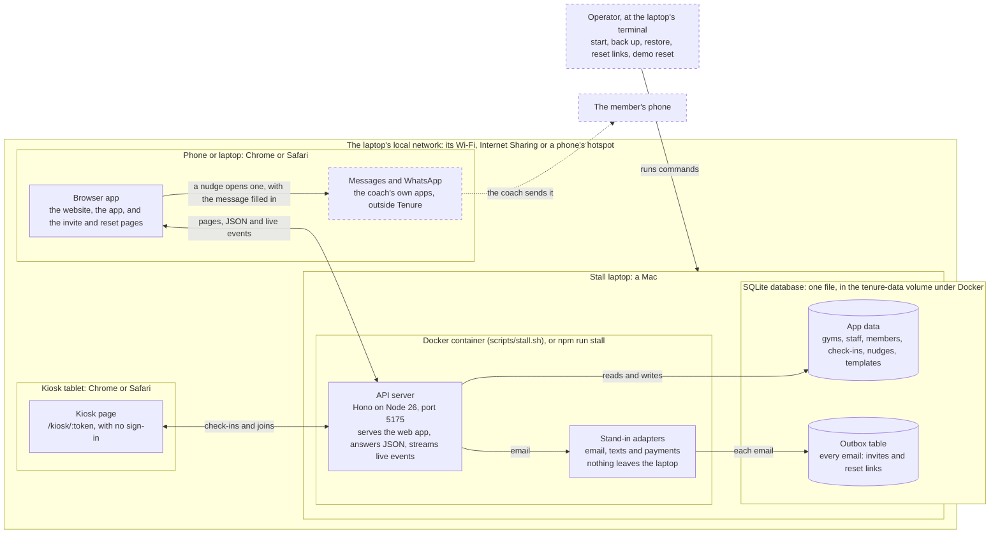

## 1. Introduction

### 1.1 Purpose

This document says what the first version of Tenure must do (§3) and how well (§4). It is the working document for
the people and agents who build, test and review that version, and for Uzair, who approves its scope.

Tenure helps independent gyms keep new members past their first 90 days. It counts each new member's visits week by
week, shows who is slipping, and lets a coach nudge them with a message sent from the coach's own phone.

### 1.2 Scope

The first version is the whole MVP, built simply: every core screen, the account basics, and a simple public website
with sign-up. Its core flows are tested end to end, through the server and in the browser, and small rough edges are
allowed. It runs on one machine, locally or in Docker. In stall mode it serves phones and the kiosk on that machine's
local network (FR-OPS-01).

**In the first version**

| Area | What's in | Where |
| --- | --- | --- |
| Accounts | Sign-up with the gym's country, log-in, 30-day sessions, password reset, and staff invites by email | §3.1, FR-STAFF-03 |
| The gym and its staff | Settings, owners and coaches, deactivating and reactivating staff | §3.2, §3.3 |
| Members | The Members list and the member page: add, edit, archive, restore and delete | §3.4, §3.5 |
| The first 90 days | Today and the board | §3.6, §3.7 |
| Nudges | The composer and its Contact menu, the nudges log, and templates | §3.8, §3.9 |
| The kiosk | Check-in by phone or name, joining, and the welcome | §3.10 |
| The import | Members or check-ins from a CSV file | §3.11 |
| Reports and Billing | Cohorts, visits by week, nudge results, and the pilot day | §3.12, §3.13 |
| The shell | Me, the navigation and the two themes | §3.14, §3.15 |
| The website | Home, Pricing, sign-up, and "Try the demo" at the stall | §3.16 |
| Across the product | Five markets, live updates, privacy and deletion | §3.17 to §3.19 |
| Running it | Stall mode, Docker, backup and restore, the demo reset, migrations, and the development outbox | §3.20, §3.21 |
| Quality | Speed, accessibility, security, privacy, reliability, browsers, maintenance, markets and copy | §4 |

**Not in the first version**

| What | Where it stands |
| --- | --- |
| Real email, texts and payments | Stand-ins only, and email lands in the outbox (FR-DEV-02). Real providers come with the hardening, once Uzair has made the accounts (ARCHITECTURE §13) |
| Online hosting | Local and Docker only (FR-OPS-01). Hosting also comes with the hardening |
| Email verification | Later (FR-AUTH-10). Password reset is in (FR-AUTH-07) |
| Translations | English only (FR-GLOBAL-06). Translations are decided per market (ARCHITECTURE §2) |
| Native apps | Tenure runs in Chrome and Safari (NFR-COMP-01) |
| Links to other gym software | Members and check-ins come in through the CSV import (FR-IMPORT-01) and the kiosk |
| The add-to-home-screen kiosk | Later (FR-KIOSK-09). The kiosk runs in the browser |
| A price | The pilot is free, and no price is shown until Uzair sets one (FR-BILL-01, FR-WEB-02) |
| Analytics and tracking | None (FR-PRIV-01) |

The rare edge cases and the rest of the old app's tests wait for the polish that follows (ARCHITECTURE §13).

### 1.3 Definitions

| Term | Meaning |
| --- | --- |
| Gym | One customer of Tenure, with its own staff, members, country and time zone. Every read and write is held to the signed-in user's gym (FR-PRIV-02). |
| Staff | The people who sign in to a gym: its owners and coaches (FR-STAFF-01). |
| Owner | A staff member with the owner role. Whoever signs the gym up is its first owner (FR-AUTH-03). Owners see every member and have the owner-only pages (FR-STAFF-06). |
| Co-owner | Another owner, invited with the Owner choice in "Invite staff" (FR-STAFF-03, FR-STAFF-04). A co-owner has the same rights as the first owner. The last active owner can't be deactivated (FR-STAFF-05). |
| Coach | A staff member with the coach role. A coach sees and acts on only their own members (FR-STAFF-07). |
| Own members | The members whose coach is that staff member. An owner can coach members too. |
| Member | Someone who trains at the gym. Members don't sign in: they check in at the kiosk, and staff add or import them (FR-MEM-05, FR-IMPORT-01). A member has a first name, an optional last name (FR-GLOBAL-04) and a joined date, and may have a phone and a coach. |
| Kiosk | The check-in screen at `/kiosk/:token`, open on the front-desk tablet or screen. It needs no sign-in (FR-KIOSK-01). Members check in there by phone or name, and visitors join (FR-KIOSK-02, FR-KIOSK-04). |
| Kiosk token | The gym's secret in the kiosk link: anyone with the link can use the kiosk. A bad token shows a not-found screen (FR-KIOSK-01). Settings shows the link and its QR code (FR-GYM-03). |
| Check-in | One recorded arrival, made at the kiosk or brought in by the import. A second one by the same member within an hour isn't stored (FR-KIOSK-03, FR-IMPORT-07). |
| Visit | A day on which a member checked in, in the gym's time zone. Weeks, pace and statuses count visits, so several check-ins on one day count once. |
| The 90-day window | A member's first 90 days: day 0 is the joined date and day 89 the last, in the gym's time zone. The board and Members' "First 90 days" view list only members inside it (FR-BOARD-01, FR-MEM-01). Visits outside it don't count toward weeks, pace or status. |
| Week | Seven days counted from the joined date. Week 1 is days 0 to 6, and so on to week 13, days 84 to 89, which has only 6. A week is finished once all its days are before today; the current week is still in progress. |
| Status | One of four, worked out from a member's finished weeks. The rules are checked in the order below, and the first that matches wins (ARCHITECTURE §7). |
| Slipping | Checked first: 2 or more finished weeks, and the last two each under 2 visits. |
| New | Checked second: fewer than 2 finished weeks. |
| On the line | Checked third: the last finished week had 3 or more visits. |
| Below the line | Checked last: everything else. |
| The line | 3 visits a week. Reports draws it on its chart (FR-REPORT-02). |
| Pace | A member's mean visits a week over their last 3 finished weeks, or over all of them if fewer have finished, to one decimal. There is none before the first finished week. |
| Nudge | A staff member's message to a member, to bring them back. It is written in the composer, from a template or from scratch (FR-NUDGE-01), and recorded when the sender picks how to send it (FR-NUDGE-02). Tenure never sends it (FR-NUDGE-05). |
| Channel | How a nudge went out, stored with it: `text`, `whatsapp`, `copy` or `in-person`, shown as "Text", "WhatsApp", "Copied" or "In person" (FR-NUDGE-06). A nudge from before the first version shows none. |
| Came back | A nudge came back when the member checks in strictly after it and within 7 days (FR-NUDGE-07). |
| Template | A named nudge message that fills `{first}`, `{coach}`, `{gym}` and `{days}` (FR-TPL-02). Owners edit templates and coaches read them (FR-TPL-01). A new gym gets the three default ones (FR-TPL-03). |
| Pilot | A gym's free first 90 days on Tenure, counted from the day it signed up. Billing shows "Pilot day {n} of 90" (FR-BILL-01). There is no price. |
| Archive | Hiding a member and keeping their history. An archived member is left out of every list except Members' "Archived" view, and out of the kiosk's name search (FR-MEM-01, FR-KIOSK-02). Their history still counts in Reports (FR-REPORT-01). At the kiosk, a typed phone or a join that matches them shows "Please see the front desk to check in." (FR-KIOSK-06). "Restore member" or a matching import row brings them back (FR-MEMBER-06, FR-IMPORT-09). Only an archived member can be deleted for good (FR-MEMBER-07). |
| Stall mode | Tenure as it runs at the expo stall: `npm run stall`, or Docker through `scripts/stall.sh`, serves the built app from the API on the laptop's network (FR-OPS-01). The kiosk, phone and invite links use the laptop's LAN address (FR-GYM-03, FR-STAFF-03), "Try the demo" works (FR-WEB-04), and a button re-seeds the demo gym (FR-OPS-03). |
| The demo gym | Northside Strength, the seeded sample gym: 3 staff and 85 members, 60 of them in their first 90 days. Its dates are relative to the day it was seeded, and its country follows the laptop's time zone (FR-GLOBAL-05). Its kiosk shows the "Sample data" tag (FR-KIOSK-07). `npm run demo:reset` re-seeds it (FR-OPS-03). |
| Stand-in | An adapter that keeps an email, a text or a payment on the machine instead of calling a provider. Every environment uses the stand-ins in the first version (FR-DEV-02). |
| Outbox | The table where the email stand-in puts every email, such as invites and reset links. `/dev/outbox` shows it, in development only (FR-DEV-01). |
| E.164 | The international phone format: "+", the country code, then the number, with no spaces, such as +13125550142. Every phone is stored this way (FR-GLOBAL-02). |
| MoSCoW | The priority scale in §3: Must, Should, Could and Won't, as defined at the top of this document. |

### 1.4 References

| Reference | What it holds |
| --- | --- |
| `docs/ARCHITECTURE.md` | The contract: the decisions, layout, dependency rules, design tokens, commands and milestones |
| `docs/milestone-2/FIRST-VERSION.md` | The approved plan for the first version and for this spec (7 Nov 2026) |
| `docs/milestone-2/answers.md` | Uzair's product answers, which win over every other source |
| `docs/milestone-2/kiosk-blend.md` | The kiosk's N1 "Soft corners" blend, with its CSS and contrast checks |
| `packages/copy/COPY.md` | Every word the product shows |
| `docs/DEMO.md` | The stall runbook, written in phase 4 (FR-OPS-05) |
| `legacy/app/SPEC.md` | The old app's product spec and API, the reference for the port |
| `legacy/app/DEMO.md` | The old app's stall runbook and demo script |
| `marketing/brand/DESIGN.md` | The brand's voice, for the home page copy round |
| WCAG 2.1 | W3C, Web Content Accessibility Guidelines 2.1, held to level AA (NFR-USE-01) |
| ISO/IEC/IEEE 29148:2018 | Systems and software engineering: life cycle processes, requirements engineering. The shape of this spec |
| ITU-T E.164 | The international public telecommunication numbering plan: the phone format |

## 2. Overall description

### 2.1 Product perspective

Tenure is a self-contained web app on one machine. In stall mode and in Docker, one server, the API on Node 26, serves
the website, the app and the kiosk, answers their JSON requests, and streams live events to open screens (FR-LIVE-01).
All data lives in one SQLite file on the same machine (FR-PRIV-01). At the stall that machine is a Mac, running
Tenure in Docker or with `npm run stall`, and phones and the kiosk tablet reach it over the laptop's local network
(FR-OPS-01).

The browser app is one React app: the website, the app under `/app`, the kiosk, and the invite and reset pages. The
website loads without the app's code (FR-WEB-05).

Tenure contacts no outside service (NFR-PRIV-01):
- A nudge opens the coach's own Messages or WhatsApp with the message filled in, and the coach sends it (FR-NUDGE-02,
  FR-NUDGE-05).
- Email, texts and payments go through stand-in adapters (FR-DEV-02). Email goes to the outbox table. Nothing in the
  first version sends a text or takes a payment (FR-NUDGE-05, FR-BILL-01).

The first version replaces the old expo app, kept in `legacy/app` as the reference for the port. Its flows and rules
carry over into the new layout (ARCHITECTURE §3), changed where answers.md and the first-version plan say so.

<!-- PDF: the same diagram is docs/spec/context.svg -->

*Figure 1.* Tenure at the stall. Dashed boxes are outside Tenure. In development (`npm run dev`) the parts run on one
Mac without Docker: the web app has its own server on port 5174, and the outbox page is on (FR-DEV-01).

**Interfaces**

| Interface | Between | What passes |
| --- | --- | --- |
| HTTP | Browsers on the network, and the API | Pages and JSON. A write must be JSON from a matching Origin (NFR-SEC-02), and bodies are capped (NFR-SEC-05) |
| Live events | The API and each signed-in tab | One server-sent event stream per tab, scoped to the user (FR-LIVE-02) |
| Message links | The browser app and the coach's own apps | The member's number and the filled-in message, through text and WhatsApp links (FR-NUDGE-02, FR-NUDGE-03) |
| The clipboard | The browser app and the device | A copied message or link (FR-NUDGE-02, FR-GYM-03, FR-STAFF-03) |
| QR codes | Settings and a phone's camera | The kiosk and phone links (FR-GYM-03) |
| CSV files | The owner's files and the import | Members or check-ins, up to 2 MB (FR-IMPORT-01) |
| Adapter ports | The API and its providers | Emails to the outbox now; Resend, Twilio and Stripe later (FR-DEV-02) |
| The terminal | The operator and the machine | The stall, backup, restore, reset-link and demo reset commands (FR-OPS-01 to FR-OPS-03, FR-AUTH-08) |

### 2.2 Product functions

| Function | What it does | Requirements |
| --- | --- | --- |
| Start a gym | An owner signs up with the gym's country and starts the free pilot, on an empty Today that links to the import and the kiosk | FR-AUTH-01 to FR-AUTH-03, FR-TODAY-03 |
| Check in | Members check in at the kiosk by phone or name; a visitor joins and is checked in at once | FR-KIOSK-02 to FR-KIOSK-06 |
| See who is slipping | Today and the board show each member's weeks, pace and status, and the member page their 90 days, all updated live | FR-TODAY-01, FR-BOARD-01, FR-MEMBER-01, FR-LIVE-01 |
| Nudge | A coach picks a template or writes a message, then contacts the member by text, WhatsApp or a copied message. Tenure records the nudge, and whether the member came back | FR-NUDGE-01 to FR-NUDGE-07, FR-TPL-01 |
| Look after members | Add, edit, archive, restore and delete members, and import members or check-ins from a CSV file | FR-MEM-05, FR-MEMBER-02, FR-MEMBER-05 to FR-MEMBER-07, FR-IMPORT-01 |
| Run the team | Invite coaches and co-owners, deactivate and reactivate them, and keep each coach to their own members | FR-STAFF-02 to FR-STAFF-07 |
| Read the results | Cohorts by join month, visits by week and nudge results; the pilot day on Billing | FR-REPORT-01, FR-BILL-01 |
| Set up | The gym's name, country and time zone, and the kiosk and phone links with their QR codes | FR-GYM-01 to FR-GYM-03 |
| Keep accounts safe | Sessions, password reset and rate limits | FR-AUTH-04 to FR-AUTH-07, NFR-SEC-01, NFR-SEC-03 |
| Work in five markets | Phones, dates and times, and single names, by the gym's country | FR-GLOBAL-01 to FR-GLOBAL-04 |
| Introduce Tenure | The website's Home, Pricing and sign-up, and "Try the demo" at the stall | FR-WEB-01 to FR-WEB-04 |
| Run the stall | Stall mode and Docker, backup and restore, the demo reset, and reset links | FR-OPS-01 to FR-OPS-03, FR-AUTH-08 |

### 2.3 User classes

| User class | Who | What they use | What they may do |
| --- | --- | --- | --- |
| Owner | Runs the gym, and signed it up | The whole app, on a laptop or a phone | Everything in their gym, including the owner-only pages (FR-STAFF-06). Sees every member and every live event (FR-LIVE-02) |
| Co-owner | A second owner, invited by an owner | The same as the owner | The same as the owner (FR-STAFF-01, FR-STAFF-04) |
| Coach | Coaches members, and joined through a coach invite | Today, the board, Members, Nudges and Templates, often on their own phone | Works with only their own members (FR-STAFF-07): adds, archives, restores and nudges them (FR-MEM-05, FR-MEMBER-05, FR-MEMBER-06). Reads templates (FR-TPL-01). Gets 403 from owner routes (FR-STAFF-06) |
| Member at the kiosk | A member, or a newcomer joining | The kiosk only, with no account | Checks in by phone or name, or joins with a first name (FR-KIOSK-02, FR-KIOSK-04). Sees their welcome (FR-KIOSK-05), and the "First L." names the name search shows |
| Stall visitor | Someone at the expo stall | The kiosk, and "Try the demo" in stall mode | Joins at the kiosk, and uses the demo gym as its owner, with everything usable (FR-WEB-04). The demo is re-seeded between visitors (FR-OPS-03) |
| Operator | Whoever runs the machine, such as the stall team | The laptop's terminal and the runbook (FR-OPS-05) | Starts Tenure (FR-OPS-01), backs up and restores (FR-OPS-02), re-seeds the demo (FR-OPS-03) and prints reset links (FR-AUTH-08). Only someone at the laptop can get a reset link |

### 2.4 Operating environment

| Part | Environment |
| --- | --- |
| Browsers | Chrome on laptops and Android; Safari on Mac, iPhone and iPad (NFR-COMP-01). The blended background needs a 2024 or later browser, and older ones show the flat page ground (ARCHITECTURE §2) |
| Screens | From phone width up: below 1024 px a header and a bottom tab bar, and from 1024 px a sidebar (FR-SHELL-01, FR-SHELL-02) |
| The server | A Mac with Docker Desktop, running `scripts/stall.sh`, or Node 26 directly, with `npm run stall` (FR-OPS-01). One process serves everything on port 5175, which must be free. The data is one SQLite file, kept in the `tenure-data` volume under Docker |
| The network | The laptop's local network: its Wi-Fi, Internet Sharing, or a phone's hotspot. Phones and the kiosk join it and open the laptop's LAN address over plain HTTP, so the session cookie isn't marked Secure (NFR-SEC-01). Tenure needs no internet while it runs: it calls no outside service (NFR-PRIV-01), and its fonts are self-hosted. The first Docker build does, to fetch packages (ARCHITECTURE §12) |
| The kiosk | A tablet at the front desk, such as an iPad in Safari, or a second browser window. It works by touch or with a hardware keyboard (FR-KIOSK-08) |
| Rate limits under Docker | Every device counts as one for the rate limits (NFR-SEC-03), because Docker Desktop's port publishing hides each client's address (ARCHITECTURE §12) |
| Development | `npm run dev` on a Mac with Node 26: the API on port 5175 and the web app on 5174, with hot reload and the outbox page (FR-DEV-01) |

### 2.5 Constraints

| Constraint | What it means | Source |
| --- | --- | --- |
| The contract | The layout, dependency rules, design tokens and commands in ARCHITECTURE.md hold. To break a rule, that file changes first, in its own commit. The lint checks the dependency rules (NFR-MAINT-01) | ARCHITECTURE §3, §4, §9 |
| The stack | A TypeScript monorepo: React 19 and Vite, Hono on Node 26, SQLite through Drizzle, npm workspaces and Turborepo. Node 26 runs the TypeScript directly, and nothing is installed globally | ARCHITECTURE §2, CLAUDE.md |
| One test-only package | `@playwright/test` is the only package added for the first version (NFR-MAINT-04) | FIRST-VERSION.md |
| The gates | Typecheck, lint, test, build and e2e pass before each phase is done (NFR-MAINT-02). Every Must has a test that names its ID, or a stated check (NFR-MAINT-03) | ARCHITECTURE §11 |
| The copy rules | Every word comes from COPY.md, in sentence case. A line describes the action rather than quoting a button, and button labels take no closing punctuation (NFR-COPY-01). COPY.md's own rules hold too: numerals always, and no exclamation marks | ARCHITECTURE §10, COPY.md |
| Five markets | Only the US, Canada, the UK, Pakistan and the UAE can be chosen (FR-GLOBAL-01), and the interface is in English only (FR-GLOBAL-06) | ARCHITECTURE §2, answers.md |
| Nothing leaves the machine | No outside service is contacted (NFR-PRIV-01), and Tenure sends no message itself (FR-NUDGE-05) | ARCHITECTURE §2 |
| Printed links | `/kiosk/:token` and `/invite/:token` keep their shape, so printed links still work | ARCHITECTURE §8 |
| Hands off | `legacy/app` and `marketing/` don't change during the port | CLAUDE.md |

### 2.6 Assumptions and dependencies

**Assumptions**

- The laptop's clock and time zone are right on the day. The demo gym's dates are relative to the day it was seeded,
  in the laptop's zone, so it is re-seeded on the morning of the stall (FR-GLOBAL-05, ARCHITECTURE §12).
- The operator re-seeds the demo between visitors (FR-OPS-03). Until then, a visitor who taps "Try the demo" sees what
  earlier visitors entered at the kiosk, names and phones included, as any owner would (FR-WEB-04).
- The laptop's firewall lets phones and the kiosk connect on port 5175.
- Coaches send nudges from their own phone or computer, with Messages or WhatsApp set up on it. A text needs mobile
  service, and WhatsApp needs the internet (FR-NUDGE-05).
- Each gym is in one of the five markets (FR-GLOBAL-01). Its members' phones are local numbers, or typed with "+"
  (FR-GLOBAL-02). The demo keeps its +1 sample numbers in every country (FR-GLOBAL-05).
- A gym's existing members come in as a CSV file of up to 2 MB, or as pasted text (FR-IMPORT-01).
- No email leaves the machine. Staff take invite links by copying them (FR-STAFF-03), and reset links from the
  operator (FR-AUTH-08).
- Backups are the operator's to keep. A deleted member stays in older backups (NFR-PRIV-02).

**Dependencies**

| Dependency | What relies on it |
| --- | --- |
| Node 26 and npm, with internet for the first install | Every command (ARCHITECTURE §12) |
| Docker Desktop on the Mac | `scripts/stall.sh`, and the `tenure-data` volume that backups copy (FR-OPS-01, FR-OPS-02) |
| `libphonenumber-js` and its metadata | Which numbers are real in each country, and their E.164 form (FR-GLOBAL-02) |
| The Intl data in Node and the browsers | Dates and times in the gym's locale, with en-001 where a country has no English formats (FR-GLOBAL-03) |
| The device's own apps | Text and WhatsApp links open Messages and WhatsApp with the message filled in. iOS opens WhatsApp only on the tap itself, so each menu item is a link (FR-NUDGE-02, FR-NUDGE-03) |
| Playwright's browsers | The e2e gate: Chrome through the installed browser, and WebKit downloaded once. If WebKit has no build for this macOS, iPhone Safari on the Simulator is checked by hand at each pause (NFR-COMP-01) |
| Uzair's picks | The design polish picks before the screens are built, and the home page words before the website (FR-WEB-01) |
| The core-flow edge-case answers | They fold into the backend jobs before those merge |
